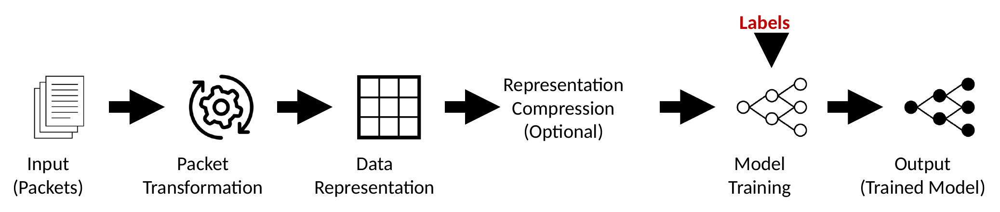
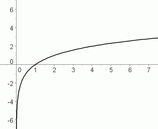
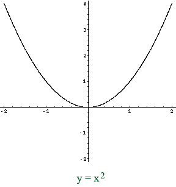
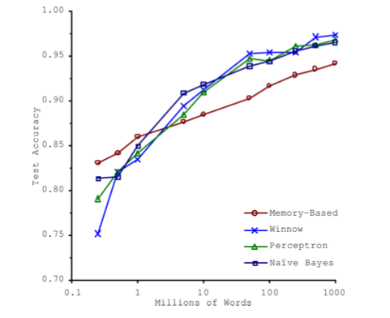
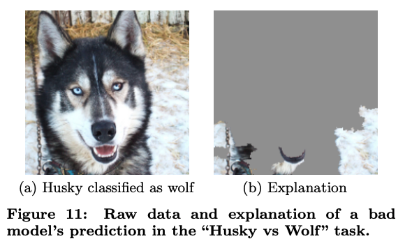

# The ML Pipeline {.center}

> Every step has a cost — and every step is a place where things go wrong.

::: {.notes}
Open with the pipeline framing from the book (Chapter 4: Machine Learning Pipeline). The goal
today is to understand what happens *before* the model sees a single byte. Garbage in,
garbage out — but what kinds of garbage, and how do we catch it?
:::

## Where We Are in the Pipeline {.smaller}

::: {.columns}
::: {.column width="60%"}
- **Data engineering** — today's focus
  - Understanding and exploring data
  - Cleaning and handling outliers
  - Feature generation and representation
  - Labeling examples
  - Splitting into train / validation / test
- Model training
- Model evaluation
:::
::: {.column width="40%"}
Each stage introduces its own failure modes. Data engineering errors are the hardest
to catch because they are silent — the model still trains and produces numbers.
:::
:::

::: {.notes}
See the "Data Engineering" section of the pipeline chapter. Emphasize that the pipeline
is sequential and that errors early propagate to every downstream stage.
:::

## The Pipeline in One Picture {.smaller}

<!-- recovered from docs/slides/07-Preparation.pptx slide 2 -->
{width="100%" fig-alt="Pipeline from input packets through packet transformation, data representation, optional representation compression, and model training (with labels entering at training) to the output trained model"}

- **Input is raw packets**; everything to the right of the first arrow is a choice you make, and every choice has a cost
- **Packet transformation and data representation** are where today's lecture lives: this is where features are born
- **Representation compression** is optional; it trades fidelity for scale, which is why it sits in the middle
- **Labels enter only at model training**; leakage is any path by which they, or the test set, sneak in earlier

::: {.notes}
Recovered from the original PowerPoint (slide 2, "Machine Learning Framework"); the
icons and arrows were drawn in PowerPoint, so the earlier text-and-media extraction
dropped them. The figure is static; walk it left to right.

Walk the picture: packets in; a transformation step (parsing, flow assembly,
filtering); a representation step (the grid: rows are examples, columns are features);
an optional compression step (sampling, binning, dimensionality reduction); training,
with labels coming in from above; a trained model out. Each arrow is a cost (compute,
storage, latency, engineering time) and the goals on the original slide were to explore
the general capabilities of traffic analysis and to make the cost-accuracy tradeoff
explicit at each step.

Point at the "Labels" arrow now and say that it is the only place labels are allowed
to touch the pipeline; the data-leakage section later is about the ways they leak in
further left. Also note that representation shapes model choice (the slide after
next).
:::

## Why Data Representation Matters {.smaller}

- Network data arrives as raw packets; models need **structured features**
- Many challenges particular to network traffic:
  - **Scale** — traffic is generated continuously
  - **Sequential dependencies** — handshakes, parameter negotiation
  - **Bursty timeseries** — inter-arrival times are highly non-uniform
  - **Cross-flow dependencies** — a single application uses many flows

| Representation | What It Captures | Cost |
|---|---|---|
| **Packet** | Full fidelity | Very high |
| **Event** | Anomalies, spikes | Medium |
| **Time bin** | Rate statistics | Depends on bin size |
| **Volume bin** | Standardizes events | Normalizes burstiness |

::: {.notes}
See "Modeling: Data Representation" in the source slides. Volume-based binning is
attractive for network ML because it removes the sensitivity to bursty inter-arrival
times — each bin always contains the same amount of traffic. The cost is that absolute
timing information is lost.

Cold call: which representation would you pick for DDoS detection vs. application
identification? Why might they differ?
:::

## Looking Ahead: Representation Shapes Model Choice {.smaller}

The representation you choose constrains the models you can use later:

::: {.columns}
::: {.column width="50%"}
**Non-temporal models (simple detectors)**

- Random forest, SVM, convolutional neural networks
- Work well on volume-based and binned representations
- *Limitation:* do not capture temporal features
:::
::: {.column width="50%"}
**Temporal models (more complex detectors)**

- Long Short-Term Memory (LSTM), Gated Recurrent Units (GRU)
- Capture temporal information from sequential features
- *Cost:* more data, more compute, harder to interpret
:::
:::

Consider problems with different levels of complexity — match the representation and
model to the problem, not the other way around.

::: {.notes}
See "(Looking Ahead) Modeling: Model Selection" (slide 5 source). This is a preview —
model families get full treatment in later lectures. The point today: representation and
model choice are coupled decisions. A volume-binned representation throws away exact
timing, so pairing it with an LSTM wastes the LSTM's strength; conversely, a random
forest on raw packet sequences cannot exploit the ordering.
:::

# Feature Engineering {.center}

> Features are the **domain knowledge** you encode for your model.

::: {.notes}
Transition: before we discuss how things go wrong (data pitfalls), we need to understand
what features are and how they are built. Good features let you use simpler, faster models.
:::

## What Are Features?

- Features are **hints** — rules of thumb you give the model
- They encode **domain knowledge** that a raw model cannot easily discover
- Better features → simpler models that are faster, easier to interpret, and easier to
  maintain

> Reducing complexity in features may allow us to use less complex models that are faster
> to run, easier to understand, and easier to maintain.

::: {.notes}
This is directly from slide 6 / the pipeline chapter. Stress the maintenance argument:
a feature-rich, simple model is often preferable to a complex neural net in production
networking systems where explainability matters.
:::

## A Taxonomy of Feature Operations {.smaller}

::: {.columns}
::: {.column width="50%"}
**Encoding**

- **One-hot encoding** — a category becomes one binary column per value
  (worked example next slide)
- **Ordinal encoding** — ordered categories → integers
- **Discretization** — equal-width, equal-size, entropy-based, or
  domain-specific bins
- **Missing-value indicators** — a binary "was this missing?" feature alongside
  imputation

**Normalization**

- Scale features to similar range, e.g., \[0, 1\] or \[−1, 1\]
- **Standardize**: zero mean, unit variance
  ($x_\text{new} = (x - \mu) / \sigma$)
- Caution: outliers distort mean and variance
:::
::: {.column width="50%"}
**Transformations**

- **Log** — compresses heavy-tailed distributions (byte counts, flow durations)
- Square root, squared — different marginal-utility curves

**Aggregation and Interaction**

- Date / time deltas (days since last event)
- Aggregates over time windows or spatial locality; **relative** aggregates
  (compared to the average); **seasonality**
- **Interaction features** — products of two features capture non-linear
  relationships in linear models; random forests are one way of *discovering*
  useful interactions
:::
:::

::: {.notes}
This is the map for the next four slides; do not explain each item here. Say
the four families out loud (encode, normalize, transform, discretize) and that
each one exists because a model consumes numbers, and the raw field is either
not a number (encoding), the wrong scale (normalization), the wrong shape
(transformation), or more precise than the information it carries
(discretization). Aggregation and interaction are feature *generation*: new
columns from old ones.

See "Generating Features" and "Normalization" in the source slides.

Critical networking note: log transformation of packet byte counts and inter-arrival
times is almost always a good idea because these distributions are extremely heavy-tailed.
A raw 1 MB flow and a 1 GB flow look like a rounding error without log-scale.
:::

## One-Hot Encoding: Protocol as a Feature {.smaller}

A model multiplies features by weights. A category like `proto = UDP` is not a number,
so it gets **one binary column per value**:

::: {.columns}
::: {.column width="45%"}
| flow | proto | | `is_tcp` | `is_udp` | `is_icmp` |
|---|---|---|---|---|---|
| 1 | TCP | → | 1 | 0 | 0 |
| 2 | UDP | → | 0 | 1 | 0 |
| 3 | ICMP | → | 0 | 0 | 1 |
| 4 | TCP | → | 1 | 0 | 0 |
:::
::: {.column width="55%"}
- **Why not `TCP=0, UDP=1, ICMP=2`?** That tells a linear model UDP sits *between*
  TCP and ICMP and that ICMP is "twice" UDP. No such order exists; the weights it
  learns are meaningless.
- **Cost: one column per value.** Destination port has 65,535 values. Group them
  (well-known < 1024, registered, ephemeral) or keep the top-*k* ports plus an
  `other` column.
- **Presence vs. absence** is the same trick for set-valued fields: one column per
  TLS extension offered, per DNS record type seen.
- Trees split on raw categories fine; linear models, SVMs, and neural networks need
  the encoding.
:::
:::

::: {.notes}
Worked example for the one-hot entry on the taxonomy slide (source slide 8,
"Categorical to Binary": one-vs-all dummy variables, groups, presence vs. absence).

Walk the table left to right: four flows, one categorical column, three binary
columns out. Then ask why not just number the protocols. Let them find the answer:
a linear model would learn a single weight for "proto" and apply it to 0, 1, 2 as if
ICMP were two UDPs. The order is an artifact of how you typed the list.

The port example is the one that bites in practice: netml does not one-hot ports,
and students who add `dst_port` as a raw integer are feeding the model an ordinal
feature that is really categorical. Grouping (privileged, registered, ephemeral) is
also the discretization slide's example, so say "we will see this again in two
slides."

Dummy-variable trap, if someone asks: with an intercept, one of the three columns
is redundant (it is 1 minus the other two); drop one for linear regression. Trees
and regularized models do not care.
:::

## Normalization: Putting Features on the Same Scale {.smaller}

Flow features live on wildly different scales: packets per flow run from 1 to
106, mean inter-arrival from 10−6 to 10 s, TTL from 1 to 255.
Any model that computes **distances or gradients** (k-NN, SVM, logistic regression,
neural networks) is dominated by whichever feature has the biggest numbers, which is an
artifact of units, not of information.

::: {.columns}
::: {.column width="50%"}
**Min–max scaling** → \[0, 1\]

$$x' = \frac{x - x_{\min}}{x_{\max} - x_{\min}}$$

One extreme value squashes everything else toward 0.
:::
::: {.column width="50%"}
**Standardization (z-score)** → mean 0, variance 1

$$x' = \frac{x - \mu}{\sigma}$$

Less fragile, but outliers still stretch $\sigma$; log-transform first (next slide).
:::
:::

- **Fit $\mu, \sigma$ (or min, max) on the training set only**, then apply the same
  numbers to validation and test. Computing them on everything leaks test-set
  statistics into training; this is our first sighting of *leakage*.
- **Trees and random forests do not care.** A split at 1,000 bytes is the same split at
  any scale. (Friday's question: "should features be on the same scale?" Linear and
  distance-based models, yes; trees, no.)

::: {.notes}
This answers Friday's question directly; say so. The setup is the first paragraph:
give the three features and ask which one a distance-based model would effectively
be using. (Packets per flow, because its range is six orders of magnitude wider.)

Two formulas, both one line. Min-max is what people reach for first; one giant flow
in the dataset sets $x_{\max}$ and every normal flow lands at 0.001. Z-score is the
default; its weakness is the same heavy tail, which is why the next slide exists.

The "fit on train only" bullet is the early preview of data leakage. The formula is
trivial; the lesson is *when* you compute $\mu$ and $\sigma$. This is one of the most
common classroom mistakes and it is in the breakout at the end. See "Dividing Data"
in the pipeline chapter for the golden rule.

Trees: a decision tree asks "is x > t?"; scaling x and t together changes nothing.
This is why random forests are forgiving of sloppy preprocessing, and why the
hands-on (logistic regression) is not.
:::

## Transformations: Reshaping a Skewed Feature {.smaller}

Normalization changes the **scale** of a feature, not its **shape**. Most network
quantities are heavy-tailed: of 10,000 flows, most carry a few KB and a handful carry
GB. After z-scoring, the handful sit at +40σ and everything else is crushed near zero,
so the model learns about the handful.

::: {.columns}
::: {.column width="34%"}
| flow bytes | log10 | √ |
|---|---|---|
| 1 KB | 3 | 32 |
| 1 MB | 6 | 1,000 |
| 1 GB | 9 | 31,623 |

A **log** turns every ×1000 into +3: the three flows become equally spaced, and
1 MB vs. 2 MB is as visible as 1 GB vs. 2 GB.
:::
::: {.column width="22%"}
{width="100%"}
:::
::: {.column width="22%"}
{width="100%"}
:::
::: {.column width="22%"}
{width="85%"}
:::
:::

**Rule of thumb:** long right tail in the histogram → take the log (log(1 + *x*) if
zeros occur), *then* normalize.

::: {.notes}
Setup is the first paragraph: z-scoring does not fix a heavy tail, it just relabels
it. Draw the histogram of flow sizes in the air (spike at the left, a tail off the
right edge of the room). The three-row table is the whole lesson: in raw bytes the
rows are 1 : 1,000 : 1,000,000; in log space they are 3 : 6 : 9.

The curves (source slide 11, converted from TIFF) are the shapes of the three
functions, nothing more. Log compresses, square root compresses less, square
expands. "Marginal utility" is the economist's phrase for the slope: with a log, the
model treats the next KB as mattering less the bigger the flow already is, which is
how a human reads traffic too.

Square is rare in networking; mention it only as the mirror image. If someone asks
about negative values: log needs x > 0, so log(1 + x) for counts and a sign-aware
transform for things like clock offsets.

Order of operations: transform first, normalize second. Normalizing then logging
fails on the negative values z-scoring produces.
:::

## Discretization: Turning a Number into Bins {.smaller}

Sometimes the information in a number is **which side of a threshold** it falls on, not
its value. Three reasons to bin a continuous feature:

- **The relationship is a step, not a line.** Port < 1024 vs. ≥ 1024; packet < 100
  bytes (ACKs, control) vs. ≈ 1500 (bulk data). A linear model cannot learn a step from
  the raw number; a binned feature hands the step to it.
- **Robustness.** Bins blunt outliers and measurement noise; a 1,504-byte and a
  1,514-byte packet are the same thing.
- **Some models want categories.** Naive Bayes, association rules, anything that
  counts co-occurrences. (Decision trees find their own bins; this slide is for the
  models that don't.)

**How to choose the edges:**

| Method | Edges come from | Watch out for |
|---|---|---|
| Equal-width | the range, cut evenly | one outlier makes most bins empty |
| Equal-size (quantile) | the data, equal occupancy | edges land at arbitrary values |
| Entropy-based | the label: cut where class purity jumps | overfits with few examples |
| Domain-specific | what you know: 1024, 1500, 64 | needs someone who knows |

*Network example:* an entropy-based binner may discover the 1024 boundary; a
domain-informed binner guarantees it.

::: {.notes}
Motivation first, methods second. The question to ask the room: "why would you
throw away precision on purpose?" Three answers on the slide. The first is the
important one: a linear model with a raw port number learns one slope for ports
0–65535; a column `is_privileged_port` lets it learn the discontinuity in one weight.
This is Friday's small/medium/large packet example made explicit.

The original slide's domain examples were lead-poisoning thresholds and school
grade boundaries; the networking equivalents are the port boundary at 1024, the
Ethernet MTU at 1500, and the 64-byte minimum frame.

If short on time, read the first bullet and the "domain-specific" row and move on;
the four-method table is reference material.
:::

# Data Pitfalls {.center}

> A model trained on bad data will confidently produce wrong answers.

::: {.notes}
Transition to the pathology section. The book's "Cleaning the Data" and "Irrelevant
Features and Overfitting to Spurious Correlations" sections are the primary references.
These are not exotic edge cases — they are the dominant cause of ML failure in practice.
:::

## Five Failure Modes {.smaller}

| Failure Mode | What Goes Wrong | Network Example |
|---|---|---|
| **Insufficient data** | Model can't generalize | Too few attack samples |
| **Non-representative data** | Model fails on new populations | Lab traffic ≠ campus traffic |
| **Poor quality data** | Errors and outliers corrupt training | Clock skew in packet timestamps |
| **Irrelevant features** | Model learns spurious correlations | TTL as attack proxy |
| **Overfitting** | Model memorizes training set | 95% train accuracy, 60% deploy |

::: {.notes}
See "Challenges with Machine Learning" (slide 15 source). Use this table as a quick
map; the next several slides go deep on the most dangerous ones.
:::

## Insufficient Training Data

::: {.columns}
::: {.column width="55%"}
- ML models learn from patterns in data — more data → better generalization, especially
  for deep models
- Classic result: accuracy scales roughly log-linearly with corpus size across many
  algorithms (Banko & Brill, 2001)
- Network implication: **rare attack classes** are chronically under-represented; class
  imbalance leads to degenerate classifiers
:::
::: {.column width="45%"}

:::
:::

::: {.notes}
The image is from Banko & Brill's 2001 ACL paper "Scaling to Very Very Large Corpora."
The key takeaway for networking: you can't buy your way out of class imbalance by
collecting more of the majority class. You need representative examples of attacks.
:::

## Non-Representative Training Data {.smaller}

- Training data must represent the **deployment distribution**
- Gaps appear along many dimensions: time period, network topology, user population,
  application mix
- Non-representativeness is a well-studied problem in statistics; in ML it has acute
  consequences for **algorithmic fairness**

::: {.columns}
::: {.column width="55%"}
A vivid real-world example: Google Translate's Finnish → English translation mapped the
gender-neutral pronoun *hän* to gendered English pronouns based on stereotyped contexts
in training data.
:::
::: {.column width="45%"}
{width=85%}
:::
:::

::: {.notes}
The Finnish pronoun example (slide 17 source) is memorable and travels well. The
networking parallel: a model trained only on enterprise traffic will fail on ISP traffic;
a model trained on daytime workday flows will fail on overnight bulk-transfer traffic.
:::

## The Husky–Wolf Problem: Spurious Correlations {.smaller}

::: {.columns}
::: {.column width="55%"}
Ribeiro et al. (LIME, KDD 2016) trained a classifier to distinguish huskies from wolves.
It achieved high accuracy by learning to detect **snow in the background** — not the
animal — because training wolves appeared in snowy scenes and training huskies did not.

**Network equivalent:** a model trained to detect port scans learned to use the **TTL
field** as the discriminative feature. Attackers in the training corpus happened to be a
fixed hop-count from the monitor. In production, attacks arrive from all distances.
:::
::: {.column width="45%"}

:::
:::

::: {.notes}
See the "Irrelevant Features and Overfitting to Spurious Correlations" section of the
pipeline chapter. The TTL example is from the book text and is a networking-native
version of the husky-wolf story. Both illustrate that high train/validation accuracy does
not mean the model has learned the right concept.

Solution: feature importance analysis + domain knowledge + diverse training data +
out-of-distribution test sets.
:::

## Cleaning Network Data {.smaller}

Every operation so far assumes the numbers are right. Packet captures lie in specific,
well-catalogued ways: skewed clocks, dropped packets, truncated frames, duplicated
records. Vern Paxson's *Strategies for Sound Internet Measurement* (IMC 2004) is the
canonical catalogue, and it reads as an ML data-cleaning guide.

- Identify outliers with **box plots**, statistical tests, and domain knowledge
- *Not all outliers are errors:* small packets (TCP ACKs) are normal — removing them
  harms the model
- Remove outliers only when they represent **measurement errors or physically
  impossible values**:
  - Timestamps with clock skew
  - Packet lengths exceeding the MTU
- "Sound internet measurement" principles transfer directly to ML data engineering

::: {.notes}
See the "Cleaning the Data" section of the pipeline chapter, which cites Paxson's IMC
2004 paper extensively. Stress the domain-knowledge point: a generic outlier-removal rule
will remove valid TCP ACKs. You have to *know* the domain to know which outliers matter.
:::

# Data Leakage {.center}

> Leakage is when information about the **test set bleeds into training** — producing
> inflated accuracy that evaporates on deployment.

::: {.notes}
This is arguably the most important topic in the deck. The book calls it the "golden
rule": never train on the test set. But leakage is more subtle than just accidentally
passing test rows into training.
:::

## The Golden Rule of Supervised Learning

**Never train on the test set.**

Three common ways to break it:

1. **Normalization leakage** — computing mean / variance on the full dataset (including
   test) before splitting
2. **Temporal leakage** — shuffling chronological data, so future samples train on past
   labels (critical for network traffic)
3. **Feature leakage** — a feature encodes the label (e.g., using a flow's final byte
   count to predict whether it will be flagged)

::: {.columns}
::: {.column width="50%"}
Correct split order:
1. Split train / val / test first
2. Fit transforms on train
3. Apply to val and test
:::
::: {.column width="50%"}
Wrong order:
1. Normalize full dataset
2. Then split
→ Test accuracy is **not** a true estimate of generalization error
:::
:::

::: {.notes}
See "Training and Testing Sets" and "Dividing Data" sections of the pipeline chapter.
The normalization leakage is the most common classroom error; the temporal leakage is
the most common *production* error in networking.

For chronological data (flows, pcaps), the test set should be a *contiguous future
window*, not a random sample. Shuffling inter-mixes future with past.
:::

## Temporal Leakage in Network Data

Network traffic is **chronological**. Shuffling before splitting leaks future into the
past.

- Correct: train on traffic from **time window T₁**, test on **window T₂ > T₁**
- Wrong: randomly shuffle all flows, then 80/20 split — future flows train the model on
  attack traffic that hasn't happened yet in the test window
- Also: normalization on the full trace includes future statistics

This is why results on academic traffic datasets (CAIDA, PCAP repositories) often fail
to replicate on live campus deployments — the benchmark didn't respect temporal order.

::: {.notes}
This is a networking-specific elaboration of the golden rule. The book mentions that
chronological data requires a contiguous test subset. The networking consequence is
severe: a DDoS detector trained on shuffled CAIDA data may achieve 99% accuracy on the
held-out split but fail completely when deployed because the statistical fingerprint of
the test split was already visible during training.
:::

## How Common Is Leakage? {.smaller}

The last two slides sound like beginner mistakes. They are not. Kapoor and Narayanan
(Princeton) went looking for leakage in *published, peer-reviewed* ML-based science
across every field that uses it.

::: {.columns}
::: {.column width="45%"}
**What they found**

- **41 papers across 30 fields** with leakage errors, affecting **329+** papers that
  built on them
- Fields include clinical prediction, NLP, computer vision, and **network security**
- In nearly every case the corrected result was much worse than the published one
- Their conclusion: leakage is not a rare bug but a pervasive, systematic way ML results
  come out better than they are
:::
::: {.column width="55%"}
**Their taxonomy is this lecture**

| Kapoor & Narayanan type | Where we met it |
|---|---|
| No test set at all | Hands-On 7, deliberately |
| Preprocessing or feature selection on train + test | Normalization slide, golden rule |
| Duplicates across train and test | retransmissions, repeated scans |
| Illegitimate features that encode the label | TTL, final byte count |
| Temporal leakage | previous slide |
| Train and test not independent | same host or session on both sides |
:::
:::

::: {.aside}
Kapoor & Narayanan, *Leakage and the Reproducibility Crisis in ML-based Science*,
Patterns, Sept. 2023 (running table updated May 2024, reproducible.cs.princeton.edu);
popular version in *AI Snake Oil*, Princeton University Press, 2024.
:::

::: {.notes}
Setup is the first line: "you may think this is a beginner's mistake." The point of
the slide is that the two leakage slides before it describe errors that got through
peer review in 30 fields, so students should expect to make them and should build
the checks in.

Left column is the finding; right column is the reason it belongs here: their
taxonomy of leakage is a list of things already on this deck. Read the table as a
recap of the leakage section, pointing back at each slide. "No test set" is what the
hands-on does on purpose in twenty minutes, so that the 100% accuracy they get is the
lesson. "Not independent" is the subtle one: flows from the same host, or packets of
the same scan, split across train and test are near-duplicates, and a random split
puts them on both sides.

Numbers were web-verified when the slide was written: Patterns vol. 4, issue 9
(September 2023); running leakage table last updated May 2024; *AI Snake Oil*
published September 2024, named one of Nature's ten best books of 2024. The
taxonomy on the right is theirs (L1 no clean separation: no test set, preprocessing,
feature selection, duplicates; L2 illegitimate features; L3 test set not from the
distribution of interest: temporal, non-independence, sampling bias).
:::

## Training, Validation, and Test Sets {.smaller}

Divide labeled data into **three** non-overlapping sets:

| Set | Purpose | Touch rules |
|---|---|---|
| **Training** | Fit model parameters | Used every epoch |
| **Validation** | Tune hyperparameters; catch overfitting | Used during development |
| **Test** | Report final generalization error | Touched **once**, at the very end |

- Modifying the model after seeing test error → you have tuned to your test set
- Practical splits: 60/20/20 or similar; less training data hurts complex models

**Cross-validation** (k-fold): rotate the validation set across k partitions;
average performance → more robust estimate; important when data are scarce.

::: {.notes}
See "Dividing Data," "Validation Sets," and "Cross Validation" in the pipeline chapter.
Stress the discipline of touching the test set only once. In network security settings,
the test set is often a future capture window; violating temporal ordering is the most
frequent form of leakage in the field.
:::

## Overfitting and the Bias–Variance Tradeoff {.smaller}

::: {.columns}
::: {.column width="55%"}
- **Underfitting (high bias):** model too simple to capture structure; fails on
  training *and* test data
- **Overfitting (high variance):** model memorizes training noise; great on train,
  poor on test and production
- The **bias–variance tradeoff:** find the complexity sweet spot

Detection: plot training error vs. validation error as training proceeds (or as dataset
size grows). Divergence → overfitting.

Remedies:
- More (or more diverse) training data
- **Regularization** — penalize parameter magnitude
- **Early stopping** — halt when val error starts rising
- **Ensemble methods** — bagging, boosting
:::
::: {.column width="45%"}
| | Train error | Test error |
|---|---|---|
| Underfit | High | High |
| Good fit | Low | Low |
| Overfit | Very low | High |

A model with 99% training accuracy and 65% test accuracy is not a good model — it has
memorized the training set.
:::
:::

::: {.notes}
See "Overfitting and Bias-Variance Tradeoff" in the pipeline chapter. Network ML
caveat: class imbalance can make training accuracy look deceptively high (always
predict "benign" → 99% accuracy if 1% of traffic is malicious). This is why precision,
recall, and F1 matter more than accuracy for security tasks.
:::

## Labeling Data for Supervised Learning {.smaller}

- Every supervised task requires a **label** for each example
- Labels distinguish **regression** (continuous) from **classification** (discrete)
  - *Binary classification:* 0/1 (benign / attack)
  - *Multi-class:* discrete integer or string labels (app type)
  - *Multi-label:* multiple independent binary labels per example

**Encoding choices matter:**

- **Ordinal encoding** — meaningful order, e.g., QoE: poor → 0, acceptable → 1,
  excellent → 2
- **One-hot encoding** — no implied order; each class is a binary vector

*Network labeling example:* load a benign pcap + a log4j-scan pcap, assign labels 0/1,
concatenate into a single dataframe, separate features (X) and labels (y) before
training.

::: {.notes}
See "Labeling Data" and "Labeling for Prediction Problems" in the pipeline chapter.
The log4j labeling code example from the book is a concrete and current example —
log4Shell was discovered December 2021 and scan traffic remains in research corpora.
Multi-label is less common in basic networking tasks but comes up in traffic
fingerprinting where a flow may be labeled by both application and user class.
:::

# Putting It Together {.center}

> Good data engineering is invisible when it works and catastrophic when it doesn't.

## The Data Engineering Checklist {.smaller}

Before you train any model, verify:

1. **Understand the data** — `describe()`, `shape`, `head()`, distribution plots;
   does the data make domain sense? (MTU < 1514, port ≤ 65535)
2. **Clean** — identify and handle outliers with domain knowledge; remove only
   measurement errors, not natural variation
3. **Remove irrelevant / leaky features** — TTL, IP ID, any field that proxies for
   label membership; run feature importance analysis before deployment
4. **Label carefully** — correct encoding for classification vs. regression; respect
   temporal order in network captures
5. **Split with discipline** — train / val / test; for network data use a *temporal*
   split, not a random shuffle
6. **Fit transforms on train only** — normalization, scaling, imputation: fit on train,
   apply to val/test
7. **Test set is sacred** — touch it once, at the very end

::: {.notes}
This checklist synthesizes the whole pipeline chapter. Use it as a review anchor at the
end of lecture. Students should be able to identify which step was violated when they
hear about a published result that failed to reproduce.

See the "Summary" section of the pipeline chapter for the book's own synthesis.
:::

## Breakout: Audit This Pipeline

::: {.columns}
::: {.column width="55%"}
A team builds a network intrusion detector:

1. Collect **one week** of campus traffic; label each flow benign or attack
2. **Normalize** all features across the full week
3. **Randomly shuffle** and split 80/20 into train and test
4. Train a random forest. Test accuracy: **97%**

They are about to deploy it on the campus network.
:::
::: {.column width="45%"}
**Groups of three, 8 minutes**

1. Go step by step: list **everything** that could go wrong. Aim for more than
   four.
2. Pick the **two worst** and say what the symptom would be after deployment.
3. **Redesign** the pipeline, and name the number you would report instead of 97%.

Report-back: one group per step, then the redesigns.
:::
:::

::: {.notes}
Breakout, 8 minutes in groups of three, 4 minutes of report-back. Take one group per
step so the list on the board builds in pipeline order; keep the two leakage steps
for last so they land as the climax. Then ask two groups for their redesign.

CHEAT SHEET: what could go wrong, step by step

Step 1, one week of campus traffic, labelled.
• One week misses seasonality: no weekend-vs-weekday, no semester start, no finals.
• Where did the labels come from? If from an IDS or a blocklist, the model learns
  the IDS, not attacks. If hand-labelled, who, and how consistently?
• Class imbalance: attacks are well under 1% of flows. 97% may be below the base
  rate of "always say benign".
• One week of attacks is often one campaign from a few sources. The model can learn
  the source (IP, TTL, hop count, TLS fingerprint) instead of the attack: husky and
  wolf.
• Flow-level labels lose cross-flow context (a scan is many flows, each innocuous).
• Capture problems: dropped packets under load, truncated snaplen, clock skew,
  duplicated records from two taps. Paxson's list.
• Campus traffic is not any other network's traffic; non-representative for anyone
  else, and arguably for next month's campus.

Step 2, normalize across the full week.
• Preprocessing leakage: mu and sigma include the test flows, so the training set
  has seen test-set statistics. The golden rule, broken through the scaler.
• In deployment, next week's mu and sigma differ (distribution shift), so the
  scaler is stale the day it ships.
• Heavy tails: z-scoring raw bytes without a log puts a few huge flows at +40 sigma.

Step 3, shuffle then split.
• Temporal leakage: the model trains on Friday's attack and is tested on Thursday's.
  Future predicts past; deployment is the other way round.
• Non-independence: flows from the same host, session, or scan land on both sides.
  Near-duplicates (retransmissions, repeated probes) across the split inflate
  accuracy; the test set is partly a copy of the training set.
• The test set is not a future window, so the 97% estimates nothing about
  deployment.
• No validation set: any tuning (number of trees, depth, threshold) was done against
  the test set, so test accuracy is optimistic even without the leakage.

Step 4, random forest, 97%.
• Accuracy under imbalance is meaningless; ask for precision, recall, F1, the
  confusion matrix, and the base rate.
• Feature importance was not checked: if TTL, IP ID, or source IP is at the top,
  the model is a lookup table for the training week's attackers.
• One run, one number: no variance across seeds or folds, no confidence interval.
• Random forests are forgiving of scale, so step 2 matters less *for this model*;
  it would matter a lot for the logistic regression in today's hands-on.
• The deployment question: what happens on the first attack the model has never
  seen? A classifier trained on one week's attacks is a detector for those attacks.

Redesign (what a good group says).
• Split by time first: days 1–5 train, day 6 validation, day 7 test; better, test
  on a later week or a different network.
• Fit the scaler (and any feature selection) on the training split only; log before
  scaling.
• Document label provenance; hold out some attack sources entirely so the test set
  has attackers the model never saw.
• Check feature importance and drop the proxies (TTL, IP ID, addresses).
• Report precision and recall on the future window, with the base rate, and the
  false-positive count per day, which is what the network operator will feel.

Pushes if groups stall: "which step would Kapoor and Narayanan file this under?";
"what would you see in week two that you did not see in test?"; "what does 97% mean
if 99% of flows are benign?"

The number to report instead of 97%: precision and recall (or F1) on a later time
window, alongside the base rate. If a group says "AUC", ask which operating point
the operator will actually run at.
:::

## Key Takeaways

- **Feature engineering** encodes domain knowledge; good features enable simpler, faster,
  more maintainable models
- **Data quality** failures — insufficient data, non-representativeness, noise,
  irrelevant features — are the dominant cause of ML failures in practice
- **Data leakage** produces inflated, non-reproducible results; it is pervasive across
  30+ research fields
- **Network-specific pitfalls:** temporal leakage from shuffling chronological traffic,
  spurious correlations in packet-header fields (TTL, IP ID)
- The **golden rule:** never train on the test set; for network data, always use a
  temporal split

::: {.notes}
Wrap-up. Ask students to name one form of leakage they've seen or could imagine
encountering in the project they're working on.

Reference: see the "Summary" section of the pipeline chapter for the book's own
synthesis of data engineering, model training, and model evaluation.
:::
