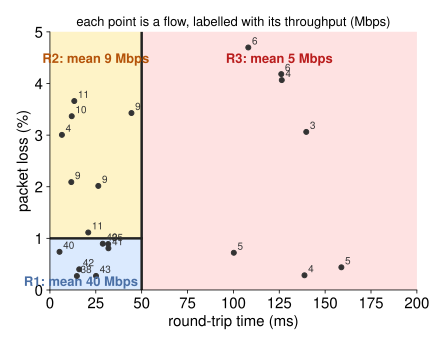
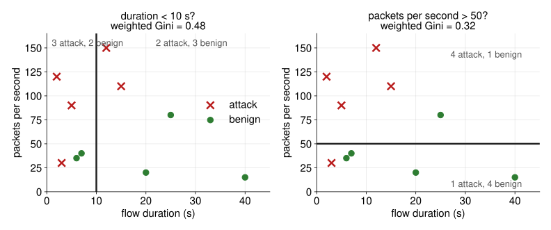
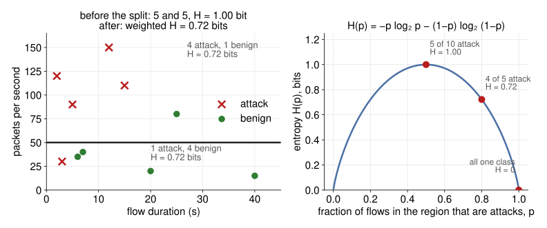
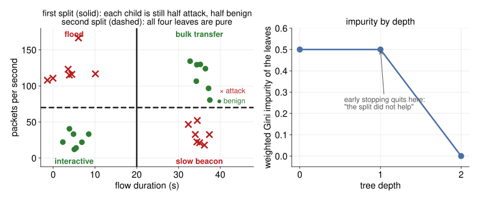
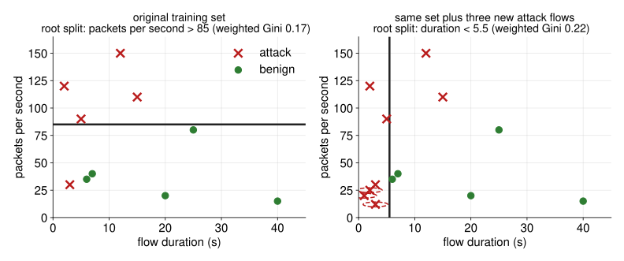
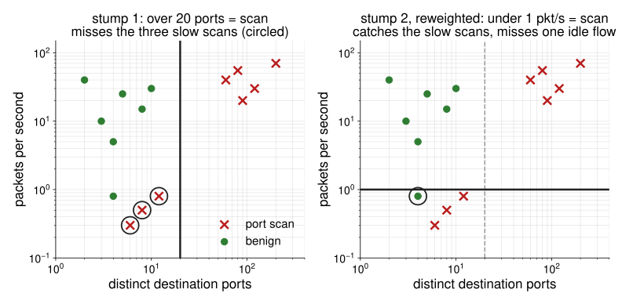

# From a Single Tree to a Forest {.center}

> A single decision tree is easy to explain — but usually wrong.
> An ensemble of trees is harder to explain — but usually right.

::: {.notes}
Open with the paradox of interpretability vs. accuracy that motivates this lecture. A single decision tree reads like a flowchart: "if packets_per_second > 50 AND destination_port == 443 then…" — a network operator can audit it. But it generalizes poorly. The techniques in this lecture — random forests and boosting — recover accuracy by trading away some of that legibility. See the "Decision Trees" and "Ensemble Methods" sections of Chapter 5 (Supervised Learning) in the course textbook.
:::

## Decision Trees: Core Idea

- **Partition** the feature space into rectangular regions using a sequence of binary splits
- Each **leaf node** holds a prediction: the mean (regression) or most frequent class (classification)
- The whole structure can be drawn as a tree — every path from root to leaf is a readable **decision rule**

::: {.columns}
::: {.column width="42%"}
**A tree over network flows** (attack vs. benign):

- Every internal node asks one yes/no question about one feature
- Every leaf is a prediction: the most common class of the training flows that land there
- Read a path root to leaf and you have a rule: "more than 50 packets/s, port 443, so benign"
:::
::: {.column width="58%"}
```{dot}
//| fig-width: 7.2
//| fig-height: 4.6
digraph boardtree {
  rankdir=TB; bgcolor="transparent";
  node [shape=box, style="rounded,filled", fontname="Helvetica", fontsize=22, margin="0.25,0.14", fillcolor="#eef3fb", color="#4a6fa5"];
  edge [fontname="Helvetica", fontsize=19, color="#444444"];
  ranksep=0.45; nodesep=0.35;
  R [label="packets per second > 50?"];
  P [label="destination port == 443?"];
  D [label="flow duration < 1 s?"];
  B [label="benign", shape=ellipse, fillcolor="#e3f1e3", color="#2e7d32", penwidth=2.5];
  M [label="more splits …", fillcolor="#f5f5f5", color="#999999", style="rounded,filled,dashed"];
  M2 [label="…", fillcolor="#f5f5f5", color="#999999", style="rounded,filled,dashed"];
  R -> P [label=" yes"];
  R -> D [label=" no"];
  P -> B [label=" yes"];
  P -> M [label=" no"];
  D -> M2;
}
```
:::
:::

::: {.notes}
Emphasize the appeal: every prediction is traceable. This is exactly what a network operator or a compliance auditor wants — you can print the tree and walk through it with non-experts. Contrast with a neural network: you can't trace a prediction through millions of weights. This interpretability advantage is real and important in networking security contexts. See "Decision Trees" in the Supervised Learning chapter.
:::

## The Same Tree as a Partition of the Feature Space {.smaller}

::: {.columns}
::: {.column width="50%"}
```{dot}
//| fig-width: 6.2
//| fig-height: 5.0
digraph twofeat {
  rankdir=TB; bgcolor="transparent";
  node [shape=box, style="rounded,filled", fontname="Helvetica", fontsize=30, margin="0.2,0.1", fillcolor="#eef3fb", color="#4a6fa5"];
  edge [fontname="Helvetica", fontsize=26, color="#444444"];
  ranksep=0.35; nodesep=0.2;
  R [label="packets per second > 50?"];
  T [label="duration < 10 s?"];
  U [label="duration < 1 s?"];
  A1 [label="attack\n(burst)", shape=ellipse, fillcolor="#fde8e8", color="#b91c1c"];
  B1 [label="benign\n(bulk transfer)", shape=ellipse, fillcolor="#e3f1e3", color="#2e7d32"];
  A2 [label="attack\n(probe)", shape=ellipse, fillcolor="#fde8e8", color="#b91c1c"];
  B2 [label="benign\n(interactive)", shape=ellipse, fillcolor="#e3f1e3", color="#2e7d32"];
  R -> T [label=" yes"];
  R -> U [label=" no"];
  T -> A1 [label=" yes"];
  T -> B1 [label=" no"];
  U -> A2 [label=" yes"];
  U -> B2 [label=" no"];
}
```
:::
::: {.column width="50%"}
::: {.partition}
<svg viewBox="0 0 580 440" xmlns="http://www.w3.org/2000/svg" font-family="Helvetica, Arial, sans-serif">
  <!-- regions: x = duration (90..540), y = packets per second (20..380, up) -->
  <rect x="90" y="20" width="240" height="180" fill="#fde8e8"/>
  <rect x="330" y="20" width="210" height="180" fill="#e3f1e3"/>
  <rect x="90" y="200" width="110" height="180" fill="#fde8e8"/>
  <rect x="200" y="200" width="340" height="180" fill="#e3f1e3"/>
  <!-- split lines -->
  <line x1="90" y1="200" x2="540" y2="200" stroke="#333" stroke-width="3"/>
  <line x1="330" y1="20" x2="330" y2="200" stroke="#333" stroke-width="3"/>
  <line x1="200" y1="200" x2="200" y2="380" stroke="#333" stroke-width="3"/>
  <!-- frame and axes -->
  <rect x="90" y="20" width="450" height="360" fill="none" stroke="#333" stroke-width="2"/>
  <text x="30" y="200" font-size="20" fill="#333" text-anchor="middle" transform="rotate(-90 30 200)">packets per second</text>
  <text x="315" y="428" font-size="20" fill="#333" text-anchor="middle">flow duration</text>
  <text x="80" y="206" font-size="18" fill="#333" text-anchor="end">50</text>
  <text x="200" y="400" font-size="18" fill="#333" text-anchor="middle">1 s</text>
  <text x="330" y="400" font-size="18" fill="#333" text-anchor="middle">10 s</text>
  <!-- region labels -->
  <text x="210" y="50" font-size="19" fill="#b91c1c" text-anchor="middle" font-weight="bold">attack (burst)</text>
  <text x="435" y="50" font-size="19" fill="#2e7d32" text-anchor="middle" font-weight="bold">benign (bulk)</text>
  <text x="145" y="366" font-size="17" fill="#b91c1c" text-anchor="middle" font-weight="bold">attack (probe)</text>
  <text x="370" y="360" font-size="19" fill="#2e7d32" text-anchor="middle" font-weight="bold">benign (interactive)</text>
  <!-- attack points: x marks -->
  <g stroke="#b91c1c" stroke-width="2.5">
    <path d="M140 90 l10 10 m0 -10 l-10 10 M190 130 l10 10 m0 -10 l-10 10 M250 80 l10 10 m0 -10 l-10 10 M290 150 l10 10 m0 -10 l-10 10 M160 165 l10 10 m0 -10 l-10 10 M230 115 l10 10 m0 -10 l-10 10"/>
    <path d="M112 240 l10 10 m0 -10 l-10 10 M150 292 l10 10 m0 -10 l-10 10 M128 318 l10 10 m0 -10 l-10 10 M172 262 l10 10 m0 -10 l-10 10"/>
    <path d="M400 110 l10 10 m0 -10 l-10 10"/>
  </g>
  <!-- benign points: circles -->
  <g fill="#2e7d32">
    <circle cx="380" cy="80" r="5"/><circle cx="440" cy="130" r="5"/><circle cx="500" cy="70" r="5"/><circle cx="470" cy="170" r="5"/><circle cx="360" cy="160" r="5"/>
    <circle cx="260" cy="250" r="5"/><circle cx="320" cy="300" r="5"/><circle cx="410" cy="260" r="5"/><circle cx="470" cy="320" r="5"/><circle cx="360" cy="240" r="5"/><circle cx="500" cy="280" r="5"/><circle cx="230" cy="330" r="5"/>
    <circle cx="300" cy="60" r="5"/>
  </g>
</svg>
:::
:::
:::

The tree and the picture are the same model: each leaf is a rectangle, and its label is the majority class of the training flows inside it. The two halves split *the same* feature at *different* cutpoints, which is normal. Depth is the hyperparameter: keep splitting and the rectangles shrink until each holds one point.

::: {.notes}
Draw this pair on the board if you can; the slide is the clean version. A two-dimensional picture can only show two features, so both halves split on duration, at 10 s above and at 1 s below (the port-443 split from the previous slide would need a third axis). The point worth making out loud: a tree may split the same feature at different thresholds in different branches, and the regions are always axis-aligned rectangles. Walk one path both ways: "more than 50 packets a second, under 10 seconds" is the top-left rectangle, a burst; "under 50 packets a second, under a second" is the bottom-left, a probe. Ask what a stray point in the wrong rectangle does (nothing, the majority wins) and what happens if you keep splitting (one point per rectangle, 100 percent training accuracy, overfit). The port-443 tree on the previous slide is the better rule to read aloud.
:::

## A Regression Tree Over Flows {.smaller}

The same picture with a **continuous** target: predict a flow's throughput from its round-trip time and loss rate. Each leaf predicts the **mean** throughput of the training flows in its rectangle. **Recursive binary splitting** chooses each cut: try every feature and every cutpoint, keep the one whose two children have the smallest total squared error *(appendix)*.

::: {.columns}
::: {.column width="46%"}
```{dot}
//| fig-width: 5.6
//| fig-height: 4.2
digraph regtree {
  rankdir=TB; bgcolor="transparent";
  node [shape=box, style="rounded,filled", fontname="Helvetica", fontsize=26, margin="0.2,0.1", fillcolor="#eef3fb", color="#4a6fa5"];
  edge [fontname="Helvetica", fontsize=22, color="#444444"];
  ranksep=0.4; nodesep=0.25;
  R [label="RTT < 50 ms?"];
  L [label="loss < 1%?"];
  R1 [label="R1: 40 Mbps", shape=ellipse, fillcolor="#dbeafe", color="#1d4ed8"];
  R2 [label="R2: 9 Mbps", shape=ellipse, fillcolor="#fef3c7", color="#b45309"];
  R3 [label="R3: 5 Mbps", shape=ellipse, fillcolor="#fee2e2", color="#b91c1c"];
  R -> L [label=" yes"];
  R -> R3 [label=" no"];
  L -> R1 [label=" yes"];
  L -> R2 [label=" no"];
}
```
:::
::: {.column width="54%"}

:::
:::

::: {.notes}
The classification picture on the previous slide and this regression picture are the same model with a different leaf rule: majority class there, mean value here. Walk both directions: "RTT under 50 ms, loss under 1 percent" is R1, the fast-and-clean flows, mean 40 Mbps; anything with RTT over 50 ms is R3 regardless of loss, because the tree found that once latency is high, loss does not separate the throughputs enough to be worth a split. Point at a flow in the partition and read its prediction off the leaf; then pick a leaf and point at its rectangle. The split objective (appendix) is the regression-tree criterion: at every node, search all features and all cutpoints and take the pair that minimizes the summed squared error of the two children. Exhaustive at each node, greedy across nodes: that is "recursive binary splitting". The figure is generated by `docs/slides/src/trees_figures.py`.
:::

## Building a Tree: Regression vs. Classification {.smaller}

::: {.columns}
::: {.column width="50%"}
**Regression Tree**

- Predict a **continuous** target (e.g., flow throughput in Mbps)
- Split criterion: **reduces mean squared error (MSE)** most
- Greedy recursive binary splitting — computationally feasible; not globally optimal
- Leaf prediction: **mean** of training targets in that region
:::
::: {.column width="50%"}
**Classification Tree**

- Predict a **discrete** class (e.g., attack type or application)
- Split criterion: **Gini impurity** or **entropy** — not MSE, since outcomes are discrete
- Same greedy recursive splitting algorithm (CART)
- Leaf prediction: **majority class** in that region
:::
:::

The CART algorithm evaluates **every feature and every threshold** at each node; takes the split that maximizes impurity reduction; recurses on each child.

*(Gini and entropy formulas in the appendix.)*

::: {.notes}
Stress that the split search is exhaustive over all features and all thresholds — this is O(n log n) per feature per node, which is tractable. The key difference between regression and classification trees is only the splitting criterion: MSE reduction for continuous targets, Gini/entropy for categorical. In networking, most interesting problems are classification (malware vs. benign, application type, attack category). Gini impurity is the CART default; entropy is C4.5's default. They usually produce the same splits. See the "Training" subsection of "Decision Trees" in the Supervised Learning chapter.
:::

## Worked Example: Choosing a Split {.smaller}

Ten flows, two candidate root splits. For each child, Gini impurity is $1 - p^2 - (1-p)^2$ where $p$ is the attack fraction; weight each child by its share of the flows.

{width="76%" fig-align="center"}

- **Before any split:** 5 attack, 5 benign, Gini $= 1 - 0.25 - 0.25 = 0.50$
- **duration < 10 s:** children (3 attack, 2 benign) and (2, 3), each $1 - 0.36 - 0.16 = 0.48$; weighted $0.48$, a reduction of only $0.02$
- **packets per second > 50:** children (4, 1) and (1, 4), each $1 - 0.64 - 0.04 = 0.32$; weighted $0.32$, a reduction of $0.18$. **CART takes this split.**

::: {.notes}
Do one of the four child computations on the board, slowly: the (4 attack, 1 benign) child has p = 0.8, so Gini is 1 minus 0.64 minus 0.04, which is 0.32. Then the weighting: both children here hold five of the ten flows, so the weighted impurity is just the average. The comparison is the whole algorithm in miniature: CART computes this number for every feature and every threshold between two consecutive values, and keeps the smallest. Ask the class which split they would have drawn by eye before showing the numbers; most see that the horizontal line separates the two populations better. This is the mechanical skill an exam can test: given a handful of labeled points and two proposed splits, compute the weighted impurity of each and say which the tree takes. Same figure and numbers come from `docs/slides/src/trees_figures.py`, so they are reproducible.
:::

## Entropy: the Same Split in Bits {.smaller}

The other common criterion. For a region with class proportions $p_k$: $\;H = -\sum_k p_k \log_2 p_k$. A pure region has $H = 0$; an even two-class mix has $H = 1$ bit.

{width="76%" fig-align="center"}

- **Before the split:** $H = -(0.5 \log_2 0.5 + 0.5 \log_2 0.5) = 1$ bit
- **packets per second > 50:** each child is 4-to-1, $H = -(0.8 \log_2 0.8 + 0.2 \log_2 0.2) = 0.72$ bits; weighted $0.72$; **information gain** $= 1 - 0.72 = 0.28$ bits
- **duration < 10 s:** each child is 3-to-2, $H = 0.97$; gain $0.03$. Gini and entropy rank the two splits the same way, which is typical

::: {.notes}
The curve on the right is the thing to internalize: entropy is zero when a region is all one class, one bit when it is evenly mixed, and symmetric in between. Minus sign out front, because the logarithms of proportions are negative. Read the three marked points against the example on the left: the parent sits at the top (5 of 10), each child after the packets-per-second split sits at p = 0.8 (0.72 bits), and a pure leaf sits at zero. "Information gain" is just the drop in weighted entropy; a tree built with entropy picks the split with the largest gain, exactly as a Gini tree picks the largest impurity reduction. For anyone who has seen entropy in an information-theory or systems course: it is the same quantity, the expected number of bits needed to encode the class label of a flow drawn from the region.
:::

## Overfitting and Pruning

A **deep tree** can memorize training data — every leaf holds a single example:

- Training error → 0
- Test error → terrible (high variance)

**Two approaches to control tree depth:**

1. **Early stopping** — stop growing when the RSS (or Gini) improvement falls below a threshold. Problem: misses deeper splits that only become useful later in the tree.
2. **Cost-complexity pruning (preferred)** — grow a large tree, then prune back by minimizing a penalized objective: the leaves' total error plus a penalty $\alpha$ for every leaf the tree keeps. *(Equation in the appendix.)*

Tune $\alpha$ via **$K$-fold cross-validation**.

::: {.notes}
The cost-complexity pruning approach is called "weakest-link pruning" in ISL. The hyperparameter alpha (analogous to lambda in ridge regression) controls the tradeoff: alpha=0 keeps the full tree, large alpha forces a stump. The key insight for students: pruning is a regularization technique, exactly like L2 regularization for linear models, but applied to the tree structure. Cross-validation on alpha is the same procedure used everywhere: split data into K folds, evaluate the generalization error for each alpha value, pick the alpha with the lowest CV error. See the "Parameter Tuning" subsection of "Decision Trees" in the Supervised Learning chapter.
:::

## Early Stopping Can Quit Too Soon {.smaller}

Why grow the whole tree and prune, rather than stop when a split stops helping? Because impurity is not monotone in depth.

{width="80%" fig-align="center"}

Two kinds of attack (a short, fast **flood**; a long, slow **beacon**) and two kinds of benign traffic (a long, fast **bulk transfer**; short, slow **interactive** flows). The first split on either feature leaves both children half attack and half benign, so the impurity does not move and an early-stopping rule stops at the root. One more level gives four pure leaves.

::: {.notes}
This is the XOR pattern in networking clothes, and it is common whenever two different behaviours share a label: no single threshold on one feature separates them, but two thresholds do. An early-stopping rule of the form "stop when the split improves impurity by less than epsilon" quits at the root here for any epsilon, and predicts the majority class everywhere. Growing the tree one more level makes every leaf pure. That is why the standard recipe is to overgrow and then prune back with the cost-complexity penalty: pruning sees the whole tree and can keep the depth-two structure, whereas early stopping never finds it. Setting a fixed maximum depth has the same problem in reverse: it is a guess about the data before you have looked at it.
:::

## The Brittleness Problem {.smaller}

CART is **greedy**: the locally best split at each node, no backtracking. So a few new training flows can change the root split, and everything below it changes with it.

{width="80%" fig-align="center"}

Same ten flows as before, plus three short, slow attack flows (a probe): the best root split moves from **packets per second** to **duration**, and the whole tree below is rebuilt. Predictions may be similar; the tree is unrecognizable. This **high variance** motivates ensemble methods.

::: {.notes}
Walk the figure: on the left, the exhaustive root search over both features finds the packets-per-second split with weighted Gini 0.17. Add three attack flows in the bottom-left corner (short and slow, say a probe), and the best root becomes a duration threshold with Gini 0.22; the packets-per-second split is now worse because those three attacks sit below the line. Every split under the root is then chosen within different children, so the second tree shares nothing with the first. Contrast with logistic regression, where three new points move the boundary slightly. This is the most important practical takeaway of the tree section, and it motivates the rest of the lecture.
:::

## Decision Trees: Pros and Cons

::: {.columns}
::: {.column width="50%"}
**Advantages**

- **Interpretable** — every prediction has an auditable rule path
- No feature scaling needed (no distance computations)
- Handles **mixed feature types** (numeric, binary, nominal) natively
- Mirrors human decision-making — easy for non-experts
- Built-in **feature importance** from impurity reduction
:::
::: {.column width="50%"}
**Limitations**

- **Brittle** — high variance; small data changes → large tree changes
- Usually **not very accurate** compared to ensemble methods
- Can overfit badly if not pruned
- Feature importance is **unreliable** for individual trees (too sensitive to data changes)
:::
:::

::: {.notes}
Bring the tradeoff home for networking contexts: a decision tree classifier for intrusion detection is easy to show a security analyst ("here's exactly why the IDS flagged this flow"), but it might miss 30% of attacks that would be caught by a random forest. In high-stakes settings, the accuracy penalty is unacceptable. The rest of the lecture shows how to keep most of the accuracy while recovering some interpretability. See the "Benefits and Drawbacks" subsection in the Supervised Learning chapter.
:::

# Ensemble Methods {.center}

> One tree is brittle. A forest is robust.

::: {.notes}
The key insight of ensemble methods is the "wisdom of crowds": many diverse, simple models that each get the answer partially right can collectively outperform a single complex model. The diversity is essential — if all models make the same mistakes, aggregating them doesn't help. See the "Ensemble Methods" section of Chapter 5 (Supervised Learning) in the course textbook.
:::

## Bagging: Bootstrap Aggregation {.smaller}

**Key idea:** reduce variance by averaging predictions over many models trained on bootstrapped datasets.

::: {.columns}
::: {.column width="46%"}
1. Draw $B$ bootstrap samples of size $n$ **with replacement** from the training set
2. Train a **separate decision tree** on each bootstrap sample (no pruning — let trees grow deep)
3. Aggregate predictions:
   - **Regression:** average the $B$ predictions
   - **Classification:** majority vote across the $B$ trees

Each bootstrap sample contains ~**63.2%** of unique training examples (rest are duplicates).
:::
::: {.column width="54%"}
```{dot}
//| fig-width: 6.4
//| fig-height: 4.4
digraph bagging {
  rankdir=TB; bgcolor="transparent";
  node [shape=box, style="rounded,filled", fontname="Helvetica", fontsize=34, margin="0.15,0.08", fillcolor="#eef3fb", color="#4a6fa5"];
  edge [color="#444444"];
  ranksep=0.5; nodesep=0.12;
  D [label="training set D\n(n labeled flows)", fillcolor="#f5f5f5", color="#555555"];
  D1 [label="D1"]; D2 [label="D2"]; D3 [label="D3"]; D4 [label="D4"]; D5 [label="D5"];
  T1 [label="tree 1", shape=triangle, fillcolor="#e3f1e3", color="#2e7d32"]; T2 [label="tree 2", shape=triangle, fillcolor="#e3f1e3", color="#2e7d32"];
  T3 [label="tree 3", shape=triangle, fillcolor="#e3f1e3", color="#2e7d32"]; T4 [label="tree 4", shape=triangle, fillcolor="#e3f1e3", color="#2e7d32"]; T5 [label="tree 5", shape=triangle, fillcolor="#e3f1e3", color="#2e7d32"];
  V [label="majority vote\n(or average)", fillcolor="#fef3c7", color="#b45309"];
  D -> D1 [label=" n draws with\n replacement", fontname="Helvetica", fontsize=26]; D -> D2; D -> D3; D -> D4; D -> D5;
  D1 -> T1; D2 -> T2; D3 -> T3; D4 -> T4; D5 -> T5;
  T1 -> V; T2 -> V; T3 -> V; T4 -> V; T5 -> V;
}
```
:::
:::

::: {.notes}
Recall the variance reduction math from probability: if you have n independent observations each with variance sigma^2, the mean has variance sigma^2/n. Bagging approximates this — the trees aren't truly independent (they're all drawn from the same underlying distribution) but they're decorrelated enough to substantially reduce variance. The 63.2% figure follows from the probability that any single example is NOT selected in n draws with replacement: (1 - 1/n)^n → 1/e ≈ 36.8% excluded, so 63.2% included. The excluded ~36.8% becomes the "out-of-bag" sample — free cross-validation data! See the "Bagging & Pasting" subsection of the Supervised Learning chapter.
:::

## Out-of-Bag Error Estimation

Bagging gives us a **free cross-validation estimate** without additional computation:

- Each tree was trained on ~63.2% of examples → the remaining ~36.8% are **out-of-bag (OOB)**
- For each training example, average predictions only from trees that did **not** see it
- OOB error ≈ cross-validation error; no separate validation set needed

**Feature importance** is also computable from bagged trees:

- For each feature, measure the average reduction in RSS (regression) or Gini (classification) across all splits on that feature, averaged over all trees
- More stable and reliable than a single tree's feature importance

::: {.notes}
OOB estimation is a major practical advantage: in networking datasets, labeled examples are often scarce and expensive. Using OOB error means you don't have to sacrifice 20% of your labeled data for a validation set. The feature importance calculation is covered in detail in the "Evaluation" content from the source extract and the "Feature Importance in Random Forests" subsection of the book. Stress that averaging over many trees makes feature importance much more reliable than reading it from a single tree.
:::

## Why Bagging Alone Is Not Enough {.smaller}

Averaging only helps when the trees **disagree**. If one feature dominates, every bootstrap sample still splits on it first, and the trees come out nearly identical.

::: {.columns}
::: {.column width="55%"}
::: {.partition}
<svg viewBox="0 0 640 300" xmlns="http://www.w3.org/2000/svg" font-family="Helvetica, Arial, sans-serif">
  <text x="10" y="28" font-size="22" font-weight="bold" fill="#b91c1c">Bagged trees: five bootstrap samples, one root</text>
  <g font-size="17" text-anchor="middle">
    <rect x="10" y="44" width="116" height="40" rx="8" fill="#fde8e8" stroke="#b91c1c" stroke-width="2"/><text x="68" y="70" fill="#333">bytes/s &gt; 8k?</text>
    <rect x="136" y="44" width="116" height="40" rx="8" fill="#fde8e8" stroke="#b91c1c" stroke-width="2"/><text x="194" y="70" fill="#333">bytes/s &gt; 8k?</text>
    <rect x="262" y="44" width="116" height="40" rx="8" fill="#fde8e8" stroke="#b91c1c" stroke-width="2"/><text x="320" y="70" fill="#333">bytes/s &gt; 9k?</text>
    <rect x="388" y="44" width="116" height="40" rx="8" fill="#fde8e8" stroke="#b91c1c" stroke-width="2"/><text x="446" y="70" fill="#333">bytes/s &gt; 8k?</text>
    <rect x="514" y="44" width="116" height="40" rx="8" fill="#fde8e8" stroke="#b91c1c" stroke-width="2"/><text x="572" y="70" fill="#333">bytes/s &gt; 8k?</text>
  </g>
  <g stroke="#b91c1c" stroke-width="2" fill="none">
    <path d="M50 84 l-20 30 M86 84 l20 30 M176 84 l-20 30 M212 84 l20 30 M302 84 l-20 30 M338 84 l20 30 M428 84 l-20 30 M464 84 l20 30 M554 84 l-20 30 M590 84 l20 30"/>
  </g>
  <text x="320" y="140" font-size="17" fill="#777" text-anchor="middle">… the trees agree with each other, so averaging them changes little</text>
  <text x="10" y="186" font-size="22" font-weight="bold" fill="#2e7d32">Random forest: a random feature subset per split, five roots</text>
  <g font-size="16" text-anchor="middle">
    <rect x="10" y="202" width="116" height="40" rx="8" fill="#e3f1e3" stroke="#2e7d32" stroke-width="2"/><text x="68" y="228" fill="#333">bytes/s &gt; 8k?</text>
    <rect x="136" y="202" width="116" height="40" rx="8" fill="#e3f1e3" stroke="#2e7d32" stroke-width="2"/><text x="194" y="228" fill="#333">duration &gt; 30 s?</text>
    <rect x="262" y="202" width="116" height="40" rx="8" fill="#e3f1e3" stroke="#2e7d32" stroke-width="2"/><text x="320" y="228" fill="#333">pkts/s &gt; 50?</text>
    <rect x="388" y="202" width="116" height="40" rx="8" fill="#e3f1e3" stroke="#2e7d32" stroke-width="2"/><text x="446" y="228" fill="#333">pkt size &gt; 900?</text>
    <rect x="514" y="202" width="116" height="40" rx="8" fill="#e3f1e3" stroke="#2e7d32" stroke-width="2"/><text x="572" y="228" fill="#333">IAT &lt; 20 ms?</text>
  </g>
  <g stroke="#2e7d32" stroke-width="2" fill="none">
    <path d="M50 242 l-20 30 M86 242 l20 30 M176 242 l-20 30 M212 242 l20 30 M302 242 l-20 30 M338 242 l20 30 M428 242 l-20 30 M464 242 l20 30 M554 242 l-20 30 M590 242 l20 30"/>
  </g>
  <text x="320" y="296" font-size="17" fill="#777" text-anchor="middle">… different trees make different mistakes, and the vote cancels them</text>
</svg>
:::
:::
::: {.column width="45%"}
For $B$ trees with variance $\sigma^2$ and pairwise correlation $\rho$, the average has variance

$$\rho\,\sigma^2 + \frac{1-\rho}{B}\,\sigma^2$$

The second term vanishes as $B$ grows. The first does not: **correlated trees keep their shared variance no matter how many you add.**

Example: in the smart-camera traffic of the hands-on, bytes per second separates livestream from idle so well that every bagged tree starts there. Only the lower levels differ.
:::
:::

::: {.notes}
This is the example promised in class of the correlation problem actually happening. The variance formula is the one in ESL and ISL: if the trees were independent (rho = 0) the variance of the average would fall like 1 over B, as in the sigma squared over n argument from probability. They are not independent, because they are all fit to bootstrap samples of the same data and all find the same dominant feature. The rho sigma squared term is the floor. The random forest trick on the next slide attacks rho directly: by hiding the dominant feature from a node some of the time, it forces different trees to start from different features, and the rows in the lower diagram show what that looks like. In the Nest Cam data, bytes per second is that dominant feature; try `max_features=1` on the hands-on's forest to see the roots change.
:::

## Random Forests: Decorrelating the Trees {.smaller}

::: {.columns}
::: {.column width="52%"}
**Random forests** add one tweak to bagging:

> At each node, consider only a **random subset of $m$ features** (not all $M$)

- Typically $m = \sqrt{M}$ for classification; $m = M/3$ for regression
- A different subset at every node of every tree, so the dominant feature is often unavailable and the trees start from different places
- Trees become **decorrelated** → greater variance reduction when aggregated

Final prediction: **majority vote** (classification) or **average** (regression) across all trees.
:::
::: {.column width="48%"}
```{dot}
//| fig-width: 5.6
//| fig-height: 4.6
digraph rf {
  rankdir=TB; bgcolor="transparent";
  node [shape=box, style="rounded,filled", fontname="Helvetica", fontsize=28, margin="0.15,0.08", fillcolor="#eef3fb", color="#4a6fa5"];
  edge [fontname="Helvetica", fontsize=24, color="#444444"];
  ranksep=0.45; nodesep=0.1;
  D [label="bootstrap samples\n+ random features per split", fillcolor="#f5f5f5", color="#555555"];
  T1 [label="pkts/s > 50?\n…"]; T2 [label="duration > 30 s?\n…"]; T3 [label="bytes/s > 8k?\n…"]; T4 [label="pkt size > 900?\n…"]; T5 [label="IAT < 20 ms?\n…"];
  V [label="attack: 3 votes\nbenign: 2 votes\n→ attack", fillcolor="#fde8e8", color="#b91c1c"];
  D -> T1; D -> T2; D -> T3; D -> T4; D -> T5;
  T1 -> V [label="attack"]; T2 -> V [label="benign"]; T3 -> V [label="attack"]; T4 -> V [label="attack"]; T5 -> V [label="benign"];
}
```
:::
:::

::: {.notes}
Two ingredients make a random forest, and both matter: bootstrap aggregation of the training data, and a random subset of candidate features at each split. The m = sqrt(M) rule is empirically well supported and is scikit-learn's default for classification. An odd number of trees avoids ties in a majority vote, which is why the picture shows five; in practice there are hundreds and ties do not matter. Random forests are described as one of the best out-of-the-box classifiers in the book: very little tuning, mixed feature types, no scaling, and the trees train in parallel. See the "Random Forests" subsection of the Supervised Learning chapter.
:::

## Why Random Forests Work So Well

::: {.columns}
::: {.column width="50%"}
**Solving Brittleness**

- Hundreds of trees each trained on different data subsets
- Ensemble vote is **stable** even if individual trees change
- Adding new training examples shifts some trees but not the aggregate prediction
:::
::: {.column width="50%"}
**Practical Advantages**

- **Minimal tuning** — mainly just "number of trees" (more is almost always better)
- Works with **mixed feature types**; no scaling needed
- Highly **parallelizable** — each tree is independent
- **Competitive with deep learning** on tabular data
:::
:::

**Bottom line:** Random forests are an excellent first model to try on any new network traffic classification problem.

::: {.notes}
The book explicitly calls random forests "one of the best out-of-the-box classifiers." The competition with deep learning on tabular data is not just hype — Grinsztajn et al. (2022) showed this systematically on benchmark datasets. In networking, most features we extract from flows (packet counts, byte rates, inter-arrival times, port numbers) are tabular, not raw bytes — this is exactly the regime where random forests shine. The key hyperparameters are: n_estimators (more is better, diminishing returns), max_features (sqrt(M) default is usually fine), and max_depth (usually None — let trees grow). See the "Why Random Forests Are One of the Best Out-of-the-Box Classifiers" subsection of the Supervised Learning chapter.
:::

## Application: IoT Privacy Inference

::: {.columns}
::: {.column width="60%"}
A compelling networking application of random forests:

- Apthorpe et al. collected **encrypted** traffic from smart home cameras
- Features: packet sizes, timing, rates — **no content** inspected
- Random forest classifier trained to predict: **motion detected or not?**
- Result: high accuracy from traffic patterns alone — **metadata leaks private in-home activity**
:::
::: {.column width="40%"}
**Privacy implication:**

Encryption protects *content*.
It does not protect *traffic metadata*.

Random forest feature importance revealed which timing patterns were most diagnostic — providing insight, not just a black-box prediction.
:::
:::

::: {.notes}
This is a canonical example from the book's sidebar. The paper (Apthorpe et al. 2017) is widely cited and directly relevant to students interested in IoT security and privacy. The key teaching point is dual: (1) random forests as a research instrument — they revealed WHICH features leaked information; (2) the privacy implication — encryption alone is not sufficient to protect user behavior from network observers. This is why ISPs, network operators, and even home router firmware can infer what you're doing even over HTTPS. See the IoT Privacy sidebar in the "Random Forests" subsection of the Supervised Learning chapter.
:::

# Boosting {.center}

> Bagging reduces **variance** by parallelism.
> Boosting reduces **bias** by sequential correction.

::: {.notes}
This is the key conceptual distinction to hammer home. Bagging trains many independent models and averages — this reduces variance (the models disagree less in aggregate). Boosting trains models sequentially where each new model tries to fix the mistakes of the previous ones — this reduces bias (the aggregate model can represent more complex patterns). See the "Boosting" subsection of the Ensemble Methods section in the Supervised Learning chapter.
:::

## Gradient Boosting: Sequential Residual Fitting

**Core algorithm:**

1. Start with a simple prediction (e.g., the mean of all targets)
2. Compute the **residuals** — the errors the current model makes
3. Train a new (shallow) tree to **predict the residuals**
4. Add this correction, scaled by a **shrinkage factor** $\lambda$, to the current model
5. Repeat for $B$ iterations

After each round the model is the previous model plus a small, shrunken copy of the new residual tree. *(Equation in the appendix.)*

::: {.notes}
Gradient boosting is described as predicting "the residual between predicted labels and correct labels for the training data. Successive models predict the residual of the previous model, effectively predicting the amount of correction needed to improve the earlier model's output." (Supervised Learning chapter.) The shrinkage parameter lambda is the learning rate — small lambda means each tree contributes only a little, requiring more trees but usually giving better generalization. This is analogous to the learning rate in gradient descent. XGBoost and LightGBM are the dominant implementations; both add regularization terms, parallelism, and efficient histogram-based splitting on top of this core algorithm. See the "Boosting" subsection in the Supervised Learning chapter.
:::

## AdaBoost: Reweighting for Classification {.smaller}

**AdaBoost** is boosting for classification using example reweighting. Example: detecting port scans from (distinct destination ports, packets per second).

::: {.columns}
::: {.column width="36%"}
1. Start with equal weights on all training flows
2. Train a **weak learner**, a one-level tree (a "stump"): more than 20 ports means scan. It misses the three **slow scans**
3. **Increase the weights** of the flows it got wrong; decrease the rest
4. The next stump is fit to the reweighted data and picks the rate: under one packet per second means scan. It catches the slow scans and misses one idle benign flow, which gets upweighted in turn
5. Final prediction: a **weighted vote** of all the stumps
:::
::: {.column width="64%"}

:::
:::

::: {.notes}
AdaBoost (Freund and Schapire, 1997) was the first boosting algorithm in wide use. The stump is the canonical weak learner: one feature, one threshold. The networking story on the figure: fast scans touch many ports and are caught by the first stump; slow scans touch few ports and look like benign low-rate traffic to it, so they are the misclassified, circled points that get more weight. The second stump, fit to the reweighted data, concentrates on them and finds that a rate under one packet per second separates slow scans from everything else, at the cost of one idle benign flow, which becomes the next round's hard example. Chain enough stumps and the weighted vote fits the training data; empirically, test error keeps improving too. Unlike bagging, the rounds depend on each other, so boosting does not parallelize the same way. Figure from `docs/slides/src/trees_figures.py`.
:::

## Boosting Parameters and Tuning {.smaller}

| Parameter | Description | Practical Guidance |
|---|---|---|
| **Number of trees $B$** | How many sequential models to train | Use cross-validation; more trees can overfit (unlike random forests) |
| **Shrinkage $\lambda$** | Learning rate — how much each tree contributes | Smaller $\lambda$ = more trees needed but usually better generalization |
| **Tree depth $d$** | Complexity of each weak learner | Depth 1 (stumps) often works well; $d = 1$–$5$ typical |

**Key difference from random forests:** boosting **can overfit** as $B$ grows — number of trees must be tuned via cross-validation.

::: {.notes}
This is an important practical distinction: random forests almost never overfit as you add more trees (adding trees only helps, with diminishing returns). Boosting can overfit because each new tree is deliberately targeting the residuals of the previous model — if you keep going long enough, you can memorize the training data. The shrinkage parameter is the most important tuning knob. XGBoost uses 0.1 as a default; practitioners often try 0.01–0.3. Smaller lambda with more trees usually beats larger lambda with fewer trees. See the "Parameters in Boosting" content from the source extract and the Boosting subsection in the Supervised Learning chapter.
:::

## Random Forests vs. Boosting {.smaller}

::: {.columns}
::: {.column width="50%"}
**Random Forests**

- Trees trained **in parallel** — independently on bootstrapped subsets
- Reduces **variance** (individual trees disagree; aggregate is stable)
- Hard to overfit by adding more trees
- **Minimal tuning** required
- Excellent default; strong on tabular data
- **Parallelizable** — scales easily
:::
::: {.column width="50%"}
**Gradient Boosting / XGBoost**

- Trees trained **sequentially** — each corrects the previous
- Reduces **bias** (aggregate can model complex patterns)
- **Can overfit** — $B$ must be tuned carefully
- More hyperparameters (learning rate, depth, regularization)
- Often achieves **highest accuracy** on structured data competitions
- Sequential — harder to parallelize
:::
:::

**Rule of thumb:** Start with random forests for robustness. Try XGBoost for maximum performance.

::: {.notes}
Both methods dominate Kaggle competitions on tabular data. XGBoost won a remarkable number of competitions in 2014-2017 and remains dominant alongside LightGBM. For networking applications: if you need a fast, robust baseline that's easy to explain to a security team, use random forests. If you're squeezing out the last percentage point of detection accuracy (and have time to tune), use gradient boosting. The book notes: "Research suggests boosting methods may be effective for networking applications such as traffic classification and intrusion detection." (Supervised Learning chapter.)
:::

## Current Events: Gradient Boosting for IoT Intrusion Detection {.smaller}

::: {.vignette}
**April 2026 — Optimized Gradient Boosting IDS for IoT (Scientific Reports)**

Researchers published an optimized gradient-boosting framework for IoT intrusion detection evaluated on the CICIoT2023 benchmark — a large-scale dataset with realistic IoT attack traffic. XGBoost achieved **98.54% accuracy** and **93.06% AUC-ROC** on multi-class attack classification (DoS, DDoS, Mirai, and others). The study addressed the key challenge of highly imbalanced classes (normal traffic vastly outnumbers attack traffic) and demonstrated that gradient boosting remains competitive with deep learning on structured flow-level features.

*Source: "An optimized gradient boosting framework for IoT intrusion detection: a comprehensive evaluation on the CICIoT2023 dataset," Scientific Reports, April 2026. doi: 10.1038/s41598-026-47399-5*
:::

**Teaching point:** This result connects directly to three lecture themes — ensemble methods on tabular network features, class imbalance (more in the Data Preparation lecture), and the real-world deployment stakes of intrusion detection.

::: {.notes}
This is a primary-source verified 2026 result from Scientific Reports (Nature Publishing Group). The CICIoT2023 dataset is a well-known benchmark from the Canadian Institute for Cybersecurity containing realistic IoT network traffic. The 98.54% accuracy figure is the XGBoost result specifically; the class imbalance challenge is directly relevant to the Data Preparation and Evaluation lectures. Cold call: why is AUC-ROC a better metric than raw accuracy when classes are highly imbalanced? (Because a classifier that always predicts "normal" would have very high accuracy but AUC ≈ 0.5.) Re-verify this result before next year's refresh — dated hooks in Scientific Reports are durable.
:::

## Ensemble Methods and Interpretability {.smaller}

A practical tension: ensemble methods improve accuracy but reduce interpretability.

| Method | Interpretability | Accuracy |
|---|---|---|
| Single decision tree | High — readable rules | Low |
| Random forest | Medium — feature importance only | High |
| Gradient boosting | Medium — SHAP values help | Very high |

**Addressing the gap:**

- **Feature importance** (both methods): which inputs matter most?
- **SHAP values** (SHapley Additive exPlanations): per-prediction attribution — how much did each feature contribute to **this specific prediction**?
- Particularly valuable for networking: explain to a security analyst why **this specific flow** was flagged

::: {.notes}
SHAP (Lundberg & Lee, 2017) is now the standard interpretability tool for ensemble models. Most major gradient boosting libraries (XGBoost, LightGBM, scikit-learn) support SHAP natively. For students interested in explainable AI for security: SHAP gives you the best of both worlds — a highly accurate ensemble model with per-prediction explanations. The feature importance caveat: random forest feature importance can be misleading when features are correlated (the importance may be split arbitrarily among correlated features). SHAP addresses this more rigorously. This is worth flagging as an active research area but not drilling into deeply in this lecture.
:::

## Summary: Trees and Ensembles

::: {.columns}
::: {.column width="55%"}
**Decision Trees**

- Partition feature space into rectangular regions via greedy binary splitting
- Interpretable, but **brittle and inaccurate** alone
- Tune depth via cost-complexity pruning + cross-validation

**Random Forests**

- Bagging + random feature subsets = decorrelated trees
- Reduces **variance**; minimal tuning; great default
- Feature importance via OOB error + impurity reduction
:::
::: {.column width="45%"}
**Boosting**

- Sequential trees fitting **residuals** of previous model
- Reduces **bias**; can overfit; tune $B$ and $\lambda$
- XGBoost / LightGBM: dominant for tabular data

**For networking:**

- Tree-based models handle mixed features natively
- Random forests = strong, robust baseline
- XGBoost = max accuracy on structured flow data
:::
:::

::: {.notes}
Close with the conceptual arc: single tree (interpretable, inaccurate) → bagging (variance reduction) → random forests (decorrelated variance reduction) → boosting (bias reduction via sequential correction). The networking relevance runs throughout: feature importance for understanding which flow features matter, OOB error for evaluation when labeled data is scarce, and gradient boosting for state-of-the-art IDS performance. Remind students: the activity in the Appendix trains a random forest on IoT traffic data — directly relevant to the applications covered today. See Chapter 5 (Supervised Learning) in the course textbook for all material covered today.
:::

## Practice Questions {.smaller}

In the style of an exam; none needs more arithmetic than this deck's worked examples.

1. **Tree to partition and back.** Given a depth-two tree over (packets per second, duration), draw the regions it induces and label each with its class. Given the labeled rectangles, write the tree.
2. **Choosing a split.** Eight labeled flows and two proposed splits: compute the weighted Gini impurity (or entropy) of each and say which the tree takes.
3. **Brittleness.** For the training set in question 2, add two flows that change the root split, and explain why a greedy learner cannot recover.
4. **Pruning.** Why does cost-complexity pruning find trees that early stopping misses? Give a pattern of two features and two classes where it matters.
5. **Random forests.** Name the two ingredients that turn bagged trees into a random forest, and say what goes wrong with bagging alone when one feature dominates.
6. **Bagging vs. boosting.** Which reduces variance and which reduces bias? Which can overfit as you add trees, and why?

::: {.notes}
Each question maps to one slide: 1 to the partition slides, 2 to the worked Gini and entropy examples, 3 to the brittleness figure, 4 to the early-stopping slide, 5 to the two bagging slides, 6 to the comparison table. Hand these out as a study guide or work one on the board as a recap. Answers are the slides themselves; none of the appendix math is required.
:::

# Appendix: The Math {.center}

## Splitting Criteria: Gini Impurity and Entropy {.smaller}

For a node containing $K$ classes with proportions $p_1, \ldots, p_K$:

$$\text{Gini} = 1 - \sum_{k=1}^{K} p_k^2 \qquad \text{Entropy} = -\sum_{k=1}^{K} p_k \log_2 p_k$$

- Both equal **zero** for a pure node (all one class) — the ideal leaf
- Both are maximized when classes are equally mixed — the worst split
- In practice, Gini and entropy produce nearly identical trees
- A third criterion — the **classification error rate** (fraction of the node not in its majority class) — is too insensitive for growing trees; it's used mainly when *pruning* them

**Greedy choice at each node:** select the feature $j$ and threshold $t$ that maximize the **weighted impurity reduction** across the two resulting child nodes.

::: {.notes}
The math is important for intuition. Gini impurity measures the probability that a randomly drawn pair of examples from the node belong to different classes — a pure node has probability zero. Entropy is the information-theoretic measure of disorder. Both penalize mixed nodes and reward pure ones. Cold call: if a node has 50 examples all of class 0, what is its Gini impurity? (Answer: 0.) What if it has 25 of class 0 and 25 of class 1? (Answer: 0.5, maximum for binary case.) This connects to information theory concepts the students may have seen elsewhere.
:::

## Regression-Tree Split Criterion

**Recursive binary splitting:** choose the feature $j$ and cutpoint $s$ defining regions $R_1(j,s) = \{X \mid X_j < s\}$ and $R_2(j,s) = \{X \mid X_j \geq s\}$ that minimize the total RSS:

$$\sum_{i:\, x_i \in R_1(j,s)} (y_i - \hat{y}_{R_1})^2 \;+\; \sum_{i:\, x_i \in R_2(j,s)} (y_i - \hat{y}_{R_2})^2$$

- $x_i, y_i$ — training example $i$'s features and target
- $R_1(j,s), R_2(j,s)$ — the two child regions produced by splitting feature $j$ at cutpoint $s$
- $\hat{y}_{R_1}, \hat{y}_{R_2}$ — the mean target in each child region (the leaf predictions)

::: {.notes}
Companion to "Representing the Feature Space." This is the regression-tree criterion from ISL: at every node, search all features $j$ and all cutpoints $s$, and take the pair that minimizes the summed squared error of the two children. The search is exhaustive at each node but greedy across nodes — it never revisits an earlier split. For classification trees the same search is run with Gini or entropy in place of RSS (previous appendix slide).
:::

## Cost-Complexity Pruning

Grow a large tree $T_0$, then choose the subtree $T \subseteq T_0$ that minimizes a penalized objective:

$$\text{minimize} \; \sum_{\text{leaves}} \text{MSE}_\ell + \alpha \cdot |T|$$

- $\text{MSE}_\ell$ — mean squared error of the training examples in leaf $\ell$ (Gini or entropy for classification)
- $|T|$ — number of leaves in the subtree
- $\alpha \geq 0$ — complexity penalty per leaf; $\alpha = 0$ keeps the full tree, large $\alpha$ collapses it to a stump

Tune $\alpha$ via $K$-fold cross-validation.

::: {.notes}
Companion to "Overfitting and Pruning." ISL calls this weakest-link pruning. $\alpha$ plays the role that $\lambda$ plays in ridge regression: it is a regularization knob on the tree's structure rather than on coefficient size. Cross-validation over $\alpha$ is the standard procedure — split into $K$ folds, estimate generalization error for each $\alpha$, keep the one with the lowest CV error.
:::

## Gradient Boosting Update

At step $b$, fit a shallow tree $h_b$ to the current residuals and add a shrunken copy of it to the model:

$$\hat{f}^{(b)}(\mathbf{x}) = \hat{f}^{(b-1)}(\mathbf{x}) + \lambda \cdot h_b(\mathbf{x})$$

- $\hat{f}^{(b)}$ — the ensemble after $b$ rounds; $\hat{f}^{(0)}$ is a constant (e.g., the mean target)
- $h_b$ — the tree fitted at step $b$ to the residuals $y_i - \hat{f}^{(b-1)}(\mathbf{x}_i)$
- $\lambda$ — shrinkage (learning rate); small $\lambda$ needs more rounds $B$ but usually generalizes better

After $B$ rounds the final model is $\hat{f}^{(B)} = \hat{f}^{(0)} + \lambda \sum_{b=1}^{B} h_b$.

::: {.notes}
Companion to "Gradient Boosting: Sequential Residual Fitting." Fitting a tree to residuals is gradient descent in function space: for squared-error loss the residual is exactly the negative gradient of the loss with respect to the current prediction, which is where the name comes from. XGBoost and LightGBM add regularization terms and histogram-based split finding on top of this update.
:::
