# From Features to Representations {.center}

> Earlier models expected you to hand-craft features.
> Deep learning learns the *best representation* from raw data.

```{=html}
<style>
.reveal .cell-output-display svg, .reveal .cell-output-display img { width: 100%; height: auto; }
.reveal .caption { font-size: 0.55em; color: #666666; margin-top: 0.2em; }
</style>
```

::: {.notes}
Open with the key shift: traditional ML requires a human expert to decide
which features matter (e.g., packet size, flow duration). Deep learning
lets the model discover that representation itself. Ask the class: what
features would you hand-craft to classify encrypted traffic? Then flip
the question — what if you didn't have to decide? See the Deep Learning
section of Chapter 5 ("Supervised Learning") in *Machine Learning for
Networking*.
:::

## The Limitations of Linear Models

::: {.columns}
::: {.column width="55%"}
Linear and logistic regression find **hyperplane decision boundaries**.
When classes are not linearly separable, accuracy degrades.

**Two classic workarounds:**

- **Polynomial / kernel basis expansion** — transform features manually;
  feature explosion at high degree
- **Tree ensembles** — partition space; hard to apply to raw sequences or images

**The deep learning alternative:**
*Learn* a hierarchy of transformations that makes classes linearly
separable in the final layer.
:::
::: {.column width="45%"}
**Why this matters for networking:**

Raw network data — packet bytes, header fields, timing — is high-dimensional
and structured. Manual feature engineering is:

- **Time-consuming** — domain expertise required
- **Brittle** — features may not transfer across protocols or tasks
- **Incomplete** — relevant patterns the engineer didn't think of are missed

See book Chapter 5, "Deep Learning" subsection.
:::
:::

::: {.notes}
Connect back to the logistic regression and trees lectures. The punchline
is that the previous methods all required humans to specify the input
representation. Deep learning removes that requirement — at the cost of
more data and compute. See *Machine Learning for Networking*, Chapter 5.
:::

## Where Deep Learning Sits

::: {.columns}
::: {.column width="60%"}
<!-- redrawn Nov 2026 from the hand-drawn rings in 13-Deep-Learning.pptx slide 3 -->
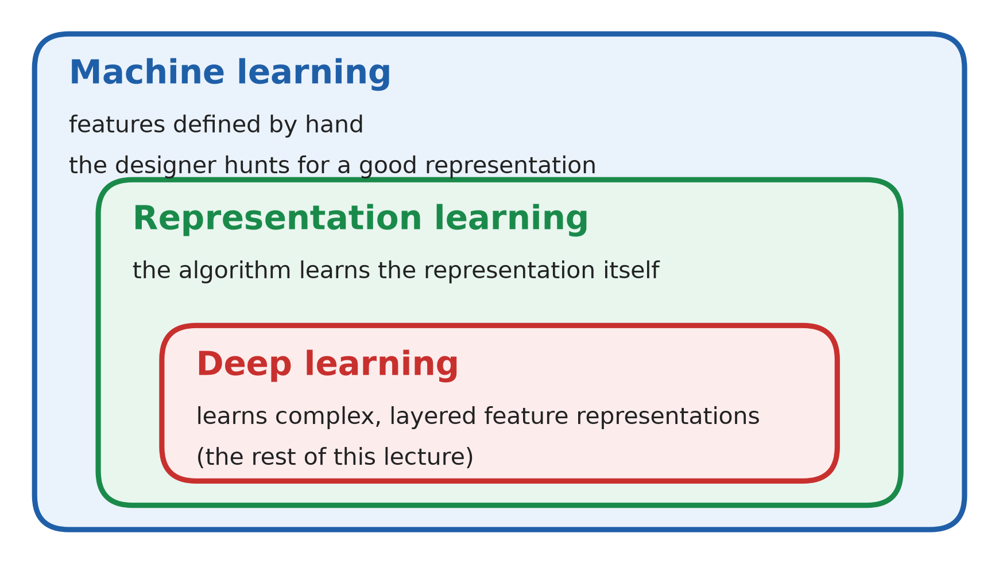
:::
::: {.column width="40%"}
- **Machine learning:** features are defined by hand; the designer hunts for a good representation
- **Representation learning:** the algorithm learns the representation itself
- **Deep learning:** learns *complex, layered* feature representations
- Everything in this lecture lives in the inner two boxes
:::
:::

::: {.notes}
Walk the three boxes outside-in. Outer ring: classic ML as taught so far, where a human picks
packet size, inter-arrival time, and so on. Middle ring: the algorithm finds the
representation. Inner ring: deep learning, where the representation is itself a
stack of learned transformations. nPrint later in the deck is the networking
version of moving from the outer ring to the inner one.
:::

## The Artificial Neuron {.smaller}

::: {.columns}
::: {.column width="45%"}
**The basic unit:** multiply, sum, activate. Each input is multiplied by its weight,
the products are summed together with a bias, and the sum passes through an
activation function.

- $x_i$ — input features
- $w_i$ — learned **weights** (one per input)
- $b$ — **bias** term (like the intercept in linear regression)
- $f(\cdot)$ — **activation function** (the critical non-linearity)

A single neuron with a sigmoid activation $\Rightarrow$ logistic regression.

Stack many neurons into layers → **neural network**.

*(Equation in the appendix.)*
:::
::: {.column width="55%"}
```{dot}
//| fig-width: 5.2
//| fig-height: 3.4
digraph neuron {
  rankdir=LR; nodesep=0.35; ranksep=0.7;
  node [fontname="Helvetica", fontsize=13, style=filled, color="#444444"];
  edge [fontname="Helvetica", fontsize=12, color="#555555"];
  x1 [label="x₁", shape=circle, fixedsize=true, width=0.5, fillcolor="#cfe3f5"];
  x2 [label="x₂", shape=circle, fixedsize=true, width=0.5, fillcolor="#cfe3f5"];
  xd [label="⋮", shape=plaintext, style="", fontsize=18];
  xn [label="xₙ", shape=circle, fixedsize=true, width=0.5, fillcolor="#cfe3f5"];
  b  [label="1", shape=circle, fixedsize=true, width=0.5, fillcolor="#eeeeee"];
  sum [label="Σ\nz = Σ wᵢxᵢ + b", shape=circle, fixedsize=true, width=1.15, fillcolor="#ffffff"];
  act [label="f(z)\nactivation", shape=box, style="rounded,filled", fillcolor="#f2d9a8", margin="0.15,0.1"];
  out [label="output\nf(z)", shape=circle, fixedsize=true, width=0.8, fillcolor="#f8d7c4"];
  x1 -> sum [label="w₁", fontcolor="#1f5fa8"]; x2 -> sum [label="w₂", fontcolor="#1f5fa8"]; xn -> sum [label="wₙ", fontcolor="#1f5fa8"];
  b  -> sum [label="b (bias)", fontcolor="#1f5fa8", style=dashed];
  sum -> act -> out [penwidth=1.6];
  {rank=same; x1; x2; xd; xn; b;}
  x1 -> x2 -> xd -> xn -> b [style=invis];
}
```

*Blue labels are the learned parameters: one weight per input, plus the bias.*
:::
:::

::: {.notes}
The analogy to logistic regression is exact: one neuron with sigmoid
activation is logistic regression. The power comes from stacking neurons
and using non-linear activations. Walk the diagram left to right: inputs,
weights on the edges, the bias as a constant-1 input, the sum, the activation box. See the "Artificial Neuron"
subsection of Chapter 5 in *Machine Learning for Networking*.
:::

## Activation Functions {.smaller}

::: {.columns}
::: {.column width="50%"}
**Why activations matter:**
Without a non-linear activation, stacking layers collapses to a single
linear transformation — no expressivity gain.

| Activation | Range | Use |
|---|---|---|
| **Sigmoid** $\sigma(z)=\tfrac{1}{1+e^{-z}}$ | (0, 1) | Output: binary classification |
| **Softmax** | (0, 1), sums to 1 | Output: multi-class |
| **Tanh** | (−1, 1) | Occasional hidden layers |
| **ReLU** $\max(0, z)$ | (0, ∞) | **Default for hidden layers** |
| **Leaky ReLU** $\max(0.01z, z)$ | ℝ | Fixes dying-ReLU |
:::
::: {.column width="50%"}
**ReLU dominates because:**

- No saturation for positive inputs → gradient stays non-zero
- Fast to compute ($\max$ operation)
- Produces **sparse activations**

**Sigmoid / tanh problems:**

- Gradient → 0 at extremes (**vanishing gradient**)
- Sigmoid output not zero-centered → slow optimization
- Both rarely used in hidden layers today
:::
:::

::: {.notes}
ReLU was the architectural change that unlocked training of deep networks.
The intuition: sigmoid squashes everything into (0,1), so after a few
layers the gradient signal shrinks to nothing. ReLU keeps the gradient
at exactly 1 for all positive inputs. Cold-call: "What is the gradient of
ReLU at z = −2?" (Zero — that's the dying ReLU problem.) See *Machine
Learning for Networking*, Chapter 5, "Activation Functions."

:::

## ReLU vs. Leaky ReLU: Why Is ReLU Still the Default? {.smaller}

::: {.columns}
::: {.column width="50%"}
**The problem leaky ReLU fixes.** ReLU is $\max(0, z)$: for a negative input the output is $0$ and so is the gradient. A neuron whose weighted input is negative on *every* training example never updates again, a **dead neuron**. Leaky ReLU, $\max(0.01z, z)$, keeps a small slope on the negative side so the neuron can recover.

**Why ReLU stayed the default anyway:**

- Dead neurons turned out to be **rare in practice** once people used He initialization, batch norm, and adaptive optimizers (Adam); the disease mostly went away for other reasons
- The comparisons (Maas et al. 2013, Xu et al. 2015) show leaky is **never worse and only occasionally slightly better**; nothing like the ReLU-over-sigmoid jump
- Leaky adds a hyperparameter (the slope) and gives up the exact zeros that make ReLU activations **sparse and cheap**
- When practitioners did decide ReLU's kink was a problem, the fix that won was a **smooth curve** (GELU, SiLU; next slide), not leaky's second straight line
:::
::: {.column width="50%"}
```{dot}
//| fig-width: 4.6
//| fig-height: 2.9
digraph relu {
  rankdir=LR; nodesep=0.25; ranksep=0.6;
  node [shape=box, style="rounded,filled", fontname="Helvetica", fontsize=12, margin="0.12,0.06"];
  edge [fontname="Helvetica", fontsize=11, color="#555555"];
  z [label="z < 0 on every\ntraining example", fillcolor="#f8d7c4"];
  r [label="ReLU: output 0,\ngradient 0", fillcolor="#ffffff"];
  d [label="weights never move:\ndead neuron", fillcolor="#f4b6b6"];
  l [label="leaky ReLU: output 0.01z,\ngradient 0.01", fillcolor="#ffffff"];
  a [label="small signal,\ncan recover", fillcolor="#d9efd3"];
  z -> r -> d; z -> l -> a;
}
```

**When it is worth trying:** a **narrow** network, like Hands-On 13's 11-unit layers, where losing a few neurons is a real fraction of the capacity. The hands-on has an optional to-do: swap in leaky ReLU and compare. Expect a small difference at most; that is the lesson.
:::
:::

::: {.notes}
This slide answers the question from the Nov 13 class: if leaky ReLU fixes
the dying-ReLU problem, why is ReLU the default? Walk the diagram first
(negative input, zero gradient, stuck; leaky keeps a trickle), then the
four reasons. The honest summary: leaky is never worse, occasionally a
little better, and the gain is too small and inconsistent to displace the
simpler function. He initialization, batch norm, and Adam made dead neurons
rare, so the fix buys little. Where it is most likely to matter is a narrow
network like the hands-on's; point students at the optional to-do there.
If anyone asks what people switch to instead: GELU and SiLU/Swish, in
transformers.
:::

## Smooth Rectifiers: GELU and SiLU {.smaller}

::: {.columns}
::: {.column width="55%"}
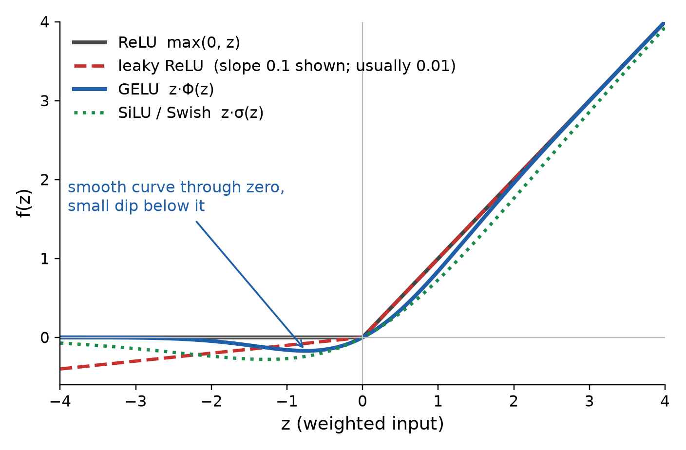
:::
::: {.column width="45%"}
Both are **smooth versions of ReLU**: near zero for negative inputs, near the identity for positive ones, a gentle curve through zero instead of a kink, and a small dip just below zero instead of a hard floor.

- **SiLU** (Swish): $f(z) = z \cdot \sigma(z)$, where $\sigma$ is the sigmoid
- **GELU**: $f(z) = z \cdot \Phi(z)$, where $\Phi$ is the standard normal CDF; numerically very close to SiLU
- Both have a non-zero gradient everywhere, so there is no dead-neuron problem, and the curve is what helped, not an extra straight line
- **Where they live:** GELU in BERT and GPT-2; SiLU in most recent LLMs and modern vision networks
- For a three-layer, 11-unit network on packet features: ReLU, leaky, GELU and SiLU all land within noise of each other. Start with ReLU.
:::
:::

::: {.notes}
One slide so the names are not mysterious. Point at the plot: all four
agree for large positive and large negative z; the difference is what
happens in a window of about two units around zero. GELU and SiLU bend
through it, and dip slightly negative before flattening. The kink in ReLU
is what makes its gradient jump from 0 to 1; the smooth curve gives a
gradient that changes gradually, which turned out to train large
transformers better. This is the answer to "why not leaky": the field
tried removing the dead zone with a second line and it barely helped;
removing the kink with a curve did. For networks the size of the hands-on
it does not matter. Keras 3 accepts activation='gelu' and 'silu' if
anyone wants to try.
:::

## Activation Functions, Plotted

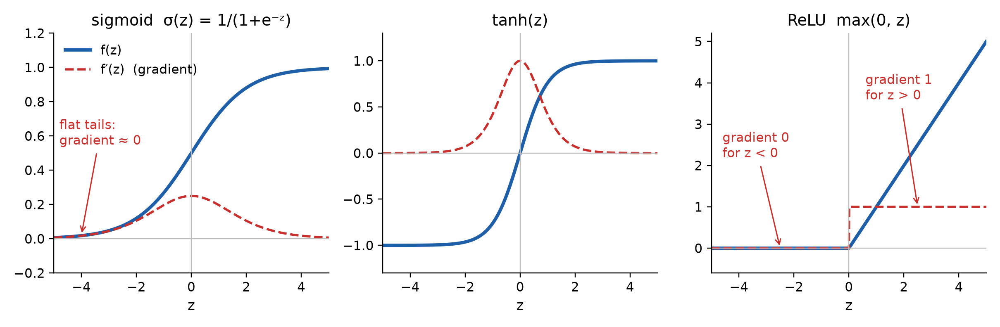

- **Sigmoid** squashes to (0, 1); **tanh** squashes to (−1, 1); both go flat at the extremes, so the gradient there is near zero
- **ReLU** is zero for negative inputs and the identity line $y = x$ for positive ones; the gradient (dashed) is exactly 1 wherever it is on, and 0 where it is off
- The flat tails are the vanishing gradient; ReLU's straight line is why it trains deep stacks

::: {.notes}
Point at the dashed gradient curves: the flat tails on sigmoid and tanh
are where the gradient goes to zero. Then point at the ReLU line and ask the
same question on either side of zero: 1 to the right, 0 to the left, which is
the dying-ReLU caveat from the previous slide.
:::

## Multi-Layer Perceptron (Feedforward Neural Network) {.smaller}

::: {.columns}
::: {.column width="50%"}
Layers of neurons, data flowing **one direction** (input → output):

- **Input layer** — raw features
- **Hidden layers** — learned transformations
- **Output layer** — sigmoid (binary), softmax (multi-class), linear (regression)

The architecture — number of layers, neurons per layer — is a
**design hyperparameter** (not learned).

Each hidden layer multiplies the previous layer's outputs by a weight matrix,
adds a bias vector, and applies the activation element-wise.

*(Equation in the appendix.)*
:::
::: {.column width="50%"}
```{dot}
//| fig-width: 5.6
//| fig-height: 3.6
digraph mlp {
  rankdir=LR; nodesep=0.16; ranksep=1.0; splines=line; newrank=true;
  node [shape=circle, fixedsize=true, width=0.4, fontname="Helvetica", fontsize=11, style=filled, fillcolor="#ffffff", color="#444444"];
  edge [color="#9a9a9a", arrowsize=0.5, penwidth=0.8];
  subgraph cluster_in  { label="input layer\n4 features"; fontname="Helvetica"; fontsize=12; color=none;
    x1 [label="size", fillcolor="#cfe3f5"]; x2 [label="IAT", fillcolor="#cfe3f5"]; x3 [label="pkts/s", fillcolor="#cfe3f5"]; x4 [label="bytes/s", fillcolor="#cfe3f5"]; }
  subgraph cluster_h1  { label="hidden layer 1\nReLU, W¹ is 4×5"; fontname="Helvetica"; fontsize=12; fontcolor="#1f5fa8"; color=none;
    h11 [label=""]; h12 [label=""]; h13 [label=""]; h14 [label=""]; h15 [label=""]; }
  subgraph cluster_h2  { label="hidden layer 2\nReLU, W² is 5×5"; fontname="Helvetica"; fontsize=12; fontcolor="#1f5fa8"; color=none;
    h21 [label=""]; h22 [label=""]; h23 [label=""]; h24 [label=""]; h25 [label=""]; }
  subgraph cluster_out { label="output\nsigmoid, W³ is 5×1"; fontname="Helvetica"; fontsize=12; fontcolor="#1f5fa8"; color=none;
    y [label="attack?", fillcolor="#f8d7c4", width=0.62]; }
  {rank=same; x1 -> x2 -> x3 -> x4 [style=invis];}
  {rank=same; h11 -> h12 -> h13 -> h14 -> h15 [style=invis];}
  {rank=same; h21 -> h22 -> h23 -> h24 -> h25 [style=invis];}
  x1 -> {h11 h12 h13 h14 h15}; x2 -> {h11 h12 h13 h14 h15}; x3 -> {h11 h12 h13 h14 h15}; x4 -> {h11 h12 h13 h14 h15};
  h11 -> {h21 h22 h23 h24 h25}; h12 -> {h21 h22 h23 h24 h25}; h13 -> {h21 h22 h23 h24 h25}; h14 -> {h21 h22 h23 h24 h25}; h15 -> {h21 h22 h23 h24 h25};
  {h21 h22 h23 h24 h25} -> y;
}
```

Every edge is one learned weight: 4·5 + 5·5 + 5·1 = 50 here, plus 11 biases. The book's advice: **start small**, and reuse an architecture proven on a similar task rather than designing from scratch.
:::
:::

::: {.notes}
Walk through the diagram: data flows left to right. Four engineered
traffic features in, two hidden layers of five ReLU units, one sigmoid
output that says attack or not (the shape of the Hands-On 13 network,
which uses 11 units per layer). Each hidden layer is a matrix multiply
followed by element-wise activation; the W and b labels between the
layers are what training learns. Count the edges to make the point that
weights multiply fast. The output
layer configuration (sigmoid vs. softmax vs. linear) is determined by
the task. See *Machine Learning for Networking*, Chapter 5, "Feedforward
Neural Networks" and "Multi-Layer Perceptron."
:::

## Training: Forward and Backward Propagation {.smaller}

::: {.columns}
::: {.column width="50%"}
```{dot}
//| fig-width: 5.2
//| fig-height: 4.3
digraph train {
  rankdir=TB; nodesep=0.3; ranksep=0.35;
  node [shape=box, style="rounded,filled", fontname="Helvetica", fontsize=15, margin="0.12,0.06"];
  edge [fontname="Helvetica", fontsize=11, color="#555555"];
  x   [label="training batch\n(features, labels)", fillcolor="#cfe3f5"];
  net [label="layers: weighted sums\nand activations", fillcolor="#cfe3f5"];
  yh  [label="prediction", fillcolor="#cfe3f5"];
  L   [label="loss: MSE or\ncross-entropy", fillcolor="#f8d7c4"];
  g   [label="chain rule, layer by layer:\ngradient of the loss\nfor every weight", fillcolor="#f2d9a8"];
  u   [label="step each weight\nagainst its gradient\n(learning rate)", fillcolor="#d9efd3"];
  x -> net -> yh -> L [label=""];
  L -> g [label=" backward pass"];
  g -> u;
  u -> net [label=" next batch", constraint=false, style=dashed];
  {rank=same; net; g;}
  {rank=same; yh; u;}
}
```

Forward pass down the left, backward pass up the right; one loop per mini-batch. *(Equations in the appendix.)*
:::
::: {.column width="50%"}
**Mini-batch training:**

- Full-dataset gradient descent: accurate but slow and memory-heavy
- Per-example (stochastic): fast but noisy
- **Mini-batch** (32–128 examples): balance — the default

**Epoch:** one complete pass through all training data.
Networks often need **hundreds or thousands of epochs**.

**Adam optimizer** (adaptive learning rates per parameter) is a
reliable default; avoids hand-tuning the global learning rate.
:::
:::

::: {.notes}
Backpropagation was a key insight that made deep learning feasible:
one backward pass computes gradients for *all* weights simultaneously
via the chain rule. Without it, training even modestly deep networks
would require separate computation for each weight. The mini-batch
framing also ties directly to GPU parallelism. See *Machine Learning
for Networking*, Chapter 5, "Training Neural Networks."
:::

## Backpropagation, Pictured {.smaller}

::: {.columns}
::: {.column width="62%"}
```{dot}
//| fig-width: 6.8
//| fig-height: 2.4
digraph bp {
  rankdir=LR; nodesep=0.5; ranksep=1.0;
  label="blue, solid: forward pass, values flow right          red, dashed: backward pass, gradients flow left"; labelloc=b; fontname="Helvetica"; fontsize=12; fontcolor="#333333";
  node [shape=circle, fixedsize=true, width=0.8, fontname="Helvetica", fontsize=13, style=filled, color="#444444", fillcolor="#ffffff"];
  edge [fontname="Helvetica", fontsize=12];
  x [label="x", fillcolor="#cfe3f5"];
  h [label="h = f(w₁x)", width=1.0];
  y [label="ŷ = g(w₂h)", width=1.0];
  L [label="loss\nL(ŷ, y)", fillcolor="#f8d7c4", width=0.9];
  x -> h [label="w₁", color="#1f5fa8", fontcolor="#1f5fa8", penwidth=2];
  h -> y [label="w₂", color="#1f5fa8", fontcolor="#1f5fa8", penwidth=2];
  y -> L [color="#1f5fa8", penwidth=2];
  L -> y [label="∂L/∂ŷ", color="#c8302e", fontcolor="#c8302e", style=dashed, penwidth=2, constraint=false];
  y -> h [label="· ∂ŷ/∂h", color="#c8302e", fontcolor="#c8302e", style=dashed, penwidth=2, constraint=false];
  h -> x [label="· ∂h/∂x", color="#c8302e", fontcolor="#c8302e", style=dashed, penwidth=2, constraint=false];
}
```

$$\frac{\partial L}{\partial w_1}
 = \underbrace{\frac{\partial L}{\partial \hat y}}_{\text{from the loss}}
 \cdot \underbrace{\frac{\partial \hat y}{\partial h}}_{w_2\, g'}
 \cdot \underbrace{\frac{\partial h}{\partial w_1}}_{x\, f'}$$
:::
::: {.column width="38%"}
**The question** for every weight: *if I nudge this weight, how much does the loss move?*

- **Forward pass** (blue): compute every neuron's value and the loss; remember them
- **Backward pass** (red): start at the loss and walk left, multiplying the local derivative at each hop (the **chain rule**)
- Each layer's gradient reuses the one from the layer to its right, so one sweep gives $\partial L / \partial w$ for **every** weight
- Then every weight steps against its gradient (next slide)
:::
:::

::: {.notes}
This is the slide to draw on the board. One input, one hidden neuron, one
output, one loss: the whole network is a chain, so the derivative of the
loss with respect to the first weight is a product of three local
derivatives. Point at each red edge as you multiply. The thing to land:
the backward pass is cheap because each hop reuses the product so far; you
never differentiate the whole network from scratch for each weight. A real
layer has many neurons, so the products become matrix products (the
appendix has the vector form), but nothing else changes. The f′ factor is
also where vanishing gradients and dying ReLUs live: if f′ is zero or tiny
at a neuron, everything to its left gets no signal.
:::

## Backpropagation, by the Numbers {.smaller}

::: {.columns}
::: {.column width="50%"}
A one-input, one-hidden-unit network with **ReLU** in the middle, a **linear** output, and **squared-error** loss. Target $y = 1$.

**Forward pass** ($x = 2,\ w_1 = 0.5,\ w_2 = -1$):

| step | value |
|---|---|
| $z = w_1 x$ | $0.5 \cdot 2 = 1$ |
| $h = \text{ReLU}(z)$ | $1$ |
| $\hat y = w_2 h$ | $-1$ |
| $L = \tfrac12(\hat y - y)^2$ | $\tfrac12(-2)^2 = 2$ |

**Backward pass** (walk right to left):

| local derivative | value |
|---|---|
| $\partial L / \partial \hat y = \hat y - y$ | $-2$ |
| $\partial \hat y / \partial w_2 = h$ | $1$ |
| $\partial \hat y / \partial h = w_2$ | $-1$ |
| $\partial h / \partial z = \text{ReLU}'(z)$ | $1$ (since $z > 0$) |
| $\partial z / \partial w_1 = x$ | $2$ |
:::
::: {.column width="50%"}
**Chain them:**

$$\frac{\partial L}{\partial w_2} = (-2)(1) = -2$$

$$\frac{\partial L}{\partial w_1} = (-2)(-1)(1)(2) = 4$$

**Update** with learning rate $\eta = 0.1$:

$$w_2 \leftarrow -1 - 0.1(-2) = -0.8 \qquad w_1 \leftarrow 0.5 - 0.1(4) = 0.1$$

**Check:** forward again gives $z = 0.2,\ h = 0.2,\ \hat y = -0.16$, so $L = \tfrac12(1.16)^2 \approx 0.67$. Down from $2$.

- Positive gradient on $w_1$ means *raising* $w_1$ raises the loss, so we lowered it
- Had $z$ been negative, $\text{ReLU}'(z) = 0$ and $w_1$ would not have moved at all: the **dying ReLU** in one line
- A real network does exactly this, for millions of weights, in matrix form
:::
:::

::: {.notes}
Do this one slowly; it is the only place in the course where a gradient is
computed by hand. Forward: multiply, ReLU, multiply, loss. Backward: five
local derivatives, each one line of calculus. Then chain them: dL/dw2 needs
two factors, dL/dw1 needs four. Ask the class why dL/dw1 came out positive
even though the prediction was too low (because w2 is negative, so pushing
h up pushes ŷ down). The ReLU′ row is worth a pause: set x = −2 instead and
the whole w1 gradient is zero, which is the dying-ReLU problem from the
activation slide. Then show the loss actually fell after one step, and say
that an epoch is this, averaged over a mini-batch, repeated for every
batch.
:::

## Gradient Descent, Pictured

::: {.columns}
::: {.column width="55%"}
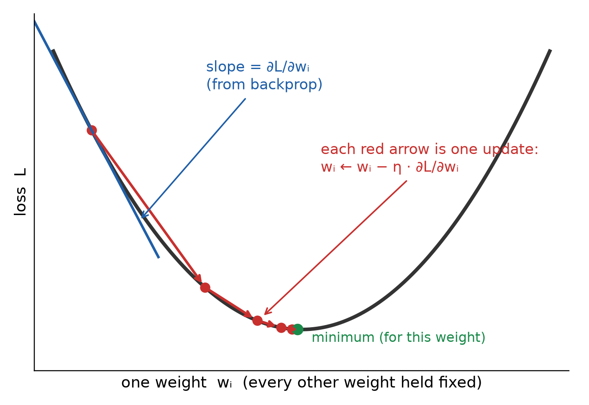
:::
::: {.column width="45%"}
- Fix every weight but one and plot the loss $L$ against that weight $w_i$: a bowl
- The gradient $\partial L / \partial w_i$ is the slope where you stand; step a little way *downhill* and repeat
- Backpropagation is how you get that slope for every weight at once (chain rule)
- A real network has millions of these axes, and the surface is not convex: you find *a* valley, not necessarily *the* valley
:::
:::

::: {.notes}
Walk the picture: start on the left wall, the blue tangent is the slope
backprop computed, each red arrow is one update step, the steps shrink as the
slope does. Then say the honest part out
loud: this bowl is one weight; the real surface has as many dimensions as there
are weights and is full of local minima and saddle points. That is the "does not
assume convexity" caveat from the original slides, and why Adam and mini-batches
matter in practice.
:::

## Challenges in Training Deep Networks {.smaller}

::: {.columns}
::: {.column width="50%"}
**Vanishing gradient:**
Repeated multiplication of small values (saturated sigmoid/tanh)
→ early-layer gradients → 0 → those layers stop learning.

*Solutions:* ReLU activations; batch normalization; residual connections.

**Exploding gradient:**
Repeated multiplication of large values → weight updates → NaN.

*Solutions:* gradient clipping; careful weight initialization.

**Overfitting:**
Millions of parameters memorize the training set.

*Solutions:*
- **Dropout** — randomly zero neurons during training
- **L1/L2 regularization** — penalize large weights
- **Early stopping** — halt when validation loss rises
- More data / data augmentation
:::
::: {.column width="50%"}
**When deep learning is worth it:**

- Large labeled datasets available
- Raw data is hard to featurize manually (raw packets, audio, images)
- Complex, high-dimensional patterns

**When to use simpler models instead:**

- Small datasets
- Interpretability required
- Limited compute
- Domain features are well-understood

*Random forests often match deep learning on tabular data with
clear, hand-crafted features.*
:::
:::

::: {.notes}
This is the "honest" slide. Students often assume deep learning always
wins. The book is explicit: for tabular network features (flow duration,
bytes, packets) with a small dataset, a random forest will frequently
match or beat an MLP with far less effort. See *Machine Learning for
Networking*, Chapter 5, "Challenges in Training Deep Networks" and
"Practical Training Considerations."
:::

## Output Activation and Loss Functions

| Task | Output activation | Loss function |
|---|---|---|
| **Binary classification** | Sigmoid → single neuron | Binary cross-entropy |
| **Multi-class classification** | Softmax → one neuron per class | Categorical cross-entropy |
| **Regression** | None (linear) | Mean squared error |

**Networking examples:**

- Binary: malicious vs. benign traffic
- Multi-class: application identification (HTTP, DNS, TLS, QUIC, P2P…)
- Regression: predict flow size, latency, throughput

::: {.notes}
Output configuration is one of the most common sources of student
confusion. Drill: if I have 5 traffic classes, what's the output layer?
(5 neurons, softmax, categorical cross-entropy.) What if I'm predicting
download throughput? (1 neuron, linear, MSE.) See *Machine Learning for
Networking*, Chapter 5, "Feedforward Neural Networks."
:::

# Representation Learning in Network Traffic {.center}

> The classic ML pipeline requires you to invent features.
> Can we eliminate that bottleneck?

::: {.notes}
Pivot from theory to the networking application of representation
learning. The argument: the classic pipeline (hypothesize → gather
traffic → engineer features → train model) is brittle because feature
engineering is the hardest, most domain-specific step. A common
representation that works across problems would be transformative.
:::

## The Classic ML Pipeline for Traffic Analysis

**Every new problem requires a bespoke pipeline:**

1. **Hypothesize** the problem
2. **Gather** traffic samples
3. **Engineer features** — packet sizes, inter-arrival times, flags, port numbers, …
4. **Preprocess** — normalization, encoding, padding
5. **Train** a model

**Pain point:** Step 3 restarts from scratch for each new task.

- Application identification needs different features than OS fingerprinting
- Malware detection features may not carry over to DDoS detection
- Feature engineering encodes human assumptions that may be wrong

::: {.notes}
This framing motivates nPrint. Draw the pipeline as a flowchart on the
board, then circle "Engineer features" to show where the brittleness
lives. The argument from the nPrint paper: if you had a universal,
normalized, machine-learnable packet representation, you could re-use
it across every downstream task. See the nPrint / nPrintML papers and
slides 14–30 of the source extract.
:::

## Bespoke Solutions: One Pipeline per Problem {.smaller}

<!-- recovered from 13-Deep-Learning.pptx slide 16 -->
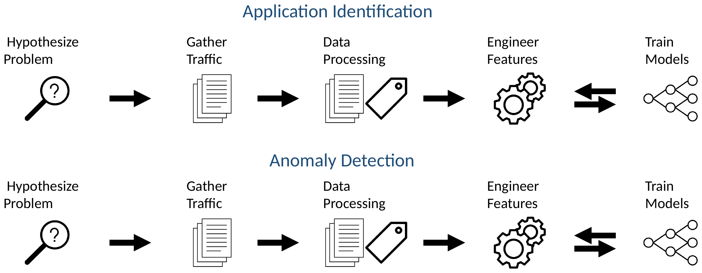{width="85%" fig-align="center"}

- Application identification and anomaly detection each rebuild the **same five steps** from scratch
- Only the first two steps are genuinely problem-specific; data processing, feature engineering, and training are repeated effort
- Every repetition re-encodes a human guess about which features matter

::: {.notes}
This is the original lecture's motivation figure, animated row by row. Read the
top row, then say "now a different problem" and read the bottom row, which is
identical. Ask the room which boxes actually depend on the problem; they will
land on the first two, which sets up the next slide.
:::

## Generalizable Solutions?

<!-- recovered from 13-Deep-Learning.pptx slide 17 -->
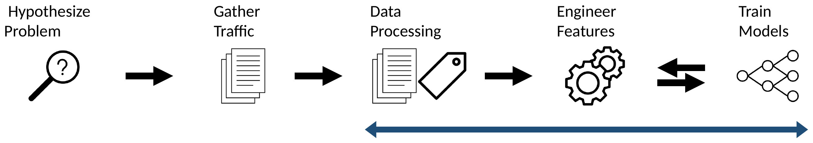

- The bracketed span is what a **standard representation plus automated training** could replace
- Hypothesizing the problem and gathering traffic stay with the analyst
- If data processing, feature engineering, and model training were the same for every problem, a new task would cost only new data

::: {.notes}
Same drawing as the previous slide with the bracket added. The bracket is the
claim: everything from data processing through training can be shared. nPrint
is the shared representation and AutoML is the shared training step, and the
nPrintML figure later closes this loop.
:::

## nPrint: A Universal Packet Representation

**Core idea:** encode every packet as a fixed-length bit vector that
maps each header field to its exact bit position in the protocol.

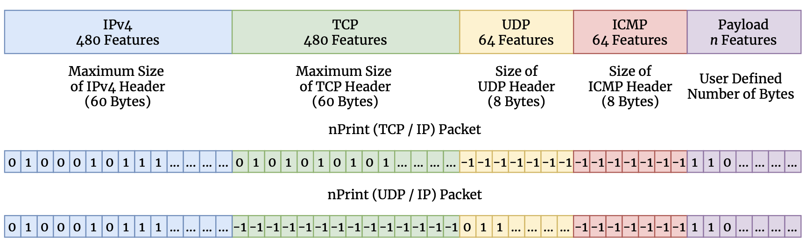

- **Complete** — every bit of every protocol header is represented
- **Constant size** — pad absent fields with −1 (not applicable)
- **Inherently normalized** — binary / ternary values throughout
- **Aligned** — field positions are fixed across packets and protocols

::: {.notes}
nPrint is a hybrid between a semantic representation and a binary one —
best of both worlds. The diagram shows how IPv4 headers become 480
features, TCP headers 480 features, UDP 64, ICMP 64, plus user-defined
payload bytes. Absent fields (e.g., UDP fields in an IPv4/TCP packet)
are encoded as −1. This is a crucial design choice: −1 ≠ 0 (field is
absent vs. field is set to zero). See Holland et al., "New Directions in
Automated Traffic Analysis," CCS 2021, and the nPrint source extract.
:::

## nPrint Enables Interpretable Features {.smaller}

Because nPrint positions each feature at a **fixed protocol field offset**,
a trained model's learned feature importances map directly back to header semantics.

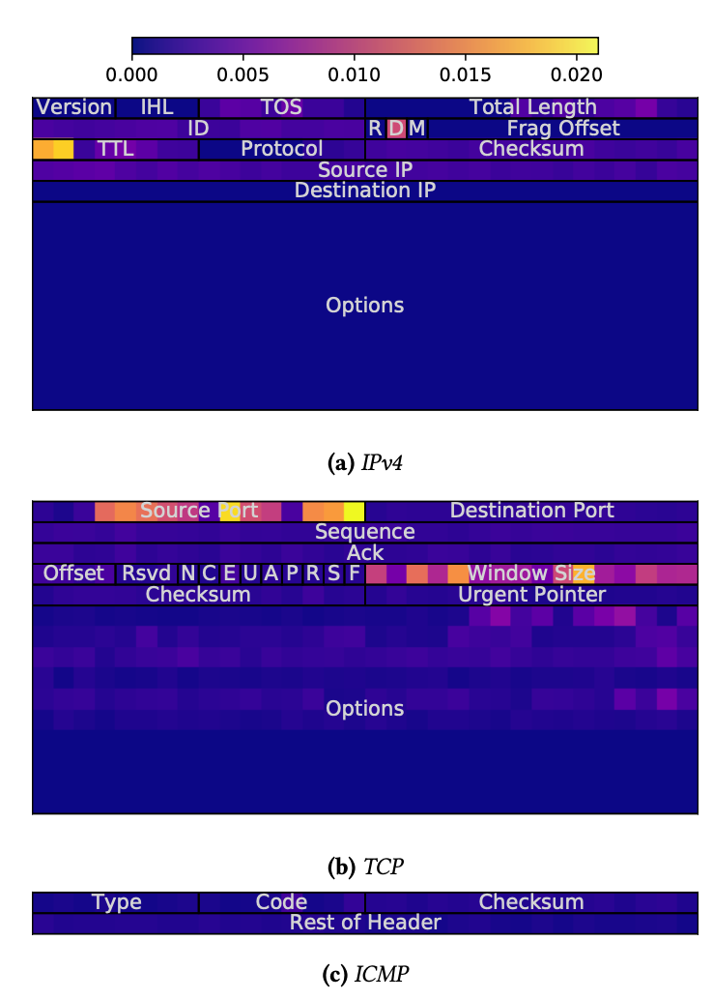

The model **automatically discovers** that:

- IP **TTL** distinguishes OS families
- TCP **window size** and **options** fingerprint operating systems
- **Source port ranges** separate IoT devices from routers

::: {.notes}
This is one of the most compelling results from the nPrint paper: you
don't just get a black-box classifier — you get interpretable feature
importances that align with what network engineers already know (TTL ≈
OS fingerprint) plus things they didn't know (which TCP option bits
matter). Show the heatmap and ask: "What does a bright cell mean?"
(That feature bit has high importance for the classification task.)
See Holland et al., CCS 2021.
:::

## nPrintML in One Picture

<!-- recovered from 13-Deep-Learning.pptx slide 25 -->
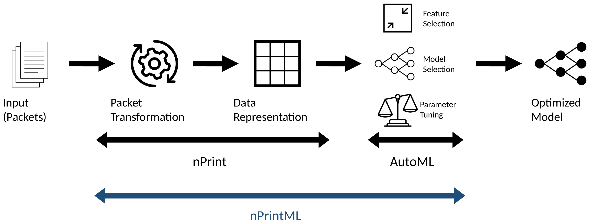{width="82%" fig-align="center"}

- **nPrint** covers the left half: transform packets, emit the fixed-size representation
- **AutoML** covers the right half: pick features, pick a model class, tune its parameters
- Together they are the bracketed span from the "Generalizable Solutions?" slide, now filled in

::: {.notes}
Point back to the bracket on the generalizable-solutions slide and show that the
two black spans here are exactly that bracket, split into representation and
training. The only input is packets; the only output is a model. That is the
whole pitch of nPrintML.
:::

## nPrintML: Combining nPrint with AutoML {.smaller}

::: {.columns}
::: {.column width="55%"}
**nPrintML pipeline:**

1. **nPrint** transforms raw packets into fixed-size feature vectors
2. **AutoML** (AutoGluon) handles:
   - Model selection across 7 classes (RF, DNN, k-NN, …)
   - Hyperparameter search
   - Model ensembling

**Key result:** same representation, same pipeline, across
**many different traffic classification tasks** — no per-task
feature engineering.

Problems addressed:
- Active device fingerprinting
- Passive OS detection
- Malware detection
- Application & video service identification
- Country of origin detection
:::
::: {.column width="45%"}
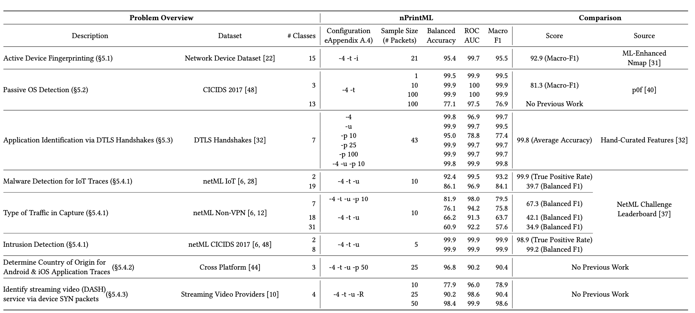

nPrintML achieves results **competitive with task-specific, hand-engineered**
feature pipelines — sometimes exceeding them.
:::
:::

::: {.notes}
AutoGluon's model ensembling achieves higher performance than other AutoML
techniques. The table (s28-i39) shows accuracy / F1 across active device
fingerprinting, passive OS detection, malware detection, application
identification, video service identification, and country-of-origin
detection — all from the same nPrint representation. Walk through a few
rows and highlight where nPrintML matches or exceeds prior bespoke work.
See Holland et al., CCS 2021, and the nPrint/nPrintML GitHub.
:::

# Convolutional Neural Networks {.center}

> CNNs were built for images. For networking, they're built for
> **sequences of packets**.

::: {.notes}
Transition to CNNs. The key motivation: MLPs treat all features as
exchangeable — there's no notion of "these two features are neighbors."
But in a sequence of packets, adjacent packets are more related than
distant ones. CNNs exploit that spatial / sequential locality. See
*Machine Learning for Networking*, Chapter 5, "Convolutional Neural
Networks."
:::

## Convolution as a Weighted Average

<!-- recovered from 13-Deep-Learning.pptx slide 32 -->
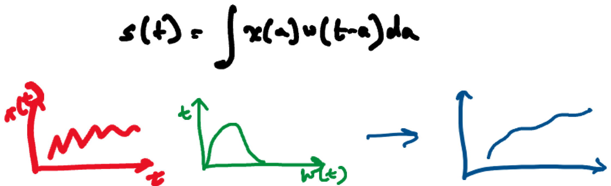

- $s(t) = \int x(a)\,w(t-a)\,da$: slide the kernel $w$ along the input $x$ and take a weighted average at each position
- A hump-shaped kernel smooths: the noisy red signal becomes the smooth blue one
- A CNN **learns** the kernel weights instead of fixing them, so the "smoothing" becomes "pattern detection"

::: {.notes}
Hand-drawn in the original lecture. Before any neural-network vocabulary, show
that convolution is just a sliding weighted average from signal processing. The
only new idea in a CNN is that the weights in the kernel are learned. Then move
to the next slide for the filter and feature-map terminology.
:::

## How Convolutions Work

**Core operation:** a small matrix of **learned weights** (a *filter*
or *kernel*) slides across the input, computing a dot product at each
position.

- Each filter detects a **local pattern** — a specific byte sequence,
  a sudden size spike, a flag combination
- **Parameter sharing**: the same filter weights are applied everywhere
  → far fewer parameters than a fully connected layer
- Multiple filters → multiple **feature maps**, each detecting a different pattern

**For 1D data** (packet sequences): the filter slides along the packet axis.

**Pooling layers:** after convolution, **max pooling** downsamples by
selecting the largest value in each window — reduces dimensions, adds
translational invariance.

::: {.notes}
Draw the 1D case on the board: a sequence of packet-size values, a
small filter sliding over it, producing an output that highlights
"spikes." Then show how max pooling compresses the output. The key
insight is parameter sharing: the filter that detects "SYN burst" is
the same weights applied to every position, not a separate set of
weights per position. See *Machine Learning for Networking*, Chapter 5,
"How Convolutions Work."
:::

## A Convolution Layer, by the Numbers

<!-- recovered from 13-Deep-Learning.pptx slide 36 -->
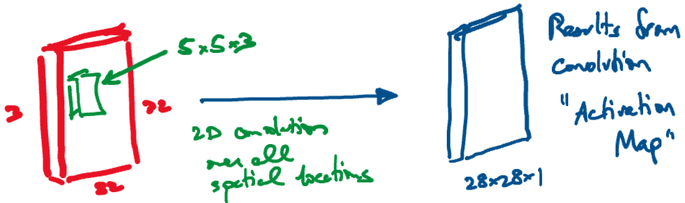

- Input: a 32 × 32 image with 3 color channels; filter: 5 × 5 × 3, matching the channel depth
- Sliding the filter over every spatial position gives a 28 × 28 × 1 **activation map** (32 − 5 + 1 = 28)
- One filter, one map; $k$ filters stack into a 28 × 28 × $k$ tensor for the next layer
- Same arithmetic in 1D: a length-$N$ packet sequence and a width-$m$ filter give $N - m + 1$ outputs

::: {.notes}
Hand-drawn in the original lecture. Do the arithmetic on the board: 32 minus 5
plus 1 is 28. Then translate to networking: replace the image with a sequence of
nPrint rows and the 5 by 5 window with a window of a few consecutive packets.
:::

## Max Pooling, by Example

::: {.columns}
::: {.column width="55%"}
<!-- recovered from 13-Deep-Learning.pptx slide 37 -->
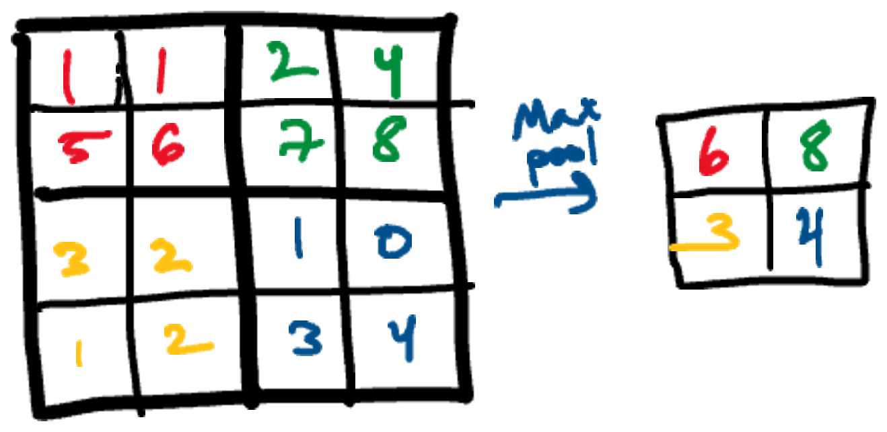
:::
::: {.column width="45%"}
- Each 2 × 2 colored block sends only its **largest** value forward: 6, 8, 3, 4
- The output is a quarter the size, which cuts parameters downstream
- Small shifts in where a pattern sits no longer change the output: **translational invariance**
- Think of it as zooming out of the image
:::
:::

::: {.notes}
Hand-drawn in the original lecture. Ask the room to read off the four maxima
before you reveal them. Then ask what happens if the 8 moves one cell to the
left: nothing, which is the invariance point.
:::

## CNN Architecture: Layers and Hierarchy {.smaller}

::: {.columns}
::: {.column width="55%"}
**Typical CNN structure (from input to output):**

1. **Convolution + ReLU** — detect local patterns
2. **Max pooling** — reduce dimensions, spatial invariance
3. Repeat multiple times → **hierarchy of representations**
4. **Flatten** — convert feature maps to a vector
5. **Fully connected layers** — combine learned features
6. **Output layer** — classification / regression

**Early layers** → simple patterns (edges, short byte runs)

**Deeper layers** → complex patterns (multi-packet behaviors, protocol sequences)

Also common:

- **Dropout** after pooling — reduce overfitting
- **Batch normalization** — stabilize gradients
:::
::: {.column width="45%"}
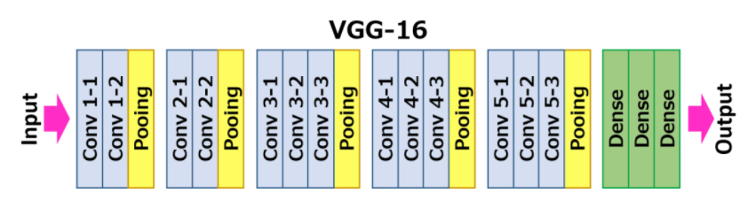

VGG-16 (image classification) illustrates the principle: repeated
conv+pool blocks build progressively more abstract representations.

The same pattern applies to 1D CNNs for packet sequences.
:::
:::

::: {.notes}
VGG-16 is a computer-vision benchmark, but it illustrates the design
pattern perfectly: multiple conv blocks, each followed by pooling, then
fully connected layers at the top. For networking, the input is 1D
(sequence of packets or bytes) and 1D convolutions slide along the
packet/time axis. The hierarchy is the same: early filters detect local
byte patterns, later filters detect multi-packet behavioral signatures.
See *Machine Learning for Networking*, Chapter 5, "Convolutional Neural
Networks" and the VGG-16 figure in the source extract (s39-i42/43).
:::

## CNNs for Network Traffic {.smaller}

CNNs exploit the **sequential structure of network data**:

- Two packets arriving in sequence are more related than packets far apart in time
- CNNs learn this locality automatically — no manual feature design
- **1D CNNs** (filter slides along packet or byte axis) are standard for flows

**Advantages over MLPs for sequences:**

- **Far fewer parameters** (parameter sharing) → less overfitting risk
- Detects the same pattern regardless of **position in sequence**
- Works with variable-length inputs (via pooling / global average pooling)

::: {.partition}
<svg viewBox="0 0 900 190" xmlns="http://www.w3.org/2000/svg" font-family="Helvetica, Arial, sans-serif" style="width:100%; display:block; margin:0 auto;">
  <g font-size="17" text-anchor="middle" fill="#333">
    <rect x="20" y="40" width="80" height="44" fill="#cfe3f5" stroke="#555"/><text x="60" y="68">pkt 1</text>
    <rect x="120" y="40" width="80" height="44" fill="#cfe3f5" stroke="#555"/><text x="160" y="68">pkt 2</text>
    <rect x="220" y="40" width="80" height="44" fill="#cfe3f5" stroke="#555"/><text x="260" y="68">pkt 3</text>
    <rect x="320" y="40" width="80" height="44" fill="#cfe3f5" stroke="#555"/><text x="360" y="68">pkt 4</text>
    <rect x="420" y="40" width="80" height="44" fill="#cfe3f5" stroke="#555"/><text x="460" y="68">pkt 5</text>
    <rect x="520" y="40" width="80" height="44" fill="#cfe3f5" stroke="#555"/><text x="560" y="68">pkt 6</text>
    <rect x="620" y="40" width="80" height="44" fill="#cfe3f5" stroke="#555"/><text x="660" y="68">pkt 7</text>
    <rect x="720" y="40" width="80" height="44" fill="#cfe3f5" stroke="#555"/><text x="760" y="68">…</text>
  </g>
  <rect x="210" y="28" width="300" height="68" fill="none" stroke="#b91c1c" stroke-width="3" stroke-dasharray="8,5"/>
  <text x="360" y="20" font-size="16" fill="#b91c1c" text-anchor="middle">one filter, three packets wide, the same weights at every position</text>
  <path d="M560 112 L660 112" stroke="#b91c1c" stroke-width="2" fill="none" marker-end="url(#arr)"/>
  <text x="760" y="117" font-size="15" fill="#777" text-anchor="middle">slides along the packets</text>
  <defs><marker id="arr" markerWidth="10" markerHeight="10" refX="8" refY="5" orient="auto"><path d="M0,0 L10,5 L0,10 z" fill="#b91c1c"/></marker></defs>
  <path d="M360 96 L360 130" stroke="#555" stroke-width="2" fill="none" marker-end="url(#arr2)"/>
  <defs><marker id="arr2" markerWidth="10" markerHeight="10" refX="8" refY="5" orient="auto"><path d="M0,0 L10,5 L0,10 z" fill="#555"/></marker></defs>
  <rect x="200" y="136" width="320" height="44" rx="10" fill="#d9efd3" stroke="#555"/>
  <text x="360" y="163" font-size="16" fill="#333" text-anchor="middle">one feature-map value: did the pattern occur here?</text>
</svg>
:::


::: {.notes}
The figure is the whole idea in one row: a filter of fixed width (here three packets) multiplies its weights against each window of the sequence and writes one number per position; the same weights are reused at every position, which is parameter sharing, and the pattern is found wherever it occurs, which is position invariance. The nPrint representation feeds naturally into 1D CNNs: each packet
is a row of bits (1088+ features), and a sequence of packets forms a 2D
array. A 1D CNN sliding across the packet dimension detects patterns
that span multiple consecutive packets. The book cites Wang et al. 2017,
Lotfollahi et al. 2020, and Holland et al. 2021 (nPrint) as key
networking CNN papers. See *Machine Learning for Networking*, Chapter 5,
"CNNs for Network Traffic."
:::

## Recurrent Neural Networks and LSTMs {.smaller}

**For variable-length sequences with long-range dependencies:**

::: {.columns}
::: {.column width="50%"}
**RNN basic idea:**
Process one timestep at a time; maintain a **hidden state** that
carries information forward.

**Problem:** vanilla RNNs suffer from **vanishing gradients** over
long sequences — they forget early context.

**LSTM solution:** gating mechanism with a dedicated **cell state**:

- **Forget gate** — what to discard
- **Input gate** — what new info to write
- **Output gate** — what to expose as output

**GRU** (Gated Recurrent Unit): simpler, fewer parameters, similar
performance to LSTM in most cases.
:::
::: {.column width="50%"}
```{dot}
//| fig-width: 5.2
//| fig-height: 3.1
digraph rnn {
  rankdir=TB; nodesep=0.3; ranksep=0.35;
  node [shape=box, style="rounded,filled", fontname="Helvetica", fontsize=15, margin="0.12,0.06"];
  edge [fontname="Helvetica", fontsize=12, color="#555555"];
  x1 [label="pkt 1", fillcolor="#cfe3f5"]; x2 [label="pkt 2", fillcolor="#cfe3f5"]; x3 [label="pkt 3", fillcolor="#cfe3f5"]; x4 [label="…", fillcolor="#cfe3f5"];
  h1 [label="state", fillcolor="#f2d9a8"]; h2 [label="state", fillcolor="#f2d9a8"]; h3 [label="state", fillcolor="#f2d9a8"]; h4 [label="state", fillcolor="#f2d9a8"];
  y [label="output: class,\nor the next value", fillcolor="#d9efd3"];
  x1 -> h1; x2 -> h2; x3 -> h3; x4 -> h4;
  h1 -> h2 -> h3 -> h4 [penwidth=2.5, color="#b91c1c"];
  h4 -> y;
  {rank=same; x1; x2; x3; x4;} {rank=same; h1; h2; h3; h4;}
}
```

One cell, unrolled: each step reads a packet and the state so far; LSTM gates decide what the state forgets, writes, and exposes. **Uses:** flow-volume prediction, time-series anomalies, variable-length sequences. Largely supplanted by transformers (Chapter 7).
:::
:::

::: {.notes}
LSTMs were the dominant sequence model for 2014–2020 in networking.
The key insight vs. CNNs: RNNs can model dependencies across the entire
sequence, not just within a local window. For network time-series
(per-minute byte counts over days), an LSTM can learn daily periodicities
that a short CNN filter would miss. The book notes that LSTMs are now
largely superseded by transformers / foundation models, but they remain
important conceptually and for lightweight deployments. See *Machine
Learning for Networking*, Chapter 5, "LSTM and GRU Architectures."
:::

# Current Events {.center}

> Deep learning is now embedded in production network security systems —
> not just research benchmarks.

## Vignette: Hybrid Attention-CNN-LSTM for Intrusion Detection (2025)

::: {.vignette}
A July 2025 paper in *Scientific Reports* (Nature) — "Deep learning for
network security: an Attention-CNN-LSTM model for accurate intrusion
detection" — proposes a hybrid architecture combining **CNN** (spatial
feature extraction), **LSTM** (temporal sequence modeling), and a
**self-attention layer** (highlighting informative features). Evaluated
on Bot-IoT and NSL-KDD benchmarks, it achieves **97.5% accuracy on
Bot-IoT** and **94.8% on NSL-KDD**, with real-time inference at
**sub-35 ms latency** — fast enough for inline deployment.
The paper is open-access at
[doi:10.1038/s41598-025-07706-y](https://www.nature.com/articles/s41598-025-07706-y).
:::

**Teaching points:**

- Real production systems **combine CNN + RNN + attention** rather than using a single architecture
- Accuracy gains from deep learning must be weighed against **latency and compute costs**
- The self-attention layer mirrors ideas from transformer models — a preview of
  foundation models (see Chapter 7 of the book)

::: {.notes}
This is a verified 2025 paper (July 1, 2025, Scientific Reports, open access).
The architecture is a good synthesis of everything from this lecture:
convolution for local feature extraction, LSTM for temporal context,
attention for global feature salience. Cold-call: "Why would you add an
attention layer on top of CNN+LSTM?" (Lets the model learn which timesteps
or features to focus on, regardless of sequence position.) The 35ms latency
result is what makes it deployable inline; purely batch-mode deep learning
systems have appeared in research for years but rarely hit this target.
:::

## Deep Learning vs. Simpler Models: When to Use Which

::: {.columns}
::: {.column width="50%"}
**Prefer deep learning when:**

- Large labeled data (thousands to millions of flows)
- Raw inputs: packets, payload bytes, images
- Simpler models have hit their ceiling
- GPU compute is available

**Prefer a forest, SVM, or logistic regression when:**

- Small or medium data
- Interpretability is required (regulatory, forensics)
- Latency or compute is constrained (edge, IoT)
- The features are already well understood
:::
::: {.column width="50%"}
**Practical strategy:**

1. A **random forest** baseline on hand-crafted features
2. Not enough? An **MLP** on the same features
3. Raw data available? A **1D CNN** on packet sequences (nPrint)
4. Temporal context? Add an **LSTM** or attention
5. Watch **training vs. validation loss** throughout

*Deep learning is not always the right tool, and the book says so.*
:::
:::

::: {.notes}
This slide is the practical synthesis. It directly mirrors the advice in
*Machine Learning for Networking*, Chapter 5: "Deep learning is not always
the best solution. It tends to excel when large amounts of training data are
available... Traditional ML methods may be preferable when datasets are small,
interpretability is critical, or domain features are well understood." Use the
nPrintML result as evidence: even with a universal deep-learning-friendly
representation, AutoGluon often picks a random forest over a DNN for
smaller datasets.
:::

## Case Study: DDoS Detection for Consumer IoT {.smaller}

Doshi, Apthorpe, Feamster, "Machine Learning DDoS Detection for Consumer Internet of Things Devices," IEEE S&P Workshops (DLS) 2018

::: {.columns}
::: {.column width="52%"}
```{dot}
//| fig-width: 5.4
//| fig-height: 4.2
digraph ddos {
  rankdir=TB; nodesep=0.25; ranksep=0.3;
  node [shape=box, style="rounded,filled", fontname="Helvetica", fontsize=14, margin="0.1,0.05"];
  edge [fontname="Helvetica", fontsize=10, color="#555555"];
  cap [label="capture at the home router\nIPs, ports, protocol, size, time", fillcolor="#cfe3f5"];
  dev [label="split by device (source IP),\nthen into 10-second bins", fillcolor="#cfe3f5"];
  sl  [label="stateless, per packet:\nsize, inter-arrival ΔT and its\nderivatives, protocol one-hot", fillcolor="#f2d9a8"];
  st  [label="stateful, per bin:\nbandwidth, distinct destinations,\nchange in distinct destinations", fillcolor="#f2d9a8"];
  clf [label="binary classifier:\nk-NN, SVM, tree, forest, or neural net", fillcolor="#f8d7c4"];
  out [label="attack  or  normal", fillcolor="#d9efd3"];
  cap -> dev; dev -> sl; dev -> st; sl -> clf; st -> clf; clf -> out;
  {rank=same; sl; st;}
}
```
:::
::: {.column width="48%"}
**Data**

- Normal traffic: WeMo smart switch, YI home camera, Android phone
- Attack traffic: Mirai-style **TCP SYN flood, UDP flood, HTTP GET flood**
- 491,855 packets (459,565 attack / 32,290 benign), 85/15 train–test split

**Classifiers compared**

k-NN · linear SVM · decision tree · random forest · 4-layer neural net
:::
:::

::: {.notes}
This is the hands-on you are about to do. The feature design is driven by domain knowledge about IoT devices: they talk to a small, fixed set of endpoints and send at regular intervals, so a flood shows up as tiny packets, near-zero inter-arrival times, and a jump in destination count. Every feature is derivable from flow-level headers — no payload inspection — so the whole thing can run on a home gateway. Note the class imbalance (about 14:1 attack to benign): always-predict-attack already gets 0.93 accuracy, so look at per-class F1, not just accuracy.
:::

## Result: You Often Don't Need Deep Learning

::: {.columns}
::: {.column width="50%"}
**Test-set performance (all features)**

| | k-NN | LSVM | DT | RF | NN |
|---|---|---|---|---|---|
| Accuracy | 0.999 | 0.991 | 0.999 | 0.999 | 0.999 |
| F1 (normal) | 0.995 | 0.927 | 0.994 | 0.998 | 0.986 |
| F1 (attack) | 0.999 | 0.995 | 0.996 | 0.999 | 0.999 |

**Stateless features only, F1 (normal):** k-NN 0.967 · LSVM 0.920 · DT 0.977 · RF 0.981 · NN 0.939

Top Gini importance: packet size (0.51), then protocol flags and ΔT.
:::
::: {.column width="50%"}
**Takeaways**

- **Simple stateless features suffice:** packet size alone carries most of the signal
- **Tree ensembles and k-NN match the DNN** at a fraction of the training and inference cost — and run on a router
- Only the *linear* SVM lags: the problem is non-linear, but only mildly so
- **DNNs earn their keep** when features are unknown (raw bytes, nPrint) or interactions are genuinely non-linear and data is plentiful

*Start with the random-forest baseline; reach for deep learning when it is beaten.*
:::
:::

::: {.notes}
This is the hands-on you are about to do; spoiler: RF ≈ NN. Numbers are from Tables I and III of the paper (arXiv:1804.04159). Point out that the "wrong" way to read the table is "everything is 0.99, so it doesn't matter" — the F1 on the minority (normal) class is where the models separate, and the random forest is best there. Connect back to the previous slide's practical strategy: the paper is a worked example of step 1 (RF baseline on hand-crafted features) being good enough. Also connect forward: the paper's own future-work section says deep learning should help for subtler attacks than floods, with more data — which is exactly the regime where nPrint-style representations matter.
:::

## Summary {.smaller}

::: {.columns}
::: {.column width="55%"}
**Deep learning = representation learning through layers:**

- **Neuron:** weighted linear combination + non-linear activation
- **MLP:** stacked layers, forward pass + backpropagation
- **CNN:** local pattern detection via parameter sharing; ideal for sequences
- **LSTM/GRU:** gated memory for variable-length sequences

**Training essentials:**
- ReLU activations avoid vanishing gradients in hidden layers
- Mini-batch gradient descent + Adam optimizer are reliable defaults
- Dropout, early stopping, and weight decay prevent overfitting

**For networking specifically:**
- nPrint / nPrintML removes feature-engineering bottleneck
- 1D CNNs exploit packet-sequence locality
- Hybrid CNN+LSTM+attention matches task-specific pipelines
:::
::: {.column width="45%"}
**Key tradeoffs:**

| Dimension | Deep Learning | Simpler Models |
|---|---|---|
| Data need | High | Low/medium |
| Compute | High | Low |
| Interpretability | Low | High |
| Feature engineering | Minimal | Required |
| Performance ceiling | High | Moderate |

**Next:** Unsupervised methods — clustering and dimensionality reduction
when labels are absent.

See *Machine Learning for Networking*, Chapter 5, "Deep Learning" section.
:::
:::

::: {.notes}
Close by reinforcing the design checklist from the "When to use which"
slide. The summary table gives students a quick reference for the exam.
Reiterate the book pointer: Chapter 5 has activities for training an MLP
on IoT attack traffic and comparing to simpler models. The nPrint/nPrintML
case study is the cleanest example in the course of representation learning
solving a real systems problem at scale.
:::

# Appendix: The Math {.center}

## The Neuron, Formally

**A single neuron** computes a weighted sum of its inputs, adds a bias, and applies
an activation function:

$$\text{output} = f\!\left(\sum_{i} w_i x_i + b\right)$$

- $x_i$ — input features; $w_i$ — learned weights; $b$ — bias; $f(\cdot)$ — activation
- With $f = \sigma$ (sigmoid) this is exactly logistic regression

**A layer** applies many neurons at once. Writing the weights of layer $l$ as a matrix
$\mathbf{W}^{(l)}$ and the biases as a vector $\mathbf{b}^{(l)}$, the layer's output is

$$\mathbf{h}^{(l)} = f\!\left(\mathbf{W}^{(l)}\mathbf{h}^{(l-1)} + \mathbf{b}^{(l)}\right), \qquad \mathbf{h}^{(0)} = \mathbf{x}$$

with $f$ applied element-wise. A network with $L$ layers is the composition
$\mathbf{h}^{(L)} = f(\mathbf{W}^{(L)} f(\mathbf{W}^{(L-1)} \cdots f(\mathbf{W}^{(1)}\mathbf{x} + \mathbf{b}^{(1)}) \cdots + \mathbf{b}^{(L-1)}) + \mathbf{b}^{(L)})$.

::: {.notes}
Companion to "The Artificial Neuron" and "Multi-Layer Perceptron" slides. The
composition form is the reason non-linear activations matter: with $f$ the identity,
the whole stack collapses to a single matrix $\mathbf{W}^{(L)} \cdots \mathbf{W}^{(1)}$
and one bias, i.e. a linear model. See *Machine Learning for Networking*, Chapter 5,
"Artificial Neuron" and "Multi-Layer Perceptron."
:::

## Gradient Descent and Backpropagation {.smaller}

**Gradient descent.** After each mini-batch, every weight moves a small step against
the gradient of the loss $\mathcal{L}$:

$$w \leftarrow w - \eta \cdot \frac{\partial \mathcal{L}}{\partial w}$$

$\eta$ is the learning rate. Adam replaces the single global $\eta$ with a per-parameter
step size adapted from running gradient moments.

**Backpropagation** computes $\partial \mathcal{L} / \partial w$ for *every* weight in
one backward pass by applying the chain rule layer by layer. With pre-activation
$\mathbf{z}^{(l)} = \mathbf{W}^{(l)}\mathbf{h}^{(l-1)} + \mathbf{b}^{(l)}$ and
$\boldsymbol{\delta}^{(l)} = \partial \mathcal{L} / \partial \mathbf{z}^{(l)}$:

$$\boldsymbol{\delta}^{(l)} = \left(\mathbf{W}^{(l+1)\top} \boldsymbol{\delta}^{(l+1)}\right) \odot f'\!\left(\mathbf{z}^{(l)}\right),
\qquad
\frac{\partial \mathcal{L}}{\partial \mathbf{W}^{(l)}} = \boldsymbol{\delta}^{(l)} \left(\mathbf{h}^{(l-1)}\right)^{\top},
\qquad
\frac{\partial \mathcal{L}}{\partial \mathbf{b}^{(l)}} = \boldsymbol{\delta}^{(l)}$$

The error signal $\boldsymbol{\delta}$ starts at the output layer (from the loss) and
is passed backward; each layer reuses the next layer's $\boldsymbol{\delta}$ rather
than recomputing from scratch.

::: {.notes}
Companion to "Training: Forward and Backward Propagation." Backpropagation was a key
insight that made deep learning feasible: one backward pass computes gradients for
*all* weights simultaneously via the chain rule. Without it, training even modestly
deep networks would require separate computation for each weight. The mini-batch
framing also ties directly to GPU parallelism. The $f'(\mathbf{z}^{(l)})$ factor in
the recursion is where vanishing gradients come from: for a saturated sigmoid it is
near zero, and the product of many such factors shrinks the early-layer gradient to
nothing; ReLU's derivative is exactly 1 for positive inputs. See *Machine Learning
for Networking*, Chapter 5, "Training Neural Networks."
:::
