# Why Synthetic Network Data? {.center}

> Labeled network data is **scarce**. Generative models let us learn from what we have
> and produce realistic synthetic examples.

```{=html}
<style>
.reveal .cell-output-display svg { width: 100%; height: auto; }
.reveal .caption { font-size: 0.55em; color: #555555; margin-top: 0.2em; }
</style>
```

::: {.notes}
Open with the central tension: ML for networking needs labeled data, but labeled
network data is expensive to collect, privacy-sensitive, and often missing rare events
like attacks. This lecture asks whether generative models — and diffusion models in
particular — can close that gap. See the "Generative Models" chapter (Chapter 7) of
the course textbook.
:::

## Network Trace Datasets: What and Why

::: {.columns}
::: {.column width="60%"}
<!-- recovered from docs/slides/17-Diffusion.pptx slide 2 -->
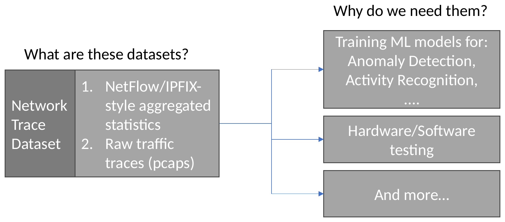
:::
::: {.column width="40%"}
- A **trace dataset** is either aggregated flow records (NetFlow/IPFIX) or
  raw packet captures (pcap)
- The same dataset feeds several consumers: ML training for anomaly
  detection and activity recognition, hardware and software testing, and more
- Each consumer wants something different from the data, which is why
  synthetic generation must get the *format* right, not just the statistics
:::
:::

::: {.notes}
Recovered from the original pptx (slide 2), where the boxes and arrows built
one by one. Walk it left to right: first the two kinds of dataset, then the
arrows to the three consumers. The point to land is that "a dataset" means
different things to a classifier and to a device under test; the next slide
explains why both kinds are scarce.
:::

## The Network Data Problem

::: {.columns}
::: {.column width="50%"}
Network trace datasets fall into two types:

- **Flow-level statistics** (NetFlow/IPFIX) — duration, byte counts, packet counts
- **Raw packet captures** (pcap / tcpdump) — full headers and payload

Both types are needed for downstream tasks:

- Training ML models for anomaly detection and traffic classification
- Hardware and software testing
- Protocol interoperability validation
:::
::: {.column width="50%"}
**Why are datasets scarce?**

- **Privacy / confidentiality** — real traffic reveals user behavior
- **Labels** — ground truth is hard to get; labeling and alignment errors
- **Collection** — continuous infrastructure is costly, and captures are lossy
- **Rare events** — attacks and failures are under-represented by definition;
  the capture may not contain the event you want
- **Staleness** — traffic and protocols drift; an old trace is not the current network
:::
:::

::: {.notes}
See the "Generative Models" chapter introduction. Ask students: what are the risks of
sharing a pcap from a corporate network? Name three specific classes of sensitive
information that could be inferred. The scarcity argument sets up *why* we need
synthetic generation before we can explain *how* to do it. Sommer & Paxson (2010)
argued that ML does not work well outside the training distribution, and labeled
network data is almost always narrow in coverage: operators do not share pcaps,
rare events are rare, and labeling flows at scale is expensive.
:::

## What Synthetic Data Buys Us

- **Traffic augmentation** — synthesize rare classes; lift minority-class accuracy
- **Simulation and testing** — exercise simulators, devices, and protocols without a live capture
- **Privacy-preserving sharing** — keep the statistics, drop the real users
- **What-if (counterfactual) analysis** — the open dream: "here is my traffic; make it look like
  I added a front end, or upgraded to 4K"
- **Zero-day and never-seen events** are the same idea: attack patterns or protocol variants
  not yet in any capture

```{dot}
//| fig-width: 12.4
//| fig-height: 2.7
digraph uses {
  rankdir=LR; nodesep=0.12; ranksep=0.55; bgcolor="transparent";
  node [shape=box, style="filled,rounded", fontname="Helvetica", fontsize=18, color="#555555", penwidth=1.3, margin="0.14,0.07"];
  edge [color="#555555", penwidth=1.4];
  real [label="a few real traces\n(scarce, sensitive)", fillcolor="#cfe3f5"];
  gen  [label="generative model\n(GAN, diffusion, SSM)", fillcolor="#f2d9a8"];
  syn  [label="unlimited synthetic traces\n(no real user inside)", fillcolor="#d9efd3"];
  a [label="augment rare classes", fillcolor="#eeeeee"];
  b [label="simulate and test devices", fillcolor="#eeeeee"];
  c [label="share without leaking users", fillcolor="#eeeeee"];
  d [label="what-if: unseen attacks,\ncounterfactual traffic", fillcolor="#eeeeee"];
  real -> gen -> syn; syn -> a; syn -> b; syn -> c; syn -> d;
}
```

::: {.notes}
These use cases come from the Chapter 7 motivation. Stress that each
use case has different fidelity requirements: a simulator test needs protocol-valid
packets; a class-balancing augmentation needs statistically realistic features but
not necessarily bit-perfect headers. The what-if use is the one nobody has
delivered yet: a model that takes your traffic and returns what it would look like
after a change you have not made. Zero-day traffic is the same request with an
attack instead of an upgrade.
:::

## What Should We Generate?

::: {.columns}
::: {.column width="52%"}
**Candidates, from most to least detailed:**

- **Packet captures** (pcap) — headers, timing, payload; what Wireshark and a
  device under test consume
- **Flow records** (NetFlow/IPFIX) — one row per flow; what the early GAN work
  (DoppelGANger, NetShare) generated
- **Logs and events** — DNS queries, HTTP requests, alerts
- **The thing that produced the traffic** — a model of the user or application

**NetDiffusion generates packets.** Which level is right is **open**: it depends on the task.
:::
::: {.column width="48%"}
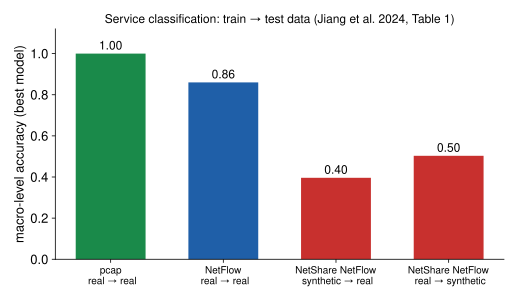{width="100%"}
:::
:::

::: {.notes}
The chart is the argument for packets: a classifier trained on raw pcaps reaches
macro accuracy 1.00; the same classifier on real NetFlow reaches 0.86; trained on
NetShare's synthetic flow records and tested on real traffic it reaches 0.40.
Headers carry protocol semantics (sequence numbers, flags, checksums) and
inter-packet timing encodes application behavior; aggregation throws those away.
But do not oversell it: a traffic-matrix study or a capacity-planning model needs
only flow records, and a model of the application that produced the traffic would
be the most reusable artifact of all. The honest answer to "what should we
generate?" is "what the consumer needs", and that is still being worked out.
:::

# Generative Architectures {.center}

> GANs came first. Diffusion models changed the game.

::: {.notes}
This section motivates the architecture progression: GAN → diffusion → SSM/transformer.
Each step addresses a limitation of the previous one. The book structures the chapter
the same way.
:::

## Four Generations of Generative Models

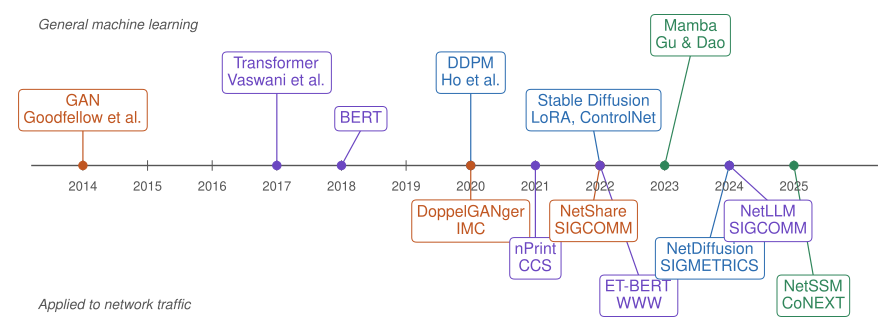{width="100%"}

::: {.caption}
Orange GANs, blue diffusion, purple transformers and LLMs, green state space models. Each family reached network traffic two to five years after it appeared in general ML.
:::

::: {.notes}
Read the figure left to right. GANs (2014) reached traffic generation with
DoppelGANger (2020) and NetShare (2022), but only as flow statistics.
Diffusion (DDPM 2020, Stable Diffusion 2022) became NetDiffusion (2024),
the first raw-pcap generator. Transformers (2017) reached traffic as
ET-BERT (2022) for classification and NetLLM (2024) for decisions, but the
quadratic attention cost blocks long traces. Mamba (2023) became NetSSM
(CoNEXT 2025). The lag between lanes is the gap this lecture is about:
what has to change for a general model to produce protocol-valid packets.
:::

## Generative Adversarial Networks (GANs) {.smaller}

::: {.columns}
::: {.column width="55%"}
**Core idea** (Goodfellow et al., 2014):

- A **generator** $G(z)$ transforms random noise into synthetic data
- A **discriminator** $D(x)$ tries to tell real from fake
- Trained **adversarially**: generator tries to fool the discriminator;
  discriminator tries to catch it
- Training ends when neither can improve — Nash equilibrium

**Training objective:** the discriminator is trained to maximize its accuracy at
telling real from fake, while the generator is trained to minimize it.
*(Equation in the appendix.)*
:::
::: {.column width="45%"}
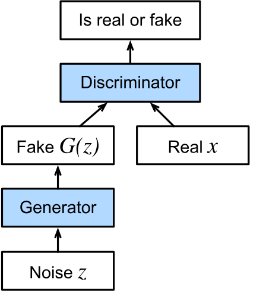
:::
:::

::: {.notes}
The GAN idea is elegant but training is famously tricky. Mode collapse
(the generator learns to produce only one type of output) and oscillation
(the two networks never converge) are the classic failure modes. Explain
the minimax objective: the discriminator maximizes the probability it
assigns to real data while minimizing the probability it assigns to fakes;
the generator minimizes the probability the discriminator is right. See
Chapter 7, "Early Approaches: Generative Adversarial Networks."
:::

## GANs for Network Traffic: DoppelGANger and NetShare

- **DoppelGANger** (Lin et al., 2020): generates time-series attributes of network flows
- **NetShare** (Yin et al., 2022): generates NetFlow-style flow statistics; both preserve
  **aggregate statistical properties** of real traffic

::: {.columns}
::: {.column width="46%"}
**Strengths**

- Generative: variation, not replay
- High statistical resemblance to real flow records
- Useful for augmenting ML training sets
:::
::: {.column width="54%"}
**Where GANs fall short**

- Generator and discriminator **need not converge**: unstable training
- **Mode collapse**: a narrow slice of realistic outputs
- Early traffic GANs emit **aggregate statistics**, not packets
- **Fooling the discriminator is not realism**: train on GAN data, underperform on real
:::
:::

::: {.notes}
Concretely: NetShare generates a table of flow tuples (srcip, dstip,
srcport, dstport, proto, bytes, duration). This is useful for traffic
matrix estimation but useless for testing a DPI engine or protocol
analyzer. The accuracy gap: models trained only on NetShare-generated data
achieve markedly lower accuracy on real test sets compared to models
trained on real data. The four shortfalls in the right column are the
reasons the field moved to diffusion: no convergence guarantee, mode
collapse, flow-level output, and a discriminator that is a proxy for
realism rather than realism itself. See Chapter 7, "Early Approaches: GANs"
and "NetDiffusion" sections.
:::

## NetShare: Reported Accuracy vs. Train-on-Synthetic, Test-on-Real {.smaller}

<!-- recovered from docs/slides/19-Generative.pptx slide 52 -->
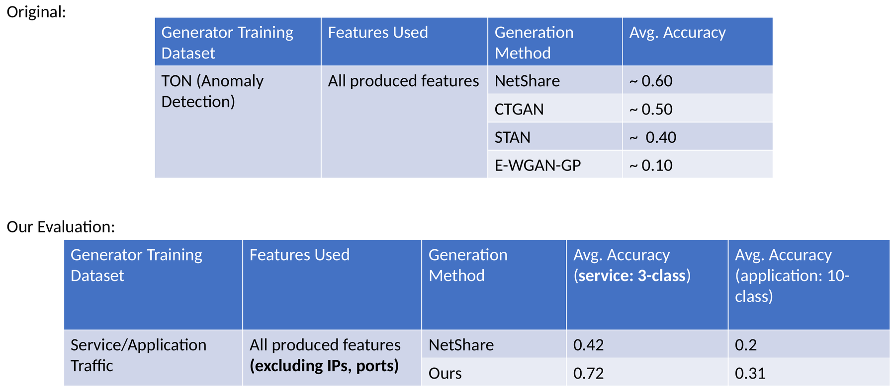{width="72%"}

- In its own paper NetShare looks strong: about 0.60 accuracy, well ahead of CTGAN, STAN, and E-WGAN-GP
- Change the task to service and application classification, train only on synthetic flows, and test on real ones: NetShare drops to 0.42 (3-class) and 0.20 (10-class)
- The evaluation setup, not just the generator, decides the headline number; this is the hard test the rest of the deck uses

::: {.notes}
Recovered from the original deck as a static table. Walk it top to bottom:
first the numbers NetShare reported, then what happens when the same
generator is asked to produce training data for a classifier that is then
tested on real traffic. The point is methodological: statistical similarity
and in-distribution accuracy do not predict train-on-synthetic /
test-on-real performance. "Ours" is NetDiffusion; the full comparison is on
the evaluation slide later. IPs and ports are excluded as features so the
classifier cannot shortcut on identifiers.
:::

# How Diffusion Models Work {.center}

> Destroy structure step by step, then learn to rebuild it.

::: {.notes}
Before introducing NetDiffusion, give students the underlying diffusion model mechanics.
The two-phase process is elegant and worth explaining in detail. See the "Diffusion
Models" section of Chapter 7 and the DDPM paper (Ho et al., 2020).
:::

## The Forward Process: Adding Noise

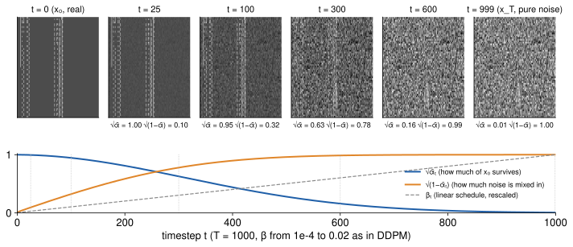{.nostretch width="62%"}

- Each step adds a little Gaussian noise on a **fixed schedule** $\beta_t$; by $t = T$ the
  signal is gone, and nothing about this direction is learned
- The model only needs to learn the **reverse** direction *(equations in the appendix)*

::: {.notes}
The figure is generated from code (figures.py): the bitmap is a real IPv4+TCP
header byte string laid out nPrint-style, and each panel is the closed-form
$x_t = \sqrt{\bar\alpha_t} x_0 + \sqrt{1-\bar\alpha_t}\,\epsilon$ at that timestep.
Point at the curves: by $t \approx 300$ only 60% of the signal amplitude survives
and the structure is already hard to see; by $t = 600$ it is gone. The key
pedagogical point: the forward process is deterministic and cheap; all the
learning happens in the reverse process.
:::

## The Reverse Process: Denoising to Generate

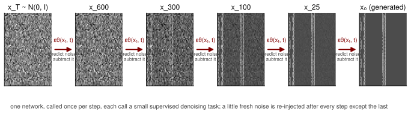{.nostretch width="82%"}

::: {.columns}
::: {.column width="50%"}
**Generation:**

1. Sample $x_T \sim \mathcal{N}(0, I)$
2. Predict the noise present, subtract it
3. Repeat until $x_0$ *(appendix)*
:::
::: {.column width="50%"}
**Why this beats GANs:**

- **No adversarial training** — stable
- **No mode collapse** — supervised steps
- **High diversity** — fresh noise each step
:::
:::

::: {.notes}
The training objective is a simple mean-squared-error loss: predict the noise that was
added. The elegance is that each training iteration picks a *random* timestep and a
*random* real sample, so the model sees a huge variety of partially-noised images.
Compare with GAN training where the two networks must be carefully balanced.
:::

## Forward and Reverse in One Picture

<!-- recovered from docs/slides/17-Diffusion.pptx slide 15 (Ho, Jain, and Abbeel, "Denoising Diffusion Probabilistic Models", NeurIPS 2020, Figure 2) -->
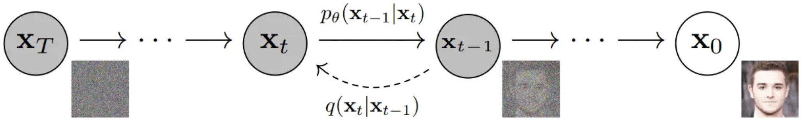{width=100%}

- Read the **dashed arrow** right to left: $q(x_t \mid x_{t-1})$ is the fixed forward
  step that adds noise, taking the face at $x_0$ to pure noise at $x_T$
- Read the **solid arrow** left to right: $p_\theta(x_{t-1} \mid x_t)$ is the learned
  reverse step, one denoising move per timestep
- Both are **Markov chains** over the same states $x_T, \ldots, x_t, x_{t-1}, \ldots, x_0$;
  the model only ever learns the solid arrow
- Generation is the whole solid chain run once, starting from a fresh noise sample

::: {.notes}
Recovered from the original pptx (slide 15); the picture is Figure 2 of the
DDPM paper, so credit Ho et al. when showing it. Walk the two arrows between
$x_t$ and $x_{t-1}$: the dashed one is what we did on the forward slide, the
solid one is what the network learns. Then point out that the whole chain is
just that pair repeated $T$ times, which is why sampling is slow (a forward
pass per step) but training is cheap (any single step can be built from the
closed form in the appendix).
:::

## Conditional Generation with Text Prompts

```{dot}
//| fig-width: 10.6
//| fig-height: 2.5
digraph cond {
  rankdir=LR; nodesep=0.5; ranksep=0.6; bgcolor="transparent";
  node [shape=box, style="filled,rounded", fontname="Helvetica", fontsize=16, color="#555555", penwidth=1.4, margin="0.16,0.08"];
  edge [color="#555555", penwidth=1.5, fontname="Helvetica", fontsize=13];
  prompt [label="prompt\n\"type-0, Amazon traffic\"", fillcolor="#cfe3f5"];
  enc [label="text encoder\n(CLIP / T5)", fillcolor="#eeeeee"];
  emb [label="embedding\nvector", fillcolor="#cfe3f5"];
  noise [label="x_T\npure noise", fillcolor="#cfe3f5"];
  den [label="denoiser ε_θ(x_t, t, embedding)\ncross-attention reads the\nembedding at every step", fillcolor="#f2d9a8"];
  out [label="x_0: sample\nmatching the prompt", fillcolor="#d9efd3"];
  prompt -> enc -> emb; emb -> den [label="conditions", constraint=false]; noise -> den; den -> out [label="T steps"];
  den -> den [label="repeat", dir=back];
}
```

- **Unconditional diffusion** is realistic but uncontrolled; **conditioning** steers every
  denoising step toward the prompt
- Same mechanism for "a cat wearing sunglasses" (Stable Diffusion) and **"type-0, Amazon
  traffic"** (NetDiffusion)
- **Stable Diffusion** (Rombach et al., 2022) diffuses in a **compressed latent space**, not raw
  pixels, and is pre-trained on billions of images; that is the model NetDiffusion fine-tunes

::: {.notes}
Cross-attention is the same mechanism used in transformers. The embedding acts as
a soft constraint on every denoising step. For networking, the prompt encodes traffic
type and protocol class. This is the key mechanism that makes text-prompted traffic
generation possible. Stable Diffusion adds two ideas on top of DDPM: latent-space
compression (fast) and text conditioning (controllable); both are what NetDiffusion
inherits.
:::

# NetDiffusion {.center}

> A text-to-traffic synthesis pipeline built on Stable Diffusion.

::: {.notes}
NetDiffusion (Jiang, Liu, et al., SIGMETRICS 2024) is the concrete application of diffusion
models to network traffic. See the "NetDiffusion" section of Chapter 7 and the paper
at https://dl.acm.org/doi/10.1145/3673660.3655071. The four-step pipeline maps
cleanly onto the diffusion model concepts just introduced.
:::

## Pipeline Overview

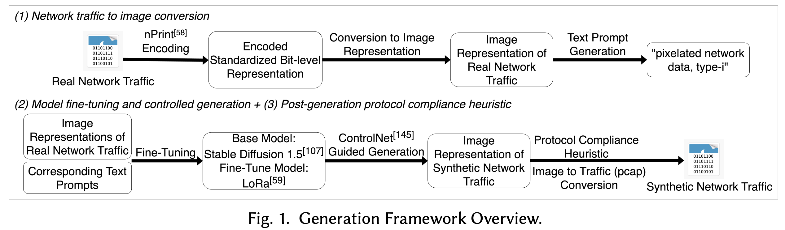

Four steps: **(1)** traffic-to-image conversion, **(2)** LoRA fine-tuning of a text-to-image
model (Stable Diffusion 1.5 in the paper; the current `noise-lab/NetDiffusion` code is a
Stable Diffusion 3 + ControlNet reimplementation), **(3)** ControlNet-guided generation,
**(4)** protocol-compliance post-processing.

::: {.notes}
This figure (s17-i09.png) is the key architecture diagram from the NetDiffusion paper.
Walk through each component from left to right. The central insight is that existing
powerful text-to-image infrastructure can be repurposed for network traffic once you
have a good image representation of packets. The base model is swappable: the
paper used Stable Diffusion 1.5, and the public code at
github.com/noise-lab/NetDiffusion now fine-tunes a LoRA on Stable Diffusion 3
with the InstantX SD3-Controlnet-Canny model for the edge conditioning, because
the SD 1.5 dependencies went stale.
:::

## The Four Steps at a Glance

<!-- recovered from docs/slides/17-Diffusion.pptx slide 26 -->
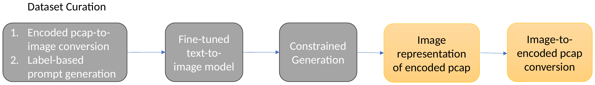{width=100%}

- **Gray boxes** are the lecture's Steps 1 to 3: encode real pcaps as images and
  label-derived prompts, fine-tune a text-to-image model, then generate under
  ControlNet constraints
- **Orange boxes** are Step 4: the generated image is an encoded pcap in disguise, and
  the last box turns it back into packets
- Everything the diffusion model touches is an image; the networking happens only at
  the two ends of the strip

::: {.notes}
Recovered from the original pptx (slide 26), the final state of a strip that grew
one box per slide across Steps 1 through 4. Use it as the map for the next
slides: point at the box you are about to explain each time. The color split is
the thing to stress, since students tend to assume the model emits packets; it
emits a picture, and the orange boxes are the bridge back.
:::

## Step 1: Traffic-to-Image Conversion {.smaller}

::: {.columns}
::: {.column width="50%"}
**nPrint encoding:**

Each packet is encoded at the **bit level** into a fixed-size vector:

- `1` = bit is set
- `0` = bit is unset
- `-1` = field absent (e.g., no TCP header in a UDP packet)

Encoded packets become **rows** in an image:

- Each row = one packet
- Each column = one protocol header field
- 1024 × 1088 px image → up to 1024 packets per flow
:::
::: {.column width="50%"}
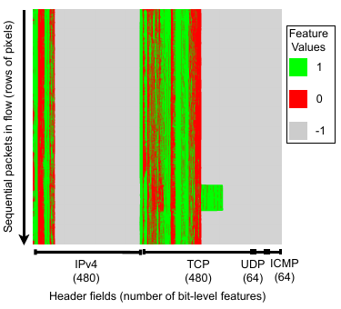
:::
:::

**Why images?** Leverages high-resolution text-to-image models; preserves
**inter-packet spatial relationships**; enables controlled generation techniques
developed for vision.

::: {.notes}
The image (s22-i14.png) shows a real TCP flow encoded this way. Note the gray regions
corresponding to absent UDP/ICMP fields — this is a TCP-only flow. The spatial
structure is what ControlNet will later use to constrain generation. Unlike tabular
data, the image format makes neighboring-packet relationships visible to the model.
:::

## One Packet, One Row

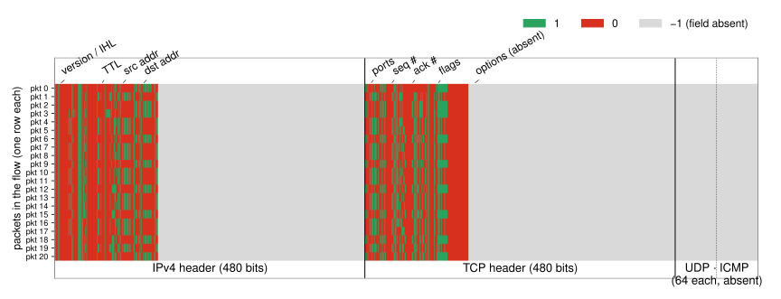{.nostretch width="70%"}

- Fields that **never change** in a flow (version, addresses, ports) are solid stripes; fields that
  **count** (seq, ack, IP id) shimmer; **flags** flip on handshake and FIN rows; absent headers are grey
- These stripes are what the Canny edge detector in Step 3 will find

::: {.notes}
Generated from code (figures.py) so every bit is real: the script builds IPv4 and
TCP headers with struct, computes the IP checksum, and unpacks the bytes. Use it
to explain why the image representation is not a gimmick: the vertical stripes
are the invariants of the flow, the shimmering columns are the counters, and
the handshake rows differ from the data rows exactly in the flags and length
fields. The paper's full-size 1024-row image on the previous slide is the same
thing at scale.
:::

## Step 2: LoRA Fine-Tuning

::: {.columns}
::: {.column width="50%"}
**Why fine-tune rather than train from scratch?**

- Training Stable Diffusion from scratch takes billions of images
- **LoRA (Low-Rank Adaptation)** freezes the pretrained weights and trains a small
  low-rank update beside them; a few hundred traffic images adapt the model

**Training procedure:**

- Each traffic image is paired with a **text prompt** from its label
  ("type-0, Netflix traffic"); the model learns prompt tokens → traffic patterns
- The base model's structure is inherited (SD 1.5 in the paper, SD 3 in the current code)
:::
::: {.column width="50%"}
::: {style="width:58%; margin:0 auto;"}
```{dot}
//| fig-width: 4.6
//| fig-height: 5.0
digraph lora {
  rankdir=TB; nodesep=0.35; ranksep=0.4; bgcolor="transparent";
  node [shape=box, style="filled,rounded", fontname="Helvetica", fontsize=15, color="#555555", penwidth=1.3, margin="0.14,0.07"];
  edge [color="#555555", penwidth=1.4, fontname="Helvetica", fontsize=13];
  x [label="layer input x\n(d dims)", fillcolor="#cfe3f5"];
  W [label="pretrained weights W\nd × d, frozen", fillcolor="#eeeeee"];
  A [label="A: d × r\ntrainable", fillcolor="#f2d9a8"];
  B [label="B: r × d\ntrainable", fillcolor="#f2d9a8"];
  sum [label="h = W x + B A x", fillcolor="#d9efd3"];
  x -> W; x -> A [label="r ≪ d\n(rank 4–64)"]; A -> B; W -> sum; B -> sum;
  {rank=same; W; A;}
}
```
:::

::: {.caption}
Only the two thin matrices $A$ and $B$ are trained; $W$ never changes.
:::
:::
:::

::: {.notes}
LoRA (Hu et al., 2022) is a parameter-efficient fine-tuning technique that was
originally developed for adapting large language models. The key idea is to represent
weight updates as low-rank matrix products, dramatically reducing the number of
trainable parameters. For NetDiffusion, this makes fine-tuning feasible on a single
GPU with a few hundred example flows.
:::

## Step 3: ControlNet-Guided Generation {.smaller}

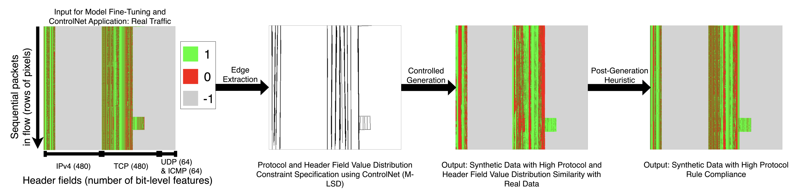{width="92%"}

::: {.columns}
::: {.column width="50%"}
**The problem:** diffusion models are "inherently creative" — they may generate
plausible-looking but protocol-invalid traffic. An image generator that draws a hand
with **six fingers** is making the same mistake as a TCP flow with no SYN or a bad checksum.
:::
::: {.column width="50%"}
**ControlNet solution:**

1. Take one **example** image of the target traffic type
2. Apply **Canny edge detection** — boundaries between protocol field regions
3. During denoising, use these edges as structural constraints, so a TCP flow gets only
   TCP + IP columns and the UDP/ICMP columns stay empty
:::
:::

::: {.notes}
ControlNet (Zhang et al., 2023) was developed for image generation but maps naturally
to the protocol-structure problem. The edges encode *where* data should appear in the
image, not *what* values it should have. The diffusion model respects these
structural boundaries during generation. The six-fingers line is the analogy to
keep: the generator has learned what traffic looks like, not what makes it valid,
and ControlNet is the hand-shaped stencil.
:::

## Why Fine-Tuning and ControlNet Both Matter

<!-- recovered from docs/slides/19-Generative.pptx slide 53 (NetDiffusion paper, Fig. 5) -->
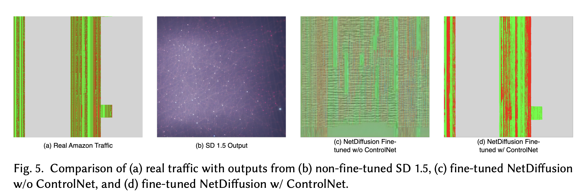{width="90%"}

- Off-the-shelf Stable Diffusion, prompted with "Amazon traffic", paints a starfield: it has no idea what a packet looks like
- LoRA fine-tuning teaches it the green/red bit texture, but the columns smear across the whole width, so header fields land where they cannot exist
- ControlNet's edge mask pins the generated bits to the columns real traffic uses; only panel (d) opens in Wireshark after post-processing

::: {.notes}
This is the ablation figure from the NetDiffusion paper, recovered from the
original deck. Walk the four panels left to right and ask students what
changed between each pair: (a) to (b) is "no fine-tuning", (b) to (c) is
"fine-tuned but unconstrained", (c) to (d) is "add ControlNet". Panel (c)
is the one to dwell on: the model has learned the look of traffic but not
its structure, which is exactly why a pure image model needs external
protocol constraints. That weakness is what motivates sequence models later.
:::

## Step 4: Protocol-Compliance Post-Processing {.smaller}

```{dot}
//| fig-width: 11
//| fig-height: 3.35
digraph post {
  rankdir=LR; nodesep=0.35; ranksep=0.5; bgcolor="transparent";
  node [shape=box, style="filled,rounded", fontname="Helvetica", fontsize=16, color="#555555", penwidth=1.4, margin="0.14,0.07"];
  edge [color="#555555", penwidth=1.5, fontname="Helvetica", fontsize=13];
  img [label="generated image\n(ControlNet output)", fillcolor="#cfe3f5"];
  dec [label="image → nPrint bits\n→ raw packets", fillcolor="#eeeeee"];
  intra [label="1. intra-packet rules\nchecksums, length fields,\nreserved bits = 0", fillcolor="#f2d9a8"];
  inter [label="2. inter-packet rules\nseq/ack progression,\nSYN → SYN-ACK → ACK, FIN/RST", fillcolor="#f2d9a8"];
  vote [label="3. flow constants\nIPs, ports: majority vote\nover generated values", fillcolor="#f2d9a8"];
  pcap [label="valid pcap\nopens in Wireshark,\nreplays with tcpreplay", fillcolor="#d9efd3"];
  img -> dec -> intra; intra -> inter [constraint=false, label="then"]; inter -> vote -> pcap;
}
```

::: {.columns}
::: {.column width="50%"}
- Even with ControlNet, some generated traffic breaks specific rules; the
  **dependency trees** (traversed bottom-up: packet first, then flow) fix only **low-tolerance** fields
- **Intra-packet** first (one packet is internally consistent), then **inter-packet**
  (the packets of a flow relate correctly)
:::
::: {.column width="50%"}
- **High-tolerance** fields (TTL, window size) are left as generated, to keep
  the model's variation and limit the effect on downstream ML
- **Goal:** the fewest edits that make the output tool-compatible: Wireshark and
  tcpreplay must accept it
:::
:::

::: {.notes}
The dependency-tree approach is a hybrid of model output and deterministic rule
enforcement. The key design choice is to correct only the "low-tolerance" fields —
those where any deviation breaks protocol compliance — while allowing flexibility
in "high-tolerance" fields like TTL or window size. This limits post-processing
impact on downstream ML tasks. For fields that should be constant (like source IP)
but vary due to generation randomness, majority voting selects the dominant value.
Say plainly that this is engineering, not modeling: the generator never learned the
rules, and that is the honest limitation.
:::

# Evaluation {.center}

> Does it work for traffic classification, data augmentation, and non-ML tools?

::: {.notes}
The evaluation covers three axes: statistical similarity to real data, ML task accuracy,
and compatibility with standard network analysis tools. Each axis corresponds to a
different downstream use case. See the "Evaluation and Results" subsection of Chapter 7.
:::

## Evaluation Setup

**Dataset:** 3 macro-service types × 10 applications:

- **Video Streaming:** Netflix, YouTube, Amazon, Twitch (9,465 flows)
- **Video Conferencing:** MS Teams, Google Meet, Zoom (6,511 flows)
- **Social Media:** Facebook, Twitter, Instagram (3,610 flows)

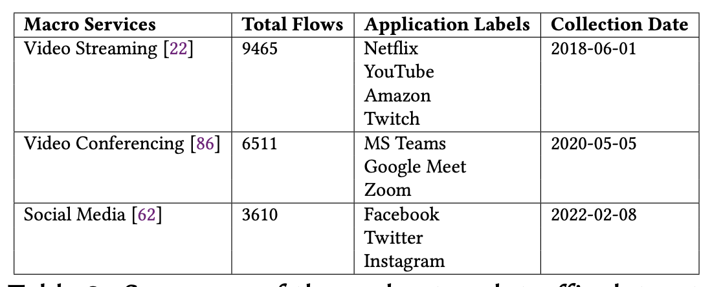

**Baseline:** NetShare — a time-series GAN generating NetFlow-style attributes.

::: {.notes}
This is the same dataset shown in the paper's Table 2. The diversity of applications
within each macro-service is important: Netflix and YouTube are both video streaming
but have different protocol behaviors. A good generative model should learn
application-level patterns, not just macro-service-level patterns.
:::

## Statistical Similarity Results

::: {.columns}
::: {.column width="48%"}
**NetDiffusion vs. NetShare:**

- **Common fields** (fields both methods generate): **> 30% higher** similarity
  to real traffic (JSD, EMD)
- **All fields** (full pcap header fields): **> 70% higher** similarity
- The all-fields gap is larger because NetShare emits only NetFlow-style
  summary attributes; it cannot produce most header field distributions at all
:::
::: {.column width="52%"}
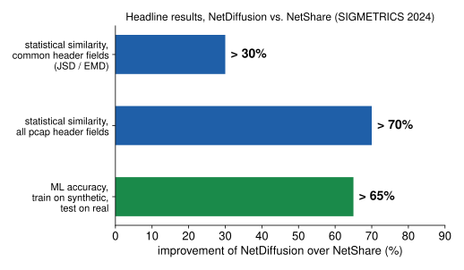{width="100%"}
:::
:::

::: {.notes}
JSD = Jensen-Shannon Divergence; EMD = Earth Mover's Distance. Both are lower-is-better
metrics for measuring how different two distributions are. NetDiffusion's advantage
on "all fields" is partly definitional: NetShare does not generate those fields at all,
so its similarity score is very low. The "common fields" comparison is fairer.
:::

## ML Accuracy: Train-on-Synthetic, Test-on-Real {.smaller}

::: {.columns}
::: {.column width="55%"}
**Scenario:** train a traffic classifier *entirely* on synthetic data, test on real data.

- NetDiffusion synthetic data → **> 65% higher accuracy** than NetShare synthetic data
- NetDiffusion approaches the accuracy of real-data training

**Why the gap?**

- NetShare's flow-level statistics lose distinguishing per-packet features
- NetDiffusion's pcap-level fidelity preserves the fine-grained patterns
  classifiers rely on

**Class balancing:** populating under-represented classes with synthetic data
*improves* per-class accuracy — especially for rare classes like Facebook Meet
and Zoom.
:::
::: {.column width="45%"}
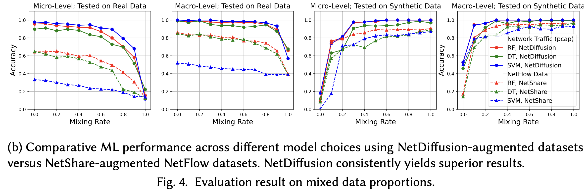
:::
:::

::: {.notes}
The mixing-rate plot (s30-i19.png) shows what happens as you replace increasing
fractions of real training data with synthetic data. NetDiffusion-augmented models
degrade gracefully; NetShare-augmented models collapse quickly. This is the practical
story for data augmentation: if you can't collect enough real labeled traffic, can you
replace it with synthetic? For NetDiffusion, largely yes.
:::

## Non-ML Compatibility {.smaller}

A key advantage of raw pcap generation: the output works with standard networking tools.

::: {.columns}
::: {.column width="50%"}
**Wireshark validation:**

- Generated pcaps open without errors
- File encapsulation: Raw IP (129 — raw/p4)
- Capture length: 65,535 bytes
- Average data rate: 1,287.76 bytes / 1,700 packets/second

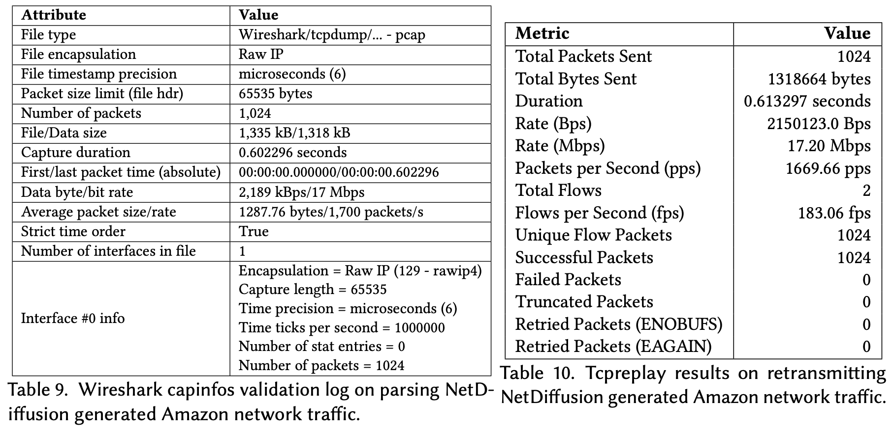
:::
::: {.column width="50%"}
**Feature extraction for network analysis:**

Essential metrics are successfully extractable from NetDiffusion data for:

- Traffic analysis (packet counts, byte counts, TCP window size)
- Protocol analysis (distribution of flags, ports)
- Network performance (packet size distribution)
- Routing behavior (average TTL)

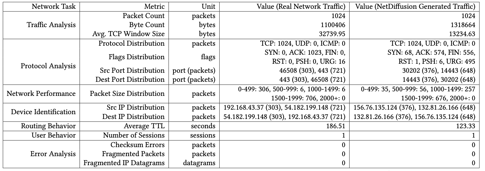
:::
:::

::: {.notes}
This is a critical differentiator vs. GAN-based methods. NetShare data cannot be
opened in Wireshark because it does not produce valid pcap binary format. NetDiffusion
data can be replayed with TCPreplay and analyzed with Wireshark — this enables the
"hardware/software testing" use case described at the start of the lecture.
:::

# Limitations and What Comes Next {.center}

> NetDiffusion shows the paradigm works. The limitations motivate the next generation.

::: {.notes}
This transition sets up the connection to the sequence-models lecture. The key message
is that diffusion models are powerful but have structural limitations that other
architectures address differently.
:::

## Current Limitations

::: {.columns}
::: {.column width="56%"}
```{dot}
//| fig-width: 8.2
//| fig-height: 4.6
digraph lim {
  rankdir=LR; nodesep=0.18; ranksep=0.9; bgcolor="transparent";
  node [shape=box, style="filled,rounded", fontname="Helvetica", fontsize=16, color="#555555", penwidth=1.4, margin="0.14,0.07"];
  edge [color="#555555", penwidth=1.5, fontname="Helvetica", fontsize=13];
  l0 [label="not really an image\npixels stand in for bits", fillcolor="#f8d7c4", style="filled,rounded,dashed"];
  l1 [label="short sequences\n~1,024 packets per image", fillcolor="#f8d7c4", style="filled,rounded,dashed"];
  l3 [label="no protocol semantics or state\ncompliance bolted on afterwards", fillcolor="#f8d7c4", style="filled,rounded,dashed"];
  l5 [label="one flow per image\nno multi-flow sessions", fillcolor="#f8d7c4", style="filled,rounded,dashed"];
  l4 [label="fidelity vs. diversity\nmemorize, or be useless", fillcolor="#f8d7c4", style="filled,rounded,dashed"];
  s1 [label="sequence models\n(transformers, state space models)", fillcolor="#d9efd3"];
  s2 [label="constraints inside the model\n(open problem)", fillcolor="#d9efd3"];
  s3 [label="privacy-aware evaluation\n(membership inference, DP)", fillcolor="#d9efd3"];
  l0 -> s1; l1 -> s1; l5 -> s1; l3 -> s2; l4 -> s3;
}
```
:::
::: {.column width="44%"}
- **Not really an image:** the model paints pixels; it has no idea what a byte is
- **Short sequences:** ~1,024 packets, cut at the image edge
- **No protocol semantics or state:** validity is restored by post-processing
- **One flow at a time:** no notion of multi-flow sessions
- **Fidelity vs. diversity:** memorize the training data, or be useless
:::
:::

::: {.notes}
These limitations follow the "Limitations of Diffusion Models" section of Chapter 7,
with the image representation itself named as the first. Each one motivates the next
architecture in the book: the sequence-length, state, and multi-flow problems
motivate sequence models (transformers and state space models), covered in the
next lecture. A DATA packet before the handshake is individually valid and
semantically wrong, which is what "no state" means in practice. The fidelity vs.
diversity limit interacts with privacy: synthetic data is not automatically
private, and membership inference applies.
:::

## Diffusion vs. Alternatives {.smaller}

| | **Diffusion (NetDiffusion)** | **Transformers** | **State Space Models (NetSSM)** |
|---|---|---|---|
| **Fidelity** | High (pcap-level) | High | High |
| **Sequence length** | ~1,024 packets | ~1,000s tokens (quadratic cost) | 8–78× longer than transformers |
| **State modeling** | Implicit (spatial) | Implicit (attention) | **Explicit (hidden state)** |
| **Protocol compliance** | Post-hoc (ControlNet + trees) | Post-hoc | More natural |
| **Compute** | Fine-tunable on GPU | Expensive | Linear scaling |

**NetSSM** (Chu et al., arXiv 2503.22663, ACM CoNEXT 2025) uses the **Mamba** selective
state space architecture to generate multi-flow sessions up to 78× longer than
transformer baselines, with explicit protocol state tracking.

::: {.notes}
See the Chapter 7 summary table and the "State Space Models" section. The key insight
is that no architecture dominates all dimensions. For short, high-fidelity samples,
diffusion is attractive. For long, state-rich flows, SSMs are more natural. Future
work on hybrid architectures is an open research direction.
:::

## Open Challenges {.smaller}

::: {.columns}
::: {.column width="50%"}
**Technical challenges:**

- **Context transfer** — can a model trained on plain TLS traffic synthesize
  VPN-encrypted traffic it has never seen?
- **Variable-length generation** — real flows span anywhere from 3 to 100,000+ packets
- **Privacy guarantees** — synthetic data is not automatically private; membership
  inference attacks apply; formal differential privacy degrades data quality
- **Foundation model** — can we build a Stable Diffusion for networking, fine-tunable
  to any downstream task?
:::
::: {.column width="50%"}
**Evaluation challenges:**

- No consensus benchmark dataset for traffic generation
- The **fidelity–diversity tradeoff**: similar enough to be realistic,
  diverse enough to add new information
- Downstream task accuracy is a proxy metric — what is the "right" metric?

**Near-term opportunities:**

- Combining diffusion image fidelity with SSM state-tracking
- Payload generation (headers are addressed; payloads remain hard)
- Attack-traffic synthesis for IDS evaluation
:::
:::

::: {.notes}
The "context transfer" challenge is particularly interesting for
a research course: it frames synthesis as a form of domain adaptation. The privacy
discussion connects to the "Privacy-Preserving Models" section of Chapter 7, which
students should read.
:::

## Next: Transformers and State-Space Models

```{dot}
//| fig-width: 12.4
//| fig-height: 2.5
digraph bridge {
  rankdir=LR; nodesep=0.25; ranksep=1.1; bgcolor="transparent";
  node [shape=box, style="filled,rounded", fontname="Helvetica", fontsize=17, color="#555555", penwidth=1.4, margin="0.16,0.08"];
  edge [color="#555555", penwidth=1.6, fontname="Helvetica", fontsize=14];
  a1 [label="pixels standing in for bits", fillcolor="#f8d7c4", style="filled,rounded,dashed"];
  a2 [label="state only implicit\nin spatial patterns", fillcolor="#f8d7c4", style="filled,rounded,dashed"];
  a3 [label="~1,024 packets, one flow", fillcolor="#f8d7c4", style="filled,rounded,dashed"];
  b1 [label="tokens: packets and fields\nas a sequence", fillcolor="#d9efd3"];
  b2 [label="a learned state\n(attention or a hidden state)", fillcolor="#d9efd3"];
  b3 [label="long, multi-flow context\n(sessions, not images)", fillcolor="#d9efd3"];
  a1 -> b1; a2 -> b2; a3 -> b3;
}
```

- **Tokens instead of pixels:** a packet is a token in a sequence; the model works on the bits, not a picture of them
- **A learned state:** TCP, UDP, and QUIC are state machines; attention or a hidden state can carry
  that state instead of hoping it emerges from spatial patterns
- **Long and multi-flow context:** whole sessions, not one 1,024-row image

**Next lecture:** transformers, protocol state machines, state-space models (Mamba), and NetSSM.

::: {.notes}
Bridge slide. Map each limitation on the left to what sequence models offer on the
right, and leave the room with the question the next lecture answers: if a packet is a
token, what does a language model of traffic look like, and where does protocol state
live inside it? NetSSM (Chu et al., CoNEXT 2025) is the same group's follow-on to
NetDiffusion and is the worked example next time; the comparison table two slides
back previews it.
:::

## Key Takeaways

- **Synthetic network data** addresses scarcity, privacy, and class-imbalance problems
  that limit real-world ML for networking
- **What to generate** (packets, flow records, logs, or the thing that produced them) is
  still open and depends on the downstream task
- **Diffusion models** — forward noise destruction + learned reverse denoising — are
  more stable than GANs and produce higher-fidelity outputs
- **NetDiffusion** maps the diffusion paradigm to networking via image representations
  of pcap data, LoRA fine-tuning, ControlNet constraints, and protocol-compliance
  post-processing
- **Limitations** (not really an image, short sequences, no protocol state, single flows)
  motivate sequence models: transformers and state space models, next lecture
- The field is moving fast: **evaluate claims empirically**, consider the
  fidelity–diversity–privacy tradeoff, and look for consensus benchmarks

::: {.notes}
See the Chapter 7 summary. End with a preview: the next lecture covers transformers
and state space models, which address the sequence-length, state, and multi-flow
limitations highlighted in this lecture. Students should read the "State Space Models"
section of Chapter 7 before that session.
:::

# Appendix: The Math {.center}

## Forward Process: Equations {.large}

**One step** of the forward (diffusion) process adds Gaussian noise with variance
$\beta_t$ from a fixed schedule:

$$q(x_t \mid x_{t-1}) = \mathcal{N}\!\left(x_t;\; \sqrt{1-\beta_t}\, x_{t-1},\; \beta_t I\right)$$

**Closed form.** Because each step is Gaussian, any $x_t$ can be sampled directly
from $x_0$ without simulating the chain. With $\alpha_t = 1 - \beta_t$ and
$\bar{\alpha}_t = \prod_{s=1}^{t} \alpha_s$:

$$q(x_t \mid x_0) = \mathcal{N}\!\left(x_t;\; \sqrt{\bar{\alpha}_t}\, x_0,\; (1-\bar{\alpha}_t) I\right)
\qquad\Longleftrightarrow\qquad
x_t = \sqrt{\bar{\alpha}_t}\, x_0 + \sqrt{1-\bar{\alpha}_t}\, \epsilon,\;\; \epsilon \sim \mathcal{N}(0, I)$$

As $t \to T$, $\bar{\alpha}_t \to 0$ and $x_T$ is (nearly) pure noise.

::: {.notes}
Companion to "The Forward Process" slide. The closed form is what makes training
cheap: to build a training example you pick a random real sample, a random timestep
$t$, and a random $\epsilon$, and produce $x_t$ in one shot. See the DDPM paper
(Ho et al., 2020) and the "Diffusion Models" section of Chapter 7.
:::

## Reverse Process: Equations {.large}

**Noise-prediction objective.** A network $\epsilon_\theta(x_t, t)$ is trained to
recover the noise $\epsilon$ that produced $x_t$ from $x_0$ — a plain mean-squared-error
loss:

$$\mathcal{L}(\theta) = \mathbb{E}_{x_0,\, t,\, \epsilon}\left[\, \big\| \epsilon - \epsilon_\theta\!\left(\sqrt{\bar{\alpha}_t}\, x_0 + \sqrt{1-\bar{\alpha}_t}\, \epsilon,\; t\right) \big\|^2 \right]$$

**Sampling update.** Starting from $x_T \sim \mathcal{N}(0, I)$, each step subtracts
the predicted noise and re-injects a little fresh noise ($z \sim \mathcal{N}(0, I)$; $z = 0$ at $t = 1$):

$$x_{t-1} = \frac{1}{\sqrt{\alpha_t}}\left(x_t - \frac{\beta_t}{\sqrt{1-\bar{\alpha}_t}}\, \epsilon_\theta(x_t, t)\right) + \sigma_t z$$

In words: predict the noise and subtract it; $x_{t-1} \leftarrow x_t - \epsilon_\theta(x_t, t)$ with the scaling dropped.

::: {.notes}
Companion to "The Reverse Process" slide. Each training iteration samples a random
timestep and a random real example, so the model sees a huge variety of partially
noised inputs; there is no adversary to balance, which is why diffusion training is
stable compared with GANs. $\sigma_t^2$ is usually set to $\beta_t$. See Ho et al.
(2020), Algorithms 1 and 2.
:::

## GAN Objective {.large}

The generator $G$ and discriminator $D$ play a two-player minimax game
(see "Generative Adversarial Networks"):

$$\min_G \max_D \; \mathbb{E}[\log D(x)] + \mathbb{E}[\log(1 - D(G(z)))]$$

- $x$: a real sample; $z$: random noise; $G(z)$: a generated sample
- $D(\cdot)$: the discriminator's estimated probability that its input is real

::: {.notes}
Explain the minimax objective: the discriminator maximizes the probability it
assigns to real data while minimizing the probability it assigns to fakes; the
generator minimizes the probability the discriminator is right. Training
ends when neither can improve — a Nash equilibrium. See Chapter 7, "Early
Approaches: Generative Adversarial Networks."
:::
