# Where Diffusion Falls Short {.center}

> NetDiffusion generates realistic packets — but only a picture of them.

```{=html}
<style>
.reveal .cell-output-display svg, .reveal .cell-output-display img { width: 100%; height: auto; }
.reveal .caption { font-size: 0.55em; color: #666666; margin-top: 0.2em; }
</style>
```

::: {.notes}
Pick up where the diffusion lecture ended. NetDiffusion was the first generator to emit
raw packets, and it did so by treating a flow as an image. Ask the room what that
representation throws away before showing the next slide: the answer is sequence length,
protocol state, and the notion of a session.
:::

## What NetDiffusion Cannot Do

::: {.columns}
::: {.column width="58%"}
- **Traffic is not really an image**: the generator only sees pixels, never a header field, a flag, or a sequence number
- **Only short sequences**: one image is a fixed number of packets (about 1,024 rows), so a long flow is cut off
- **No protocol state**: compliance has to be patched after the fact, with dependency-tree post-processing outside the model
- **No notion of a session**: a real capture interleaves several flows; a single image is one flow
:::
::: {.column width="42%"}
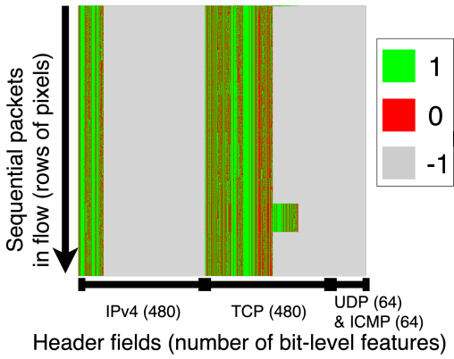

::: {.caption}
A flow as NetDiffusion sees it: one packet per row, header bits as green, red, and gray pixels (nPrint). The generator learns the texture of this picture, not the protocol that produced it.
:::
:::
:::

::: {.notes}
Each bullet is a structural limit, not a tuning problem. The image is the representation,
so the model can only learn the look of traffic; the image has a fixed height, so the
flow has a fixed length; nothing in a pixel says ESTABLISHED, so the TCP rules are
enforced by the repair step; and one image is one flow, so there is no way to say
"a browser session with a dozen connections open at once." The rest of the deck is about
an architecture that addresses the first three directly and makes the fourth possible.
:::

## The Generative Model Landscape

Three architectures — each with a different strength/weakness tradeoff:

| Architecture | Representative System | Strength | Key Weakness |
|---|---|---|---|
| **GAN / flow stats** | NetShare | Fast, flow-level | No packet-level detail |
| **Diffusion model** | NetDiffusion | High-fidelity packets | Short sequences only |
| **State-space model** | **NetSSM** | Long, stateful traces | Newer, less explored |

**Progression**: GANs → Diffusion → SSMs, each addressing the prior's limitations.

::: {.notes}
This table is the spine of the whole chapter. GANs (DoppelGANger, NetShare) gave flow-level
stats; diffusion (NetDiffusion) added packet fidelity but capped at ~1K packets; SSMs
(NetSSM) get both length and fidelity. The chapter in the book covers all three in order —
this deck focuses on the third column. See the Generative Models chapter, "Background"
section.
:::

# Transformers {.center}

> Attention mechanisms capture contextual relationships —
> but scale **quadratically** with sequence length.

::: {.notes}
Transformers are the dominant architecture of the 2020s. Understanding
them is essential both for their direct networking applications (TLS
misconfiguration detection, protocol analysis) and because their
scalability limitations motivate state space models. See Chapter 7,
"Transformers and Large Language Models."
:::

## Embeddings: Words, Packets, and Flows

**The word vector idea** (word2vec, Mikolov et al., 2013):

- Each word is a point in a vector space; similar meaning, nearby points ("cat" ≈ "lion"); king − man + woman ≈ queen

**Extended to networking:**

- **nPrint**: each packet → fixed-size bit vector that keeps protocol structure
- **ET-BERT**: packet bytes as tokens; self-supervised pre-training on unlabeled encrypted traffic (Lin et al., 2022)

```{dot}
//| fig-width: 12.4
//| fig-height: 1.9
digraph emb {
  rankdir=LR; nodesep=0.25; ranksep=0.45; bgcolor="transparent";
  node [shape=box, style="filled,rounded", fontname="Helvetica", fontsize=16,
        color="#555555", penwidth=1.4, margin="0.12,0.07"];
  edge [color="#555555", penwidth=1.5];
  w  [label="words in\na sentence", fillcolor="#cfe3f5"];
  p  [label="packets\nin a flow", fillcolor="#cfe3f5"];
  t  [label="tokens\n(WordPiece |\nnPrint bits, bytes)", fillcolor="#f2d9a8"];
  e  [label="one embedding\nvector per token", fillcolor="#f2d9a8"];
  a  [label="attention over\nthe sequence", fillcolor="#d9efd3"];
  w -> t; p -> t; t -> e -> a;
}
```

::: {.notes}
The analogy between words-in-sentences and packets-in-flows is powerful:
both are sequences of discrete tokens where meaning comes from context.
nPrint gives us a deterministic, protocol-aware tokenization. ET-BERT
then applies BERT pre-training to unlabeled traffic, learning contextual
embeddings that transfer to classification tasks. See Chapter 7, "Vectors
and Embeddings."
:::

## The Transformer Architecture

::: {.columns}
::: {.column width="55%"}
**Two core components:**

**Attention layer** — each token attends to all others: its output is a weighted
average of the values, with weights set by how well its query matches every key.
*(Equation in the appendix.)*

- Query $Q$: what am I looking for?
- Key $K$: what do I offer?
- Value $V$: what information do I carry?
- Multi-head: multiple attention heads learn different relationships

**Feed-forward layer** — processes concatenated attention output;
captures patterns from training.
:::
::: {.column width="45%"}
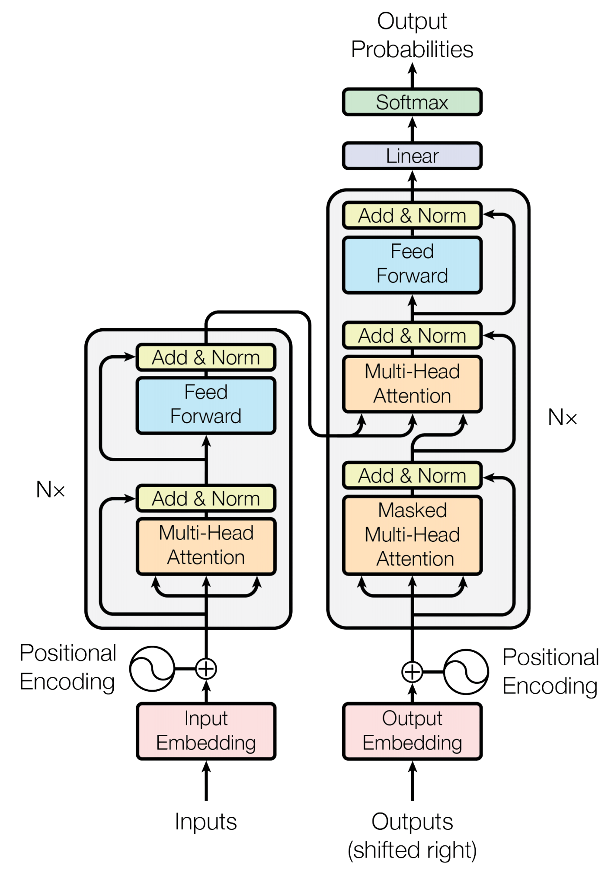
:::
:::

::: {.notes}
Vaswani et al. (2017), "Attention Is All You Need." Walk through the
encoder-decoder split: the encoder reads the input and builds
context-aware representations; the decoder generates output tokens
autoregressively. BERT uses encoder only (bidirectional context, good
for classification). GPT uses decoder only (unidirectional, good for
generation). For networking: in a TLS handshake, the query for the
ciphersuite token attends to the protocol version and certificate chain
tokens — exactly the relationships we want to detect misconfiguration.
See Chapter 7, "The Transformer Architecture."
:::

## The Scaling Problem: O(n²) Attention

**Attention compares every token with every other: cost O(n²) in the sequence length n.**

::: {.columns}
::: {.column width="52%"}
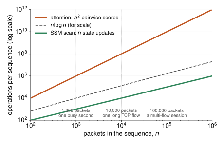
:::
::: {.column width="48%"}
**Why this hurts networking:**

- A few seconds of traffic is thousands of packets; a session is millions
- 1,000 packets → 10⁶ scores; 100,000 packets → 10¹⁰

**Also: no explicit state**

- TCP is a state machine (SYN_SENT → ESTABLISHED → FIN_WAIT); a transformer learns it only *implicitly* from position patterns
- Million-token context windows exist, but the quadratic bill is paid every time
:::
:::

::: {.notes}
This is the key motivation for state space models (the second half of this deck).
Even with flash attention and other algorithmic improvements, the O(n²)
wall is real for networking-scale sequences. Compare: GPT-3 handled ~4K
tokens; current frontier models handle ~1M tokens, but that is still only
a few thousand packets for a busy flow. See Chapter 7, "The Scaling
Problem with Transformers."
:::

## Attention Has No State

```{dot}
//| fig-width: 12.4
//| fig-height: 3.3
digraph nostate {
  rankdir=LR; nodesep=0.3; ranksep=0.4; bgcolor="transparent";
  node [shape=box, style="filled,rounded", fontname="Helvetica", fontsize=20, color="#555555", penwidth=1.4, margin="0.16,0.09"];
  edge [color="#555555", penwidth=1.4, fontname="Helvetica", fontsize=17];
  subgraph cluster_att { label="attention: the next token is scored against every earlier token, every step"; fontname="Helvetica"; fontsize=19; color="#999999"; style=dashed;
    syn [label="SYN", fillcolor="#cfe3f5"]; sa [label="SYN-ACK", fillcolor="#cfe3f5"]; ack [label="ACK", fillcolor="#cfe3f5"];
    d1 [label="DATA", fillcolor="#d9efd3"]; a1 [label="ACK", fillcolor="#d9efd3"]; dots [label="… thousands\nmore …", shape=plaintext, style=""];
    q [label="next packet?", fillcolor="#f8d7c4"];
    syn -> sa -> ack -> d1 -> a1 -> dots -> q [style=invis];
    q -> syn [constraint=false, color="#c8302e"]; q -> sa [constraint=false, color="#c8302e"]; q -> ack [constraint=false, color="#c8302e"];
    q -> d1 [constraint=false, color="#c8302e"]; q -> a1 [constraint=false, color="#c8302e"]; q -> dots [constraint=false, color="#c8302e", label="n scores,\nhandshake rediscovered\nfrom raw tokens"];
  }
  subgraph cluster_st { label="state: one vector says where the connection is"; fontname="Helvetica"; fontsize=19; color="#999999"; style=dashed;
    h [label="hₜ: ESTABLISHED,\nseq = x+1, ack = y+1", fillcolor="#f2d9a8"];
    nx [label="next packet: DATA", fillcolor="#d9efd3"];
    h -> nx [label="one update"];
  }
}
```

- A transformer relates every token to every other, but it keeps **no notion of where it is in a protocol**
- After a three-way handshake a TCP connection is **ESTABLISHED** and the next packet is data; attention has to **rediscover that from the raw tokens every time**
- O(n²) is especially bad for traffic: **a token per packet at a high data rate means very many tokens, very fast**

::: {.notes}
Two separate problems on one slide. The first is representational: there is no slot in a
transformer that holds "we are in ESTABLISHED"; the fact is implicit in the attention
pattern over the handshake tokens and has to be recomputed at every position. The second
is cost: the pairwise comparison that recomputes it grows with the square of the sequence,
and a gigabit link produces on the order of a hundred thousand packets a second, so a token
per packet (and NetSSM uses a token per byte) saturates any attention window in moments.
The next section says what a representation with state looks like.
:::

# Protocols Are State Machines {.center}

> A state machine does not only accept input — it emits output.

::: {.notes}
Short detour into theory of computation, because it names exactly what the diffusion
model lacked and what the recurrent state of an SSM provides. Two slides: deterministic
state machines (TCP) and probabilistic ones (applications, Markov models).
:::

## State Machines Generate Output

```{dot}
//| fig-width: 12.4
//| fig-height: 1.7
digraph tcp {
  rankdir=LR; nodesep=0.4; ranksep=0.7; bgcolor="transparent";
  node [shape=box, style="filled,rounded", fontname="Helvetica", fontsize=17, color="#555555", penwidth=1.4, margin="0.18,0.1"];
  edge [color="#555555", penwidth=1.5, fontname="Helvetica", fontsize=14];
  closed [label="CLOSED", fillcolor="#eeeeee"];
  synsent [label="SYN_SENT", fillcolor="#cfe3f5"];
  est [label="ESTABLISHED", fillcolor="#d9efd3"];
  finwait [label="FIN_WAIT", fillcolor="#f8d7c4"];
  closed2 [label="CLOSED", fillcolor="#eeeeee"];
  closed -> synsent [label="app: connect()\n/ send SYN"];
  synsent -> est [label="recv SYN-ACK\n/ send ACK"];
  est -> est [label="app writes or recv DATA\n/ send DATA, send ACK"];
  est -> finwait [label="app: close()\n/ send FIN"];
  finwait -> closed2 [label="recv ACK, recv FIN\n/ send ACK"];
}
```

::: {.caption}
TCP client states in Mealy notation, *input / output* on each transition (RFC 9293; TIME_WAIT and the simultaneous-close paths omitted).
:::

- A **finite-state machine** moves between a finite set of states on inputs
- A **Moore machine**'s output depends on the **state alone**; a **Mealy machine**'s on the **state and the input**
- Both **emit output**: a state machine is a **generator**, not only an acceptor, and the packets on the arrows above *are* the generated traffic

::: {.notes}
Students met state machines as acceptors (does this string belong to the language?).
Flip it: read the TCP diagram as a device that produces the packets written after the
slash. The connection is ESTABLISHED, so the next thing it emits is DATA or ACK; it is
in SYN_SENT, so the only thing it can emit is a retransmitted SYN. Moore versus Mealy is
the vocabulary question: if the output is a function of the state only, Moore; if it
depends on the state and the input that triggered the transition, Mealy. TCP's outputs
are responses to events, so the natural reading is Mealy. A generative model of traffic
is, at bottom, trying to learn this machine.
:::

## Markov Models: Probabilistic State Machines

```{dot}
//| fig-width: 12.4
//| fig-height: 2.9
digraph markov {
  rankdir=LR; nodesep=0.35; ranksep=0.75; bgcolor="transparent";
  node [shape=box, style="filled,rounded", fontname="Helvetica", fontsize=17, color="#555555", penwidth=1.4, margin="0.18,0.1"];
  edge [color="#555555", penwidth=1.5, fontname="Helvetica", fontsize=14];
  idle [label="idle", fillcolor="#eeeeee"];
  man [label="fetch manifest", fillcolor="#cfe3f5"];
  seg [label="download segment", fillcolor="#d9efd3"];
  reb [label="rebuffer", fillcolor="#f8d7c4"];
  pause [label="paused", fillcolor="#f2d9a8"];
  idle -> man [label="play  p = 1.0"];
  man -> seg [label="p = 1.0"];
  seg -> seg [label="p = 0.85"];
  seg -> reb [label="p = 0.05"];
  reb -> seg [label="p = 1.0"];
  seg -> pause [label="p = 0.07"];
  pause -> seg [label="p = 0.6"];
  pause -> idle [label="p = 0.4", constraint=false];
  seg -> idle [label="stop  p = 0.03", constraint=false];
}
```

::: {.caption}
A video-streaming client as a Markov chain (illustrative probabilities). Each state emits its own kind of traffic: a manifest request, a burst of segment downloads, silence.
:::

- A **Markov model** is a state machine with **transition probabilities**: TCP's transitions are deterministic, an application's are not
- Learning a generator for traffic means learning the **states and the transition probabilities from traces**, which is what a state-space model does **implicitly**
- Open question: could you **recover the TCP state machine from a trained SSM**?

::: {.notes}
The application layer is where determinism ends: whether the user pauses, whether the
buffer runs dry, how many segments arrive before the next manifest fetch are all random
with some distribution. A Markov chain captures that with one number per arrow. Hidden
Markov models, from the probabilistic-models lecture, are the same idea with the state
unobserved and the packets as emissions. Now the bridge: a state-space model has a
continuous hidden state and learned update rules, so it never writes down states or
probabilities, but a well-trained one must have encoded both to generate valid traffic.
Whether you can read the TCP state machine back out of a trained NetSSM (probe the hidden
state, cluster it, check whether the clusters are SYN_SENT and ESTABLISHED) is an open
research question and a good project.
:::

# State-Space Models {.center}

> Maintain a **compact state** — no pairwise attention needed.

::: {.notes}
Transition: the previous section said traffic is produced by a state machine; this one
introduces the architecture whose core object is a state. Most students know transformers
from the deep-learning lecture, so the framing is "what replaces attention?"
:::

## State Space Models: The Intuition

**Core idea**: maintain a compact **state vector** that summarizes everything seen so far

::: {.columns}
::: {.column width="52%"}
**How it works**

1. Each input token updates a **fixed-size state** $h_t$
2. Output is generated from $h_t$, not from the full history
3. Cost is **O(n)** — linear in sequence length

| Property | Transformer | SSM |
|---|---|---|
| Memory | Full history | Compressed state |
| Complexity | O(n²) | O(n) |
| 10× longer seq. | 100× compute | 10× compute |
:::
::: {.column width="48%"}
```{dot}
//| fig-width: 6
//| fig-height: 3.8
digraph ssm {
  rankdir=TB; nodesep=0.5; ranksep=0.4; bgcolor="transparent";
  node [shape=box, style="filled,rounded", fontname="Helvetica", fontsize=18,
        color="#555555", penwidth=1.4, margin="0.16,0.08"];
  edge [color="#555555", penwidth=1.6, fontname="Helvetica", fontsize=16];
  hp [label="h₍t−1₎\nstate so far", fillcolor="#f2d9a8"];
  x  [label="x_t\npacket t", fillcolor="#cfe3f5"];
  h  [label="h_t\nupdated state\n(fixed size)", fillcolor="#f2d9a8"];
  y  [label="y_t\noutput /\nnext packet", fillcolor="#d9efd3"];
  hp -> h [label="A: carry forward"];
  x  -> h [label="B: write in"];
  h  -> y [label="C: read out"];
  h  -> hp [style=dashed, constraint=false];
}
```

::: {.caption}
One fixed-size update per packet; in Mamba, A, B, C depend on x_t.
:::
:::
:::

::: {.notes}
The book's State Space Models section uses the same compressed-state framing. Analogy to
say aloud: reading a book and keeping mental notes, not memorizing every word. The diagram
on the right is the state-update box: input token → update function → new state → output.
Compare to RNNs: SSMs are more principled and can be parallelized during training via
a convolution view. The table is the takeaway: ten times the sequence is a hundred times
the compute for attention and ten times for an SSM.
:::

## The State-Space Recurrence

$$h_t = A\,h_{t-1} + B\,x_t, \qquad y_t = C\,h_t$$

```{dot}
//| fig-width: 12.4
//| fig-height: 3.6
digraph ssm {
  rankdir=TB; nodesep=0.35; ranksep=0.4; bgcolor="transparent";
  node [shape=box, style="filled,rounded", fontname="Helvetica", fontsize=18, color="#555555", penwidth=1.4, margin="0.16,0.08"];
  edge [color="#555555", penwidth=1.5, fontname="Helvetica", fontsize=16];
  { rank=same; x1 [label="x₁ (byte 1)", fillcolor="#cfe3f5"]; x2 [label="x₂ (byte 2)", fillcolor="#cfe3f5"]; x3 [label="x₃ (byte 3)", fillcolor="#cfe3f5"]; xd [label="…", shape=plaintext, style=""]; xn [label="xₙ (byte n)", fillcolor="#cfe3f5"]; }
  { rank=same; h0 [label="h₀", fillcolor="#eeeeee"]; h1 [label="h₁ = A h₀ + B x₁", fillcolor="#f2d9a8"]; h2 [label="h₂ = A h₁ + B x₂", fillcolor="#f2d9a8"]; h3 [label="h₃ = A h₂ + B x₃", fillcolor="#f2d9a8"]; hd [label="…", shape=plaintext, style=""]; hn [label="hₙ = A hₙ₋₁ + B xₙ", fillcolor="#f2d9a8"]; }
  { rank=same; y1 [label="y₁ = C h₁", fillcolor="#d9efd3"]; y2 [label="y₂ = C h₂", fillcolor="#d9efd3"]; y3 [label="y₃ = C h₃", fillcolor="#d9efd3"]; yd [label="…", shape=plaintext, style=""]; yn [label="yₙ = C hₙ", fillcolor="#d9efd3"]; }
  h0 -> h1 -> h2 -> h3 -> hd -> hn [label="A"];
  x1 -> h1 [label="B"]; x2 -> h2 [label="B"]; x3 -> h3 [label="B"]; xn -> hn [label="B"];
  h1 -> y1 [label="C"]; h2 -> y2 [label="C"]; h3 -> y3 [label="C"]; hn -> yn [label="C"];
  x1 -> x2 -> x3 -> xd -> xn [style=invis]; y1 -> y2 -> y3 -> yd -> yn [style=invis]; xd -> hd -> yd [style=invis];
}
```

- $h_t$ has a **fixed size** however long the input: one update per token, so cost is linear
- $A$ says what to **keep**, $B$ what to **write** from the new token, $C$ what to **read out**; unrolled, it is a long convolution, so training is parallel (S4, Gu et al., 2021)

::: {.notes}
This is the equation slide the coverage notes asked for. Read the recurrence left to right
along the orange row: every state is the previous state transformed by A plus the new token
projected by B; the output row reads the state through C. Point out that h never grows:
that is the whole reason the cost is O(n). The convolution view (S4) is why SSMs train as
fast as transformers even though they look like RNNs.
:::

## Mamba: Selective State Spaces

**Problem with classical SSMs**: fixed update rules treat all inputs equally — cannot
decide "this token matters" based on content.

**Mamba's key insight** (Gu & Dao, 2023): make the state-update parameters **input-dependent**

::: {.columns}
::: {.column width="50%"}
**Classical SSM**

- Same $A$, $B$, $C$ for every input: a camera with fixed focus
- Cannot selectively remember or forget
:::
::: {.column width="50%"}
**Mamba (selective SSM)**

- $B$, $C$, and the step size $\Delta$ are **computed from $x_t$**
- Model learns *when* to store, skip, or retrieve
- Hardware-aware parallel scan keeps cost O(n)
:::
:::

```{dot}
//| fig-width: 12.4
//| fig-height: 2.6
digraph mamba {
  rankdir=LR; nodesep=0.25; ranksep=0.5; bgcolor="transparent";
  node [shape=box, style="filled,rounded", fontname="Helvetica", fontsize=17, color="#555555", penwidth=1.4, margin="0.16,0.08"];
  edge [color="#555555", penwidth=1.5, fontname="Helvetica", fontsize=15];
  x [label="input token xₜ", fillcolor="#cfe3f5"];
  sel [label="selection network\nΔ(xₜ), B(xₜ), C(xₜ)", fillcolor="#f2d9a8"];
  disc [label="discretize\nĀ = exp(ΔA), B̄ = ΔB", fillcolor="#eeeeee"];
  hprev [label="state hₜ₋₁", fillcolor="#eeeeee"];
  h [label="state hₜ = Ā hₜ₋₁ + B̄ xₜ", fillcolor="#f8d7c4"];
  y [label="output yₜ = C(xₜ) hₜ", fillcolor="#d9efd3"];
  x -> sel -> disc -> h; hprev -> h; h -> y; x -> h [style=dashed, label="same byte,\nchosen weight"];
}
```

::: {.caption}
Content-aware memory with linear scaling: a large Δ for a token means "pay attention and reset", a tiny Δ means "ignore it" (Gu & Dao, 2023; Mamba-2: Dao & Gu, 2024).
:::

::: {.notes}
The selective copy task is a good intuition pump: given input "a b [c] d e [f] g h" where
brackets mark important tokens, classical SSMs fail to copy only the marked tokens because
they use fixed rules. Mamba succeeds because its update gates are input-dependent.
Reference: Gu & Dao, "Mamba: Linear-Time Sequence Modeling with Selective State Spaces,"
arXiv 2312.00752. See the book's SSM section.
:::

## Why SSMs Fit Network Traffic

::: {.columns}
::: {.column width="50%"}
**Network traffic is inherently**:

- **Sequential** — packets arrive in order
- **Stateful** — TCP maintains SYN/ESTABLISHED/FIN state machine
- **Long** — sessions span thousands to millions of packets
- **Multi-flow** — sessions interleave multiple flows
:::
::: {.column width="50%"}
**Mamba addresses each challenge**:

| Challenge | Why Mamba Helps |
|---|---|
| Long sessions | Linear O(n) scaling |
| Protocol state | Recurrent state tracks TCP naturally |
| Multi-flow | Selective memory distinguishes flows |
| Efficiency | ~5× faster than transformers |
:::
:::

::: {.notes}
The book makes this mapping explicit: "A TCP connection progresses through well-defined
states (SYN_SENT, ESTABLISHED, FIN_WAIT...). An SSM generating a TCP flow can learn to
track this progression." The recurrent hidden state IS a learned protocol state machine.
Compare to diffusion models, which rely on spatial image patterns to implicitly encode
state — far less natural.
:::

# NetSSM: Design and Method {.center}

::: {.notes}
Now apply the SSM theory to the concrete system. Walk students through the three-stage
pipeline in the architecture figure.
:::

## NetSSM Overview

**Built on the Mamba-2 architecture** — applied to raw network packet bytes

**Three key innovations**:

1. **Multi-flow session generation** — first generator to reliably produce
   interleaved, multi-flow sessions
2. **Unprecedented context length** — 8× longer training context and 78× longer
   generation than transformer-based generators
3. **Semantic similarity evaluation** — a new metric for protocol adherence and
   application-specific behavior

::: {.notes}
The paper (Chu et al., Proc. ACM on Networking 4, CoNEXT1, presented at ACM CoNEXT 2025;
arXiv:2503.22663; code at github.com/noise-lab/netssm) uses the term
"multi-flow" to distinguish session-level generation from single-flow generation. Emphasize
that prior work simply never addressed multi-flow; it was a gap, not a failed attempt.
:::

## The NetSSM Pipeline

```{dot}
//| fig-width: 12.4
//| fig-height: 2.0
digraph pipe {
  rankdir=LR; nodesep=0.25; ranksep=0.45; bgcolor="transparent";
  node [shape=box, style="filled,rounded", fontname="Helvetica", fontsize=17, color="#555555", penwidth=1.4, margin="0.16,0.08"];
  edge [color="#555555", penwidth=1.5, fontname="Helvetica", fontsize=15];
  pcap [label="real PCAPs\n(labelled by app)", fillcolor="#cfe3f5"];
  tok [label="tokenize\nbyte → ID, <|pkt|>, <|app|>", fillcolor="#eeeeee"];
  train [label="train Mamba-2\nnext-token cross-entropy\n100 K-token context", fillcolor="#f2d9a8"];
  seed [label="seed with\n<|netflix|>", fillcolor="#eeeeee"];
  gen [label="generate tokens\nautoregressively", fillcolor="#f2d9a8"];
  out [label="detokenize →\nsynthetic PCAP", fillcolor="#d9efd3"];
  pcap -> tok -> train -> seed -> gen -> out;
}
```

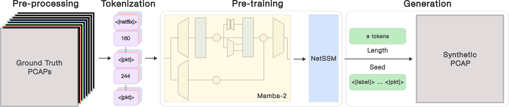{height="230px"}

::: {.caption}
Top: the three stages as a flow. Bottom: the architecture figure from the NetSSM paper (Chu et al., CoNEXT 2025).
:::

::: {.notes}
Walk left to right: (1) PCAP files are tokenized byte-by-byte; (2) the Mamba model is
trained with a cross-entropy next-token objective; (3) at generation time, a label token
(<|netflix|>, etc.) seeds the model and it autoregressively produces raw bytes that are
reassembled into PCAP. No separate post-processing step needed for TCP compliance —
unlike NetDiffusion's ControlNet + dependency trees.
:::

## Tokenization and Training

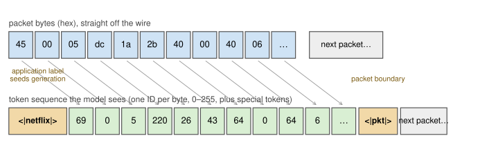

::: {.columns}
::: {.column width="50%"}
**Tokenization**

- One token per byte (IDs 0–255); no feature engineering
- Special tokens: app labels (`<|netflix|>`, …) and `<|pkt|>` boundaries
:::
::: {.column width="50%"}
**Training**

- Next-token prediction (cross-entropy), no per-packet labels
- Sequences up to **100,000 tokens** (~943 packets); Mamba-2 backbone
:::
:::

::: {.caption}
Treating raw bytes as tokens means the model must learn protocol structure from data alone, and it does. Try it: `example/train_netssm_from_scratch.ipynb` in github.com/noise-lab/netssm trains a small model on Colab (GPU runtime).
:::

::: {.notes}
Compare to NetDiffusion's tokenization: nPrint encodes packets as bit-level image rows.
NetSSM's approach is simpler and generalizes across protocols without redesigning the
representation. The 100,000-token context vs. ~12,000 for transformer-based generators
is the core scaling advantage. See the book's NetSSM section.
:::

# Evaluation {.center}

::: {.notes}
The evaluation framework is itself a contribution. Introduce the three-dimensional
assessment before showing results so students understand why each metric matters.
:::

## A Three-Dimensional Evaluation Framework

```{dot}
//| fig-width: 12.4
//| fig-height: 3.4
digraph evalfw {
  rankdir=LR; nodesep=0.3; ranksep=0.6; bgcolor="transparent";
  node [shape=box, style="filled,rounded", fontname="Helvetica", fontsize=17, color="#555555", penwidth=1.4, margin="0.16,0.08"];
  edge [color="#555555", penwidth=1.5, fontname="Helvetica", fontsize=15];
  gen [label="synthetic PCAP", fillcolor="#cfe3f5"]; real [label="real PCAP\n(held out)", fillcolor="#cfe3f5"];
  s [label="1. Statistical similarity\nJSD of packet-size distributions", fillcolor="#f2d9a8"];
  m [label="2. Downstream ML utility\ntrain classifier on synthetic,\ntest on real", fillcolor="#f2d9a8"];
  sem [label="3. Semantic similarity (new)\nprotocol rules obeyed?\napp-level behaviour reproduced?", fillcolor="#f8d7c4"];
  o1 [label="distribution match", fillcolor="#d9efd3"]; o2 [label="accuracy on real data", fillcolor="#d9efd3"]; o3 [label="valid TCP, realistic sessions", fillcolor="#d9efd3"];
  gen -> s; real -> s; gen -> m; real -> m; gen -> sem; real -> sem; s -> o1; m -> o2; sem -> o3;
}
```

Prior work stopped at **statistical similarity**. A model can match every marginal byte
distribution and still emit TCP that no stack would accept, so NetSSM adds **ML utility**
and **semantic similarity**: the hardest dimension to fake and the most practically meaningful.

::: {.notes}
Ask students: why isn't statistical similarity enough? (A model could perfectly reproduce
the marginal byte distribution while generating syntactically invalid TCP packets.)
Why isn't ML utility enough? (A classifier might achieve high accuracy for spurious
reasons unrelated to protocol fidelity.) Semantic similarity is the hardest to fake and
the most practically meaningful.
:::

## Results: Statistical and ML Performance

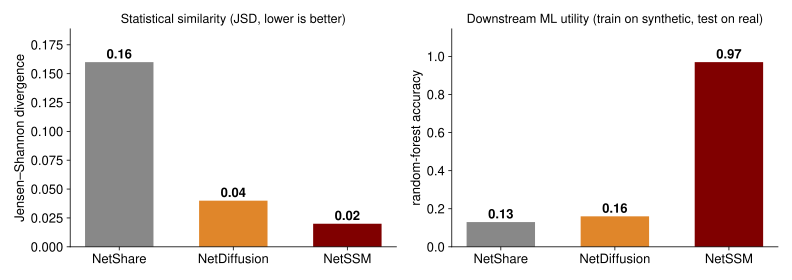

- **Statistical**: JSD 0.02, 8× better than NetShare (0.16) and 2× better than NetDiffusion (0.04)
- **ML utility**: a random forest trained **entirely on synthetic data** reaches **0.97** accuracy on real traffic; prior generators, even packet-level ones, gave 0.13–0.16

::: {.caption}
Numbers from the NetSSM paper (Chu et al., CoNEXT 2025); bars drawn from the same values.
:::

::: {.notes}
The 0.97 accuracy result is the "money slide" — it directly answers the practitioner's
question: "can I use this synthetic data to train my IDS?" The comparison baseline (0.16
for NetDiffusion) shows that prior art, despite generating raw packets, was not actually
useful for training real classifiers. See the evaluation figures for application-level
breakdowns.
:::

## Results: ML Utility vs. Synthetic Data Mix Rate

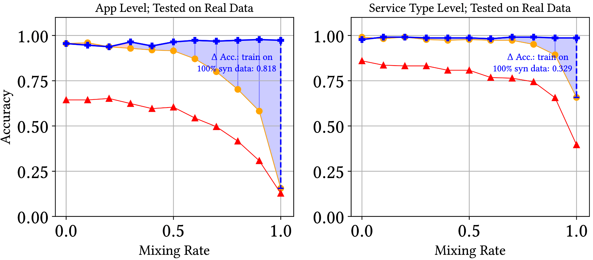

**NetSSM maintains ~0.97 accuracy even at 100% synthetic training data.**

NetDiffusion and NetShare degrade significantly as the synthetic fraction increases —
their synthetic data actively degrades classifier performance.

::: {.notes}
The mixing-rate experiment directly addresses the "but can it fully replace real data?"
question. Students should notice the flat line for NetSSM vs. the steep drops for
competitors. The implication: an organization with no access to real traffic could train
a production-grade classifier using only NetSSM output.
:::

## Results: Packet Size Distributions

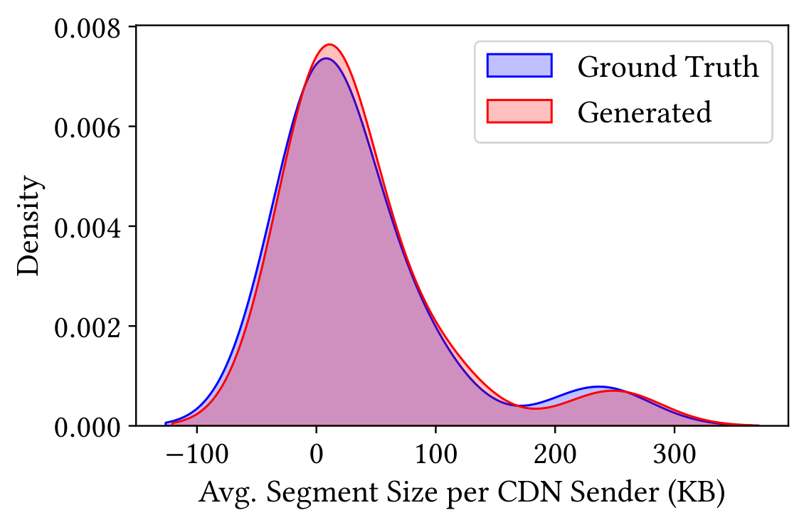

NetSSM accurately captures the full packet-size distribution — including the bi-modal
structure typical of mixed ACK + data packets.

::: {.notes}
KDE plots provide visual confirmation of statistical fidelity. Point out what the
distribution shape tells us about the traffic: the left peak is ACKs and small control
packets; the right peak is MTU-sized data packets. A model that only gets the mean right
would produce a single-mode distribution and fail this test.
:::

## Results: Semantic Similarity — TCP Compliance

**Protocol-adherent traffic with no external correction step**

```{dot}
//| fig-width: 12.4
//| fig-height: 2.5
digraph tcp {
  rankdir=LR; nodesep=0.25; ranksep=0.45; bgcolor="transparent";
  node [shape=box, style="filled,rounded", fontname="Helvetica", fontsize=16, color="#555555", penwidth=1.4, margin="0.14,0.08"];
  edge [color="#555555", penwidth=1.5, fontname="Helvetica", fontsize=14];
  syn [label="SYN\nseq=x", fillcolor="#cfe3f5"]; sa [label="SYN-ACK\nseq=y, ack=x+1", fillcolor="#cfe3f5"]; ack [label="ACK\nack=y+1", fillcolor="#cfe3f5"];
  data [label="DATA / ACK\nseq, ack advance\nby bytes sent", fillcolor="#d9efd3"]; fin [label="FIN / FIN-ACK\n(or the partial\nteardowns seen in the wild)", fillcolor="#f8d7c4"];
  st [label="hidden state hₜ tracks\nthe connection's phase,\nseq/ack counters, options", fillcolor="#f2d9a8"];
  syn -> sa -> ack -> data -> fin;
  st -> syn [style=dashed]; st -> data [style=dashed]; st -> fin [style=dashed];
}
```

- Correct three-way handshake, valid sequence and acknowledgment progression
- Advanced options (timestamps, window scaling, SACK); real-world anomalies such as partial teardowns and conflicting flags reproduced faithfully
- **Generated traces pass standard TCP protocol validators**

::: {.notes}
Contrast with NetDiffusion: NetDiffusion needed ControlNet + dependency trees as external
post-processing to fix protocol violations. NetSSM's protocol compliance emerges naturally
from the recurrent hidden state tracking the TCP state machine. This is the key argument
in the book's SSM section: "the generated packets are more likely to be consistent with
protocol semantics without requiring extensive post-processing."
:::

## Results: Multi-Flow Sessions

**NetSSM is the first generator to reliably produce multi-flow PCAP sessions.**

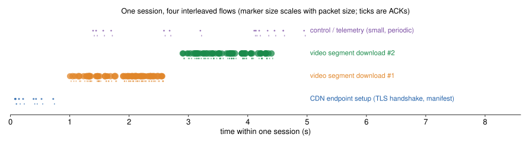

::: {.caption}
Illustrative shape of a video-streaming session: CDN endpoint setup, then segment-download bursts, with control flows interleaved throughout. NetSSM reproduces the interleaving, timing, and sequencing across flows.
:::

**Why it matters**: real traffic (web browsing, IoT, streaming) is always multi-flow.
Single-flow generators produce traces no network system would ever see.

::: {.notes}
Ask: what real-world systems would break if you only had single-flow synthetic traces?
IDS signatures that rely on cross-flow correlations; load balancers tested with realistic
session patterns; video streaming QoE models that require CDN setup + segment download
sequences. This is the gap that motivates NetSSM's main claim.
:::

# Comparison and Context {.center}

## Comparison to Prior Work

::: {.columns}
::: {.column width="50%"}
| Method | Output | Multi-flow |
|---|---|---|
| NetShare | flow stats | no |
| NetDiffusion | raw packets | no |
| **NetSSM** | **raw packets** | **yes** |

**Gaps closed by NetSSM**

- Multi-flow sessions: first of its kind
- 8× longer context, 78× longer generation
- No post-processing for protocol compliance
:::
::: {.column width="50%"}
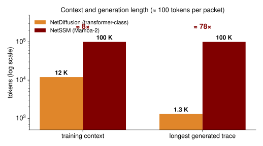
:::
:::

::: {.notes}
The 78× longer generation is the headline number from the abstract. Emphasize what
78× means in practice: NetDiffusion generates ~1,300 tokens (~12 packets); NetSSM
generates ~100,000 tokens (~943 packets). An entire TCP session, not just the
handshake.
:::

## Architecture Summary and Tradeoffs

| Architecture | Exemplar | Output | Length | Protocol state | Weak spot |
|---|---|---|---|---|---|
| **GAN** | NetShare | Flow stats | Unlimited | None | Low fidelity, mode collapse |
| **Diffusion** | NetDiffusion | Image → pcap | ~1024 pkts | Repaired afterwards | Short flows, no state |
| **Transformer** | ET-BERT | Tokens | O(n²) cost | Implicit | Quadratic scaling |
| **SSM** | NetSSM | Raw packets | O(n), very long | In the hidden state | Less spatial fidelity |

::: {.notes}
This table is the take-home summary for the chapter. Emphasize that there
is no universally best architecture: the right choice depends on whether
the application needs packet-level detail (use diffusion or SSM), long
trace lengths (use SSM), contextual protocol analysis (use transformer),
or just flow statistics (GAN is sufficient). The field is moving toward
hybrid approaches. See Chapter 7, "Summary."
:::

## NetLLM: Adapting LLMs to Networking Tasks

**NetLLM** (Wu et al., 2024) — rather than train from scratch, fine-tune
existing LLMs for three networking tasks:

::: {.columns}
::: {.column width="55%"}
**Tasks:** viewport prediction for 360° video, adaptive bitrate
selection, and cluster job scheduling

**Approach:** a multimodal encoder turns network time series into
LLM-readable tokens; the LLM is fine-tuned to emit the decision

**Results:** beats the task-specific algorithms and generalizes to
unseen network environments
:::
::: {.column width="45%"}
**Key insight:**

LLMs trained on text have learned **general reasoning patterns** that
transfer to sequential decision-making in networking.

The engineering challenge is the **multimodal gap**: network data is
time-series, not text — the encoder bridge makes it work.
:::
:::

::: {.notes}
NetLLM is an important existence proof that you don't have to train a
foundation model from scratch to get benefit from LLMs in networking.
The generalization result is surprising: fine-tuning on one network
environment and testing on a different one still outperforms algorithms
hand-crafted for that environment. This suggests the LLM's general
reasoning is doing real work, not just memorizing the training environment.
See Chapter 7, "Adapting LLMs for Networking Tasks."
:::

## Privacy Caveat: Synthetic ≠ Automatically Private {.smaller}

::: {.vignette}
**November 2025 — arXiv:2511.20497, "Quantifying the Privacy Implications of High-Fidelity Synthetic Network Traffic":** as models like NetSSM produce increasingly realistic traces, researchers demonstrated that *membership inference attacks* can determine whether a specific user's flows were in the training data. The paper introduces network-specific privacy metrics covering identifier memorization, sensitive property leakage, and topology extraction. The takeaway: fidelity and privacy exist in tension — stronger privacy guarantees (e.g., differential privacy) degrade synthetic data quality.
:::

**The fidelity–diversity–privacy trilemma**: synthetic traffic must be

- *similar enough* to train real classifiers,
- *diverse enough* to add information beyond training data, and
- *private enough* not to leak individual flows.

Balancing all three remains an open research problem.

::: {.notes}
This vignette (arxiv 2511.20497) is directly cited in the book's Privacy-Preserving Models
section. It grounds the abstract trilemma in a concrete result. Cold-call: "If you were
deploying NetSSM to share data with a university partner, what would you do before
releasing the synthetic traces?" (Differential privacy training, membership inference
audit, redaction of rare/unique patterns.)
:::

## Limitations and Open Problems

::: {.columns}
::: {.column width="50%"}
**Current limitations**

- **Protocol coverage**: tested primarily on TCP; UDP and QUIC are future work
- **Encrypted payloads**: byte-level modeling may not generalize to TLS-encrypted
  sessions without adaptation
- **Training cost**: single-flow batch size limits throughput
- **Privacy**: no differential-privacy guarantee in the base model
:::
::: {.column width="50%"}
**Open research directions**

- Extending SSMs to UDP, QUIC, and application-layer protocols
- Hybrid architectures: SSM for long-range state + diffusion for local fidelity
- Foundation models for networking (NetFound)
- Standardizing semantic similarity benchmarks
- Privacy-utility tradeoff for network generative models
:::
:::

::: {.notes}
The book's Limitations section on diffusion models lists the same issues (sequence length,
protocol compliance, state modeling) and argues these motivate SSMs. Flip the logic:
what might motivate a *fourth* architecture that addresses SSM's remaining gaps?
Hybrid SSM+diffusion is one active direction. Foundation models (NetFound) are another.
:::

# Summary {.center}

## Key Takeaways

**Three contributions of NetSSM** (Chu et al., ACM CoNEXT 2025):

1. **First reliable multi-flow session generator** — addresses the critical gap for
   real-world traffic scenarios (streaming, IoT, web)
2. **Superior performance** — 0.97 downstream accuracy vs. 0.16 for prior art;
   JSD of 0.02 vs. 0.04–0.16
3. **Semantic similarity evaluation** — new framework: statistical + ML utility +
   protocol adherence

**Broader lesson**: architecture choice matters for long, stateful sequences —
Mamba's linear scaling and selective state align naturally with network protocols.

**Protocols are state machines**: TCP's transitions are deterministic and an application's
are probabilistic; a traffic generator has to learn the states and the transitions, and the
SSM's recurrent state is where they live.

Code and a from-scratch training notebook: [github.com/noise-lab/netssm](https://github.com/noise-lab/netssm)

::: {.notes}
Close by connecting back to the course arc: we've now seen GANs (flow stats), diffusion
(short raw packets), and SSMs (long, multi-flow, protocol-compliant). Each fixed a prior
gap but introduced new ones. The field is still moving fast — the trilemma (fidelity,
diversity, privacy) will drive research for years. Ask: which of the three evaluation
dimensions matters most for your intended application?
:::

## Discussion Questions

1. **Multi-flow necessity**: for which networking applications is single-flow synthetic
   data sufficient? For which is multi-flow generation essential?

2. **Architecture tradeoffs**: when would you choose NetDiffusion over NetSSM, or
   vice versa? What does each sacrifice?

3. **Privacy-utility tradeoff**: how would you audit a synthetic dataset before
   sharing it outside your organization? What properties would you test?

4. **Benchmark gap**: NetSSM introduces semantic similarity metrics. What other
   domain-specific metrics might be needed for, say, intrusion detection?

::: {.notes}
These questions are suitable for a breakout (5 min groups, 5 min debrief). Question 1
will surface who has thought about systems vs. ML applications. Question 3 connects to
the privacy vignette. Question 4 is open-ended and good for a cold-call on the last few
minutes of class.
:::

# Appendix {.center}

> The three BERT-for-TLS slides show a transformer used for **classification** rather than
> generation; the two equation slides back the attention and state-space slides in the body.

::: {.notes}
Not taught in the main pass. The TLS slides are the worked example of a transformer applied
to a networking configuration problem, for a student who asks what transformers are good
for in networking if not generation. The two equations are the ones referenced from the
body.
:::

## BERT for TLS Misconfiguration Detection {.smaller}

**Problem:** TLS has 360 cipher suites, 44 elliptic curves, 40 extensions,
6 protocol versions — a combinatorially large, interacting configuration space.
Rule-based tools miss subtle interactions.

::: {.columns}
::: {.column width="55%"}
**Approach** (Chu et al., 2023):

1. **Pre-train BERT from scratch** on parsed TLS handshakes (tokenized
   as space-delimited strings): 5 GB, ~395 M words, 98.8% masked-LM accuracy
2. **Fine-tune** on Qualys SSL-graded sites:
   - Binary classification (misconfigured vs. properly configured)
   - Multi-label classification (certificate issue, weak cipher, etc.)

**Results:**
- Binary classification: **97.6% accuracy**, F1 = 97.6%
- Multi-label classification: **96.7% accuracy**, MCC = 0.953
:::
::: {.column width="45%"}
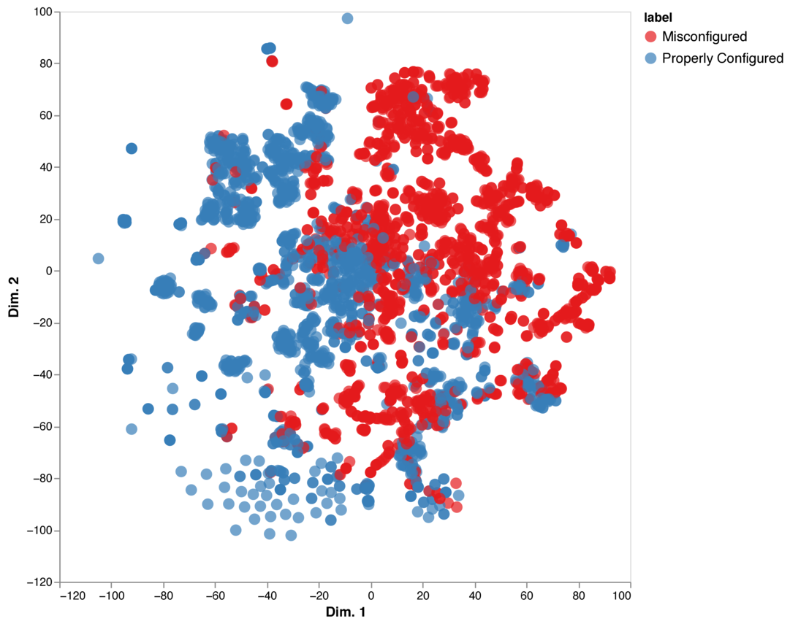
:::
:::

::: {.notes}
This is the TLS BERT work from the source extract (Slides 14–22). Key
insight: BERT's unsupervised pre-training on TLS handshake strings forces
the model to learn the semantic relationships between protocol fields —
e.g., that certain ciphersuites are incompatible with certain certificate
types. The t-SNE plot shows that fine-tuned embeddings cleanly separate
misconfigured from properly configured sites, and within misconfigured
sites, clusters correspond to distinct failure modes. See Chapter 7,
"Configuration Management with Transformers."
:::

## BERT for TLS: Model Pipeline {.smaller}

<!-- recovered from docs/slides/19-Generative.pptx slide 15 (extracted media s15-i23) -->
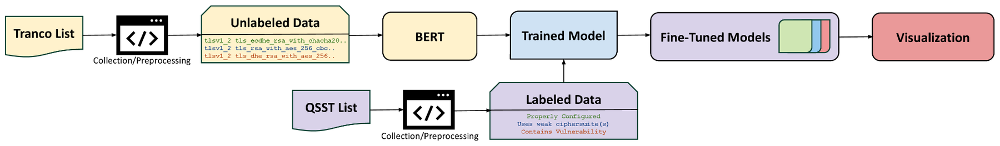{width="100%"}

::: {.columns}
::: {.column width="50%"}
**Pre-training path (top):**

- Scan the Tranco top million, parse each TLS handshake into a flat string
- Train BERT from scratch on the unlabeled strings with masked-language modeling
:::
::: {.column width="50%"}
**Fine-tuning path (bottom):**

- Qualys SSL Labs grades give labels: properly configured, weak cipher suite, known vulnerability
- One pre-trained model, several fine-tuned heads, then embeddings for visualization
:::
:::

::: {.notes}
Walk the figure left to right. The key design choice is that the unlabeled
corpus is large (a million sites) and the labeled corpus is small, which is
exactly the regime BERT-style pre-training was built for. Point out that
the same trained model feeds all the fine-tuned heads; the t-SNE plot on
the previous slide comes out of the "Visualization" box at the far right.
:::

## BERT for TLS: Tokenizing a Handshake {.smaller}

<!-- recovered from docs/slides/19-Generative.pptx slide 16 (WordPiece overlay stripped) -->
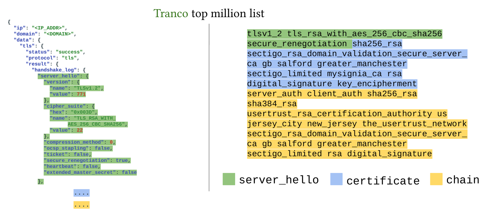{width="78%"}

- The scanner emits nested JSON; BERT wants a sentence, so each handshake becomes one flat string of field values
- Colors mark where the tokens came from: protocol version and cipher suite, then the leaf certificate, then the chain
- WordPiece then splits these into ~32,000 subword tokens, so rare CA names and cipher-suite fragments still get embeddings

::: {.notes}
This is the data-representation step the earlier bullets only name. Ask
students what is lost in the flattening (nesting, field names) and what is
kept (order and co-occurrence, which is what attention exploits). The
original slide animated a WordPiece example over the JSON; that overlay was
dropped so the two representations are side by side.
:::

## Scaled Dot-Product Attention

The attention layer from "The Transformer Architecture":

$$\text{Attention}(Q, K, V) = \text{softmax}\!\left(\frac{QK^\top}{\sqrt{d_k}}\right)V$$

- $Q$, $K$, $V$: query, key, and value matrices (one row per token)
- $QK^\top$: pairwise query–key similarity scores; $\sqrt{d_k}$ keeps them well-scaled
- softmax turns scores into weights; the result is a weighted sum of the values
- Multi-head attention runs several of these in parallel with different projections

::: {.notes}
Vaswani et al. (2017), "Attention Is All You Need." For networking: in a TLS
handshake, the query for the ciphersuite token attends to the protocol version
and certificate chain tokens — exactly the relationships we want to detect
misconfiguration. See Chapter 7, "The Transformer Architecture."
:::

## State-Space Recurrence

The hidden-state update behind "State Space Models: The Intuition":

$$h_t = \mathbf{A} h_{t-1} + \mathbf{B} x_t \qquad y_t = \mathbf{C} h_t$$

- $h_t$: hidden state; $x_t$: current input; $y_t$: output
- $\mathbf{A}$ carries the previous state forward, $\mathbf{B}$ writes the input in, $\mathbf{C}$ reads the output out
- In Mamba, $\mathbf{A}, \mathbf{B}, \mathbf{C}$ are functions of $x_t$ (selective), not fixed matrices

::: {.notes}
The SSM equations look like a discrete linear dynamical system. Mamba's key
innovation: A, B, C are functions of the current input x_t, not fixed
matrices. This lets the model selectively discard irrelevant packets (e.g.,
background traffic from another flow) and retain relevant ones (e.g., the
SYN that initiated this connection). See Chapter 7, "State Space Models" and
"How State Space Models Work."
:::
