# Why Generate Network Data? {.center}

> Labeled network traces are scarce.
> Generative models let us *create* the data we need.

```{=html}
<style>
.reveal .cell-output-display svg, .reveal .cell-output-display img { width: 100%; height: auto; }
.reveal .caption { font-size: 0.55em; color: #666666; margin-top: 0.2em; }
</style>
```

::: {.notes}
Open with the core motivation: everything downstream — classifiers, anomaly
detectors, protocol testers — depends on training data. Network data is
uniquely hard to obtain: it's sensitive, stateful, high-volume, and
non-tabular. Generative models close the gap. See Chapter 7 ("Generative
Models") in *Machine Learning for Networking*.
:::

## Why Network Data Is Scarce

::: {.columns}
::: {.column width="50%"}
**Collection barriers**

- Privacy and regulatory constraints limit sharing raw packet captures
- High-volume traces require expensive infrastructure
- Rare events (attacks, failures) are under-represented
- Labeled examples are especially hard to acquire
:::
::: {.column width="50%"}
**Downstream consequences**

- ML classifiers trained on thin data generalize poorly
- Minority-class accuracy (rare attacks) degrades first
- Network simulators lack realistic traffic diversity
- Privacy-preserving sharing of pcaps is nearly impossible
:::
:::

::: {.notes}
Sommer & Paxson (2010) famously argued that ML doesn't work well outside
the training distribution — and labeled network data is almost always
narrow in coverage. The scarcity problem is structural: operators don't
share pcaps, rare events are rare, and labeling flows at scale is
expensive. See *Machine Learning for Networking*, Chapter 7 introduction.
:::

## What Generative Models Offer

**Four practical benefits** (Chapter 7 framing):

| Use case | What the model does |
|---|---|
| **Traffic augmentation** | Create synthetic minority-class examples to re-balance training data |
| **Simulation and testing** | Feed network simulators / device test benches without live traffic |
| **Privacy-preserving sharing** | Publish statistical lookalikes instead of real pcaps |
| **What-if analysis** | Synthesize hypothetical scenarios (new attack vectors, protocol versions) |

::: {.notes}
Walk through each row with a concrete example. Augmentation: imagine you
have 50 examples of a DDoS attack pattern and 50,000 of normal traffic —
the classifier will ignore the minority class. Simulation/testing: firmware
teams need traffic to stress-test a new NIC driver. Privacy: a research
consortium wants to share ISP traces without leaking subscriber behavior.
What-if: generating TLS 1.3 traffic from a model trained on TLS 1.2. See
Chapter 7 intro of *Machine Learning for Networking*.
:::

# Architecture Landscape {.center}

> GANs → Diffusion Models → Transformers → State Space Models
> Each generation addressed the limits of the last.

::: {.notes}
Frame the chapter as an evolution story. Each architecture was motivated
by concrete failures of the previous one. This arc also mirrors the broader
deep-learning literature, so students can connect it to what they know.
See Chapter 7 of *Machine Learning for Networking* for the full arc.
:::

## Four Generations of Generative Models

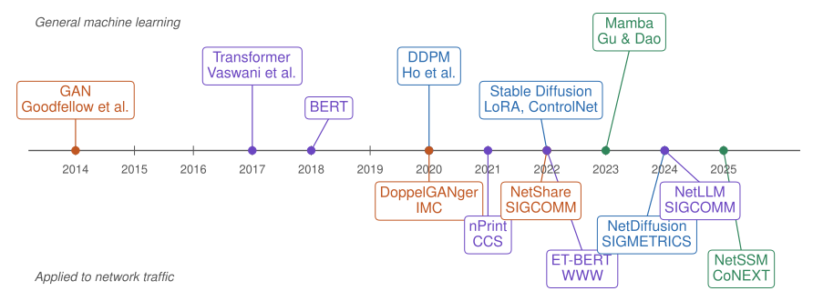{width="100%"}

::: {.caption}
Orange GANs, blue diffusion, purple transformers and LLMs, green state space models. Each family reached network traffic two to five years after it appeared in general ML.
:::

::: {.notes}
Read the figure left to right. GANs (2014) reached traffic generation with
DoppelGANger (2020) and NetShare (2022), but only as flow statistics.
Diffusion (DDPM 2020, Stable Diffusion 2022) became NetDiffusion (2024),
the first raw-pcap generator. Transformers (2017) reached traffic as
ET-BERT (2022) for classification and NetLLM (2024) for decisions, but the
quadratic attention cost blocks long traces. Mamba (2023) became NetSSM
(CoNEXT 2025). The lag between lanes is the gap this lecture is about:
what has to change for a general model to produce protocol-valid packets.
:::

## Generative Adversarial Networks (GANs) {.smaller}

::: {.columns}
::: {.column width="55%"}
**Core idea** (Goodfellow et al., 2014):

- A **generator** $G(z)$ transforms random noise into synthetic data
- A **discriminator** $D(x)$ tries to tell real from fake
- Trained **adversarially**: generator tries to fool the discriminator;
  discriminator tries to catch it
- Training ends when neither can improve — Nash equilibrium

**Training objective:** the discriminator is trained to maximize its accuracy at
telling real from fake, while the generator is trained to minimize it.
*(Equation in the appendix.)*
:::
::: {.column width="45%"}
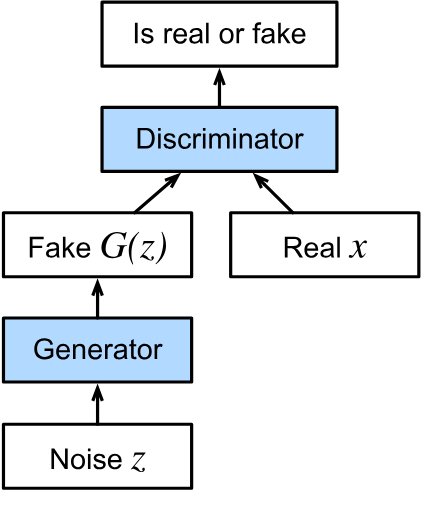
:::
:::

::: {.notes}
The GAN idea is elegant but training is famously tricky. Mode collapse
(the generator learns to produce only one type of output) and oscillation
(the two networks never converge) are the classic failure modes. Explain
the minimax objective: the discriminator maximizes the probability it
assigns to real data while minimizing the probability it assigns to fakes;
the generator minimizes the probability the discriminator is right. See
Chapter 7, "Early Approaches: Generative Adversarial Networks."
:::

## GANs for Network Traffic: DoppelGANger and NetShare

**Applied to networking:**

- **DoppelGANger** (Lin et al., 2020): generates time-series attributes of network flows
- **NetShare** (Zhang et al., 2022): generates NetFlow-style flow statistics
- Both preserve **aggregate statistical properties** of real traffic

::: {.columns}
::: {.column width="50%"}
**Strengths**

- Generative: variation, not replay
- High statistical resemblance to real flow records
- Useful for augmenting ML training sets
:::
::: {.column width="50%"}
**Limitations**

- Only **flow-level statistics**, not raw pcaps
- **Mode collapse** and training instability
- Models trained on GAN data underperform on real data
- No protocol rules: records can be invalid
:::
:::

::: {.notes}
Concretely: NetShare generates a table of flow tuples (srcip, dstip,
srcport, dstport, proto, bytes, duration). This is useful for traffic
matrix estimation but useless for testing a DPI engine or protocol
analyzer. The accuracy gap: models trained only on NetShare-generated data
achieve markedly lower accuracy on real test sets compared to models
trained on real data. See Chapter 7, "Early Approaches: GANs" and
"NetDiffusion" sections.
:::

## NetShare: Reported Accuracy vs. Train-on-Synthetic, Test-on-Real {.smaller}

<!-- recovered from docs/slides/19-Generative.pptx slide 52 -->
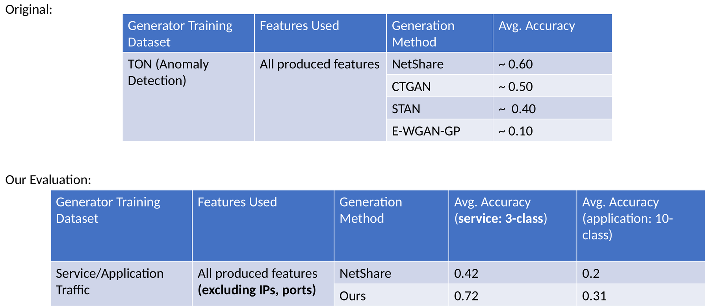{width="72%"}

- In its own paper NetShare looks strong: about 0.60 accuracy, well ahead of CTGAN, STAN, and E-WGAN-GP
- Change the task to service and application classification, train only on synthetic flows, and test on real ones: NetShare drops to 0.42 (3-class) and 0.20 (10-class)
- The evaluation setup, not just the generator, decides the headline number; this is the hard test the rest of the deck uses

::: {.notes}
Recovered from the original deck as a static table. Walk it top to bottom:
first the numbers NetShare reported, then what happens when the same
generator is asked to produce training data for a classifier that is then
tested on real traffic. The point is methodological: statistical similarity
and in-distribution accuracy do not predict train-on-synthetic /
test-on-real performance. "Ours" is NetDiffusion; the full comparison is on
the evaluation slide later. IPs and ports are excluded as features so the
classifier cannot shortcut on identifiers.
:::

# Diffusion Models {.center}

> Instead of adversarial training, learn to **reverse noise**.

::: {.notes}
Transition: GANs are hard to train stably and produce only statistical
summaries for network data. Diffusion models offer a fundamentally
different approach that sidesteps mode collapse and produces much
higher-fidelity outputs. See Chapter 7, "Diffusion Models."
:::

## How Diffusion Models Work

::: {.columns}
::: {.column width="55%"}
**Forward process:** progressively add noise to training data until it
becomes pure Gaussian noise

**Reverse process:** train a neural network to denoise, step by step —
starting from pure noise and recovering the original structure

**Why it beats GANs:** one network, one supervised denoising loss; no
adversary, no mode collapse; conditioning (a text prompt) steers the output
:::
::: {.column width="45%"}
**Stable Diffusion** (Rombach et al., 2022):

- Diffuses in a **compressed latent space**, not raw pixels
- Text prompts steer generation
- Pre-trained on billions of images; adaptable by fine-tuning
:::
:::

```{dot}
//| fig-width: 12.4
//| fig-height: 2.6
digraph diffusion {
  rankdir=LR; nodesep=0.3; ranksep=0.5; bgcolor="transparent";
  node [shape=box, style="filled,rounded", fontname="Helvetica", fontsize=16,
        color="#555555", penwidth=1.4, margin="0.14,0.08"];
  edge [color="#555555", penwidth=1.6, fontname="Helvetica", fontsize=14];
  x0 [label="x₀\nreal traffic\nimage", fillcolor="#cfe3f5"];
  x1 [label="x₁\nslightly\nnoisy", fillcolor="#dbe9f6"];
  x2 [label="…", fillcolor="#e9e1dc"];
  xT [label="x_T\npure\nnoise", fillcolor="#f8d7c4"];
  x0 -> x1 [label="forward q:\nadd noise", fontcolor="#c05621", color="#c05621"];
  x1 -> x2 -> xT [color="#c05621"];
  xT -> x2 [label="reverse p_θ:\nlearned denoiser", fontcolor="#2f855a", color="#2f855a", constraint=false];
  x2 -> x1 -> x0 [color="#2f855a", constraint=false];
}
```

::: {.notes}
Ho et al. (2020) introduced DDPM (denoising diffusion probabilistic models).
The key insight: rather than pitting two networks against each other, train
a single network to denoise, which is a well-posed supervised problem.
Stable Diffusion adds two ideas: latent-space compression (fast) and text
conditioning (controllable). Both are central to how NetDiffusion works.
See Chapter 7, "Diffusion Models" and "How Diffusion Models Work."
:::

## NetDiffusion: Text-to-Traffic Synthesis {.smaller}

**Core idea:** represent a network flow as an **image**, then use a text-to-image
diffusion model to generate synthetic flows.

::: {.columns}
::: {.column width="55%"}
**Four-stage pipeline:**

1. **Traffic → image** via nPrint: one packet per row;
   bits map to green (1), red (0), gray (absent)
2. **Fine-tune** Stable Diffusion with LoRA on traffic images
   plus text prompts ("TCP Amazon traffic")
3. **Controlled generation** with ControlNet: edges from an example
   image fix which header fields may be populated
4. **Image → pcap** with dependency-tree post-processing for
   intra- and inter-packet protocol rules
:::
::: {.column width="45%"}
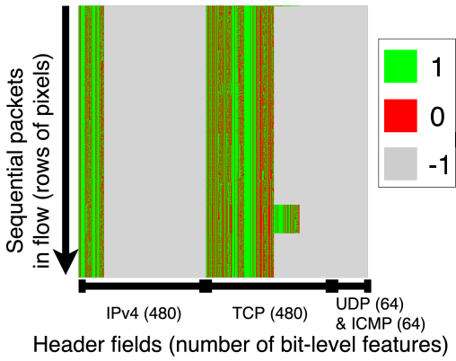
:::
:::

::: {.notes}
Walk through each stage carefully. Stage 1: nPrint turns each packet header
into a fixed-size bit vector (480 bits for IPv4, 480 for TCP, 64 for UDP/ICMP).
Arranging packets as rows gives a 1024×1088 image for a 1024-packet flow.
Stage 2: LoRA (Low Rank Adaptation) updates only a small fraction of the
model's parameters — making fine-tuning tractable on modest hardware.
Stage 3: ControlNet does Canny edge detection on a real example; the edges
mask which pixel columns the generation should populate — this prevents the
model from "inventing" TCP bits in the UDP region. Stage 4: dependency
trees handle checksum fields, sequence numbers, IP addresses. See Chapter 7,
"NetDiffusion: Applying Diffusion to Network Traffic."
:::

## NetDiffusion Pipeline Overview

```{dot}
//| fig-width: 12.4
//| fig-height: 1.7
digraph netdiffusion {
  rankdir=LR; nodesep=0.25; ranksep=0.4; bgcolor="transparent";
  node [shape=box, style="filled,rounded", fontname="Helvetica", fontsize=17,
        color="#555555", penwidth=1.4, margin="0.14,0.07"];
  edge [color="#555555", penwidth=1.5, fontname="Helvetica", fontsize=14];
  pcap [label="real pcaps\n+ labels", fillcolor="#cfe3f5"];
  img  [label="1. nPrint → image\none packet per row", fillcolor="#f2d9a8"];
  ft   [label="2. LoRA fine-tune\nStable Diffusion\non (image, caption)", fillcolor="#f2d9a8"];
  gen  [label="3. generate\ntext prompt + ControlNet\nedge mask", fillcolor="#f2d9a8"];
  post [label="4. image → pcap\ndependency-tree\nprotocol repair", fillcolor="#f2d9a8"];
  out  [label="synthetic pcaps\nopen in Wireshark,\nreplay with tcpreplay", fillcolor="#d9efd3"];
  pcap -> img -> ft -> gen -> post -> out;
}
```

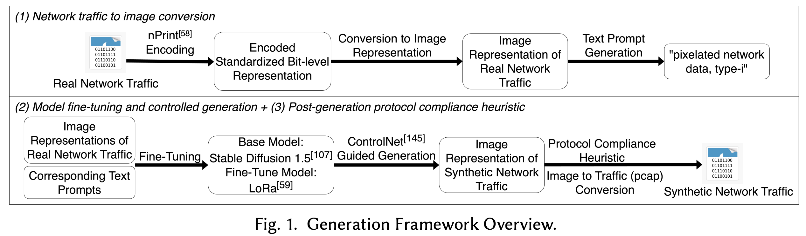{width="82%"}

::: {.notes}
This is the full pipeline diagram from the NetDiffusion paper (Jiang et al.,
2024, published in ACM SIGMETRICS / POMACS); the strip above it is the same
four steps in one line. The three rows correspond to
the three phases described on the previous slide. Point out the flow from
real pcaps (top-left) all the way to synthetic pcaps (bottom-right). The
post-generation heuristic is what allows the synthetic pcaps to open
cleanly in Wireshark and replay via TCPreplay. See Chapter 7, "NetDiffusion."
:::

## Why Fine-Tuning and ControlNet Both Matter {.smaller}

<!-- recovered from docs/slides/19-Generative.pptx slide 53 (NetDiffusion paper, Fig. 5) -->
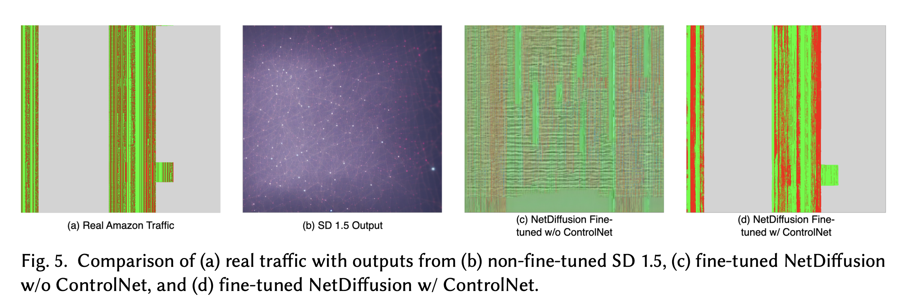{width="90%"}

- Off-the-shelf Stable Diffusion, prompted with "Amazon traffic", paints a starfield: it has no idea what a packet looks like
- LoRA fine-tuning teaches it the green/red bit texture, but the columns smear across the whole width, so header fields land where they cannot exist
- ControlNet's edge mask pins the generated bits to the columns real traffic uses; only panel (d) opens in Wireshark after post-processing

::: {.notes}
This is the ablation figure from the NetDiffusion paper, recovered from the
original deck. Walk the four panels left to right and ask students what
changed between each pair: (a) to (b) is "no fine-tuning", (b) to (c) is
"fine-tuned but unconstrained", (c) to (d) is "add ControlNet". Panel (c)
is the one to dwell on: the model has learned the look of traffic but not
its structure, which is exactly why a pure image model needs external
protocol constraints. That weakness is what motivates SSMs later.
:::

## NetDiffusion: Protocol Compliance via Post-Processing

```{dot}
//| fig-width: 12.4
//| fig-height: 2.6
digraph post {
  rankdir=LR; nodesep=0.2; ranksep=0.45; bgcolor="transparent";
  node [shape=box, style="filled,rounded", fontname="Helvetica", fontsize=16,
        color="#555555", penwidth=1.4, margin="0.14,0.07"];
  edge [color="#555555", penwidth=1.5, fontname="Helvetica", fontsize=14];
  img [label="generated image\n(bits may be\ninconsistent)", fillcolor="#f8d7c4"];
  fields [label="decode rows into\nheader fields", fillcolor="#cfe3f5"];
  subgraph cluster_intra { label="intra-packet rules (each packet alone)"; fontname="Helvetica"; fontsize=15; color="#999999"; style=dashed;
    ck [label="checksums match\npayload", fillcolor="#f2d9a8"];
    len [label="header length ≥\nminimum", fillcolor="#f2d9a8"];
    fl [label="legal flag sets\n(no SYN+FIN)", fillcolor="#f2d9a8"];
  }
  subgraph cluster_inter { label="inter-packet rules (across the flow)"; fontname="Helvetica"; fontsize=15; color="#999999"; style=dashed;
    hs [label="three-way\nhandshake first", fillcolor="#f2d9a8"];
    seq [label="seq / ack\nnumbers advance", fillcolor="#f2d9a8"];
    ip [label="IPs and ports:\nmajority vote", fillcolor="#f2d9a8"];
  }
  out [label="valid pcap\n(Wireshark,\ntcpreplay)", fillcolor="#d9efd3"];
  img -> fields -> ck -> hs -> out;
  fields -> len -> seq -> out;
  fields -> fl -> ip -> out;
}
```

**Goal:** the fewest edits that make the model's output tool-compatible.
Intra-packet fixes run first (each packet valid on its own), then
inter-packet fixes (the flow coherent as a whole).

::: {.notes}
The post-processing pass traverses the dependency tree bottom-up: fix
intra-packet issues first (so each packet is individually valid), then
enforce inter-packet constraints (so the flow is semantically coherent).
For fields that should be constant (like source IP) but vary due to
generation randomness, majority voting selects the dominant value. This is
a pragmatic engineering fix, not a principled one — it motivates the
shift to SSMs later. See Chapter 7, "Post-Processing with Dependency Trees."
:::

## NetDiffusion: Evaluation Results

::: {.columns}
::: {.column width="50%"}
**Statistical similarity** vs. NetShare (baseline GAN):

- **>70% improvement** across all generated fields
- **>30% improvement** on shared (common) fields

**ML accuracy** (train on synthetic, test on real):

- **>60% improvement** in traffic classification accuracy
- Class balancing: generating synthetic minority-class flows
  further improves accuracy for rare applications (Zoom, Facebook Meet)
:::
::: {.column width="50%"}
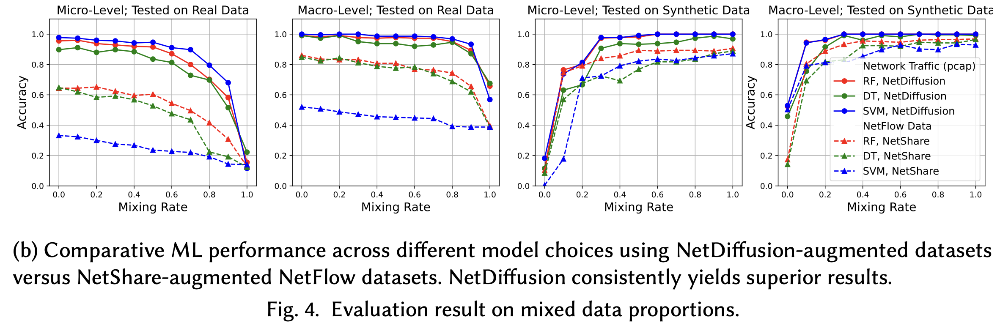
:::
:::

::: {.notes}
These numbers come from the ACM SIGMETRICS 2024 paper (Jiang et al., 2024).
Evaluation uses 10 applications across 3 macro-service classes (video
streaming, video conferencing, social media). The train-on-synthetic /
test-on-real scenario is the hardest test: if synthetic data is truly
realistic, you should be able to learn from it without seeing any real
data. The class balancing result is perhaps the most practically important:
for underrepresented classes, adding NetDiffusion-generated samples
significantly boosts classification F1. See Chapter 7, "Evaluation and
Results."
:::

## Limitations of Diffusion Models for Networking

**Four structural challenges** (Chapter 7):

| Limitation | Why it matters for networking |
|---|---|
| **Sequence length cap** | Images limited to ~1024 packets; real flows span thousands |
| **External compliance** | Protocol rules enforced by post-processing, not the model itself |
| **No explicit state** | TCP state machines not modeled; complex state transitions are hard |
| **Fidelity vs. diversity** | Memorization vs. novelty trade-off; optimal balance is an open problem |

::: {.notes}
These limitations directly motivate the move to transformers and state
space models. The sequence length issue is acute: 1024 packets is a few
seconds for a busy flow. The lack of explicit state modeling means
NetDiffusion can produce individually-valid packets that are semantically
incoherent as a flow (e.g., DATA packets before the handshake). The
fidelity-diversity trade-off interacts with privacy: synthetic data must
be different enough to protect privacy yet similar enough to be useful.
See Chapter 7, "Limitations of Diffusion Models."
:::

# Transformers and LLMs {.center}

> Attention mechanisms capture contextual relationships —
> but scale **quadratically** with sequence length.

::: {.notes}
Transformers are the dominant architecture of the 2020s. Understanding
them is essential both for their direct networking applications (TLS
misconfiguration detection, protocol analysis) and because their
scalability limitations motivate state space models. See Chapter 7,
"Transformers and Large Language Models."
:::

## Embeddings: Words, Packets, and Flows

**The word vector idea** (word2vec, Mikolov et al., 2013):

- Each word is a point in a vector space; similar meaning, nearby points ("cat" ≈ "lion"); king − man + woman ≈ queen

**Extended to networking:**

- **nPrint**: each packet → fixed-size bit vector that keeps protocol structure
- **ET-BERT**: packet bytes as tokens; self-supervised pre-training on unlabeled encrypted traffic (Lin et al., 2022)

```{dot}
//| fig-width: 12.4
//| fig-height: 1.9
digraph emb {
  rankdir=LR; nodesep=0.25; ranksep=0.45; bgcolor="transparent";
  node [shape=box, style="filled,rounded", fontname="Helvetica", fontsize=16,
        color="#555555", penwidth=1.4, margin="0.12,0.07"];
  edge [color="#555555", penwidth=1.5];
  w  [label="words in\na sentence", fillcolor="#cfe3f5"];
  p  [label="packets\nin a flow", fillcolor="#cfe3f5"];
  t  [label="tokens\n(WordPiece |\nnPrint bits, bytes)", fillcolor="#f2d9a8"];
  e  [label="one embedding\nvector per token", fillcolor="#f2d9a8"];
  a  [label="attention over\nthe sequence", fillcolor="#d9efd3"];
  w -> t; p -> t; t -> e -> a;
}
```

::: {.notes}
The analogy between words-in-sentences and packets-in-flows is powerful:
both are sequences of discrete tokens where meaning comes from context.
nPrint gives us a deterministic, protocol-aware tokenization. ET-BERT
then applies BERT pre-training to unlabeled traffic, learning contextual
embeddings that transfer to classification tasks. See Chapter 7, "Vectors
and Embeddings."
:::

## The Transformer Architecture

::: {.columns}
::: {.column width="55%"}
**Two core components:**

**Attention layer** — each token attends to all others: its output is a weighted
average of the values, with weights set by how well its query matches every key.
*(Equation in the appendix.)*

- Query $Q$: what am I looking for?
- Key $K$: what do I offer?
- Value $V$: what information do I carry?
- Multi-head: multiple attention heads learn different relationships

**Feed-forward layer** — processes concatenated attention output;
captures patterns from training.
:::
::: {.column width="45%"}
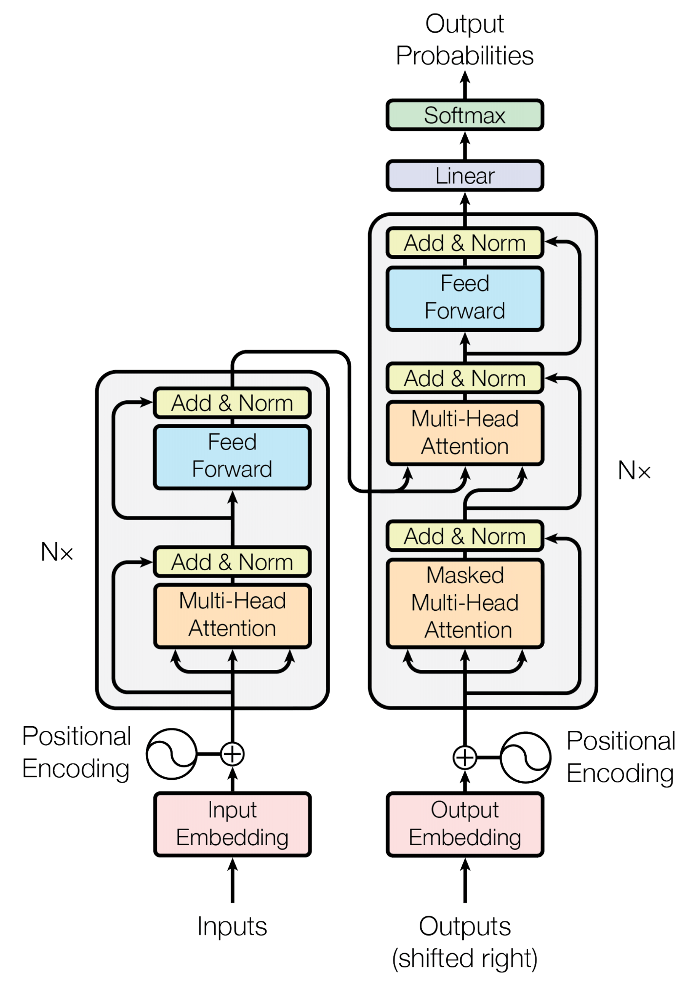
:::
:::

::: {.notes}
Vaswani et al. (2017), "Attention Is All You Need." Walk through the
encoder-decoder split: the encoder reads the input and builds
context-aware representations; the decoder generates output tokens
autoregressively. BERT uses encoder only (bidirectional context, good
for classification). GPT uses decoder only (unidirectional, good for
generation). For networking: in a TLS handshake, the query for the
ciphersuite token attends to the protocol version and certificate chain
tokens — exactly the relationships we want to detect misconfiguration.
See Chapter 7, "The Transformer Architecture."
:::

## BERT for TLS Misconfiguration Detection {.smaller}

**Problem:** TLS has 360 cipher suites, 44 elliptic curves, 40 extensions,
6 protocol versions — a combinatorially large, interacting configuration space.
Rule-based tools miss subtle interactions.

::: {.columns}
::: {.column width="55%"}
**Approach** (Chu et al., 2023):

1. **Pre-train BERT from scratch** on parsed TLS handshakes (tokenized
   as space-delimited strings): 5 GB, ~395 M words, 98.8% masked-LM accuracy
2. **Fine-tune** on Qualys SSL-graded sites:
   - Binary classification (misconfigured vs. properly configured)
   - Multi-label classification (certificate issue, weak cipher, etc.)

**Results:**
- Binary classification: **97.6% accuracy**, F1 = 97.6%
- Multi-label classification: **96.7% accuracy**, MCC = 0.953
:::
::: {.column width="45%"}
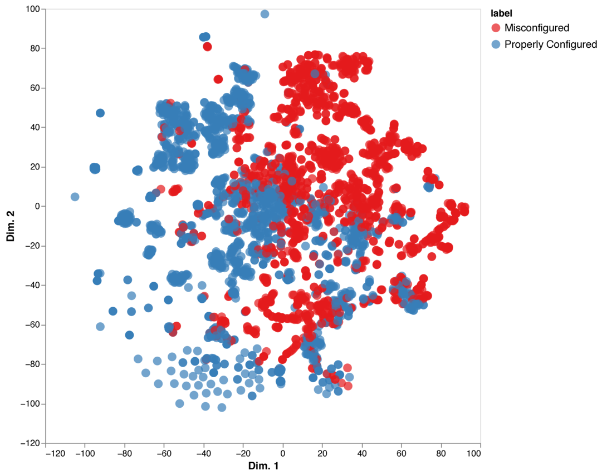
:::
:::

::: {.notes}
This is the TLS BERT work from the source extract (Slides 14–22). Key
insight: BERT's unsupervised pre-training on TLS handshake strings forces
the model to learn the semantic relationships between protocol fields —
e.g., that certain ciphersuites are incompatible with certain certificate
types. The t-SNE plot shows that fine-tuned embeddings cleanly separate
misconfigured from properly configured sites, and within misconfigured
sites, clusters correspond to distinct failure modes. See Chapter 7,
"Configuration Management with Transformers."
:::

## BERT for TLS: Model Pipeline {.smaller}

<!-- recovered from docs/slides/19-Generative.pptx slide 15 (extracted media s15-i23) -->
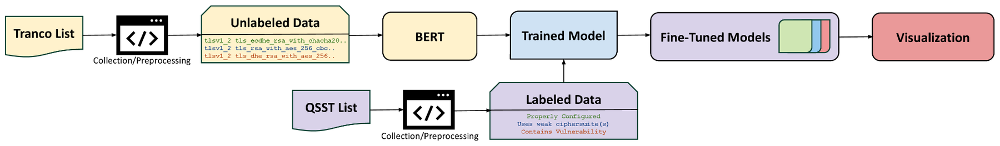{width="100%"}

::: {.columns}
::: {.column width="50%"}
**Pre-training path (top):**

- Scan the Tranco top million, parse each TLS handshake into a flat string
- Train BERT from scratch on the unlabeled strings with masked-language modeling
:::
::: {.column width="50%"}
**Fine-tuning path (bottom):**

- Qualys SSL Labs grades give labels: properly configured, weak cipher suite, known vulnerability
- One pre-trained model, several fine-tuned heads, then embeddings for visualization
:::
:::

::: {.notes}
Walk the figure left to right. The key design choice is that the unlabeled
corpus is large (a million sites) and the labeled corpus is small, which is
exactly the regime BERT-style pre-training was built for. Point out that
the same trained model feeds all the fine-tuned heads; the t-SNE plot on
the previous slide comes out of the "Visualization" box at the far right.
:::

## BERT for TLS: Tokenizing a Handshake {.smaller}

<!-- recovered from docs/slides/19-Generative.pptx slide 16 (WordPiece overlay stripped) -->
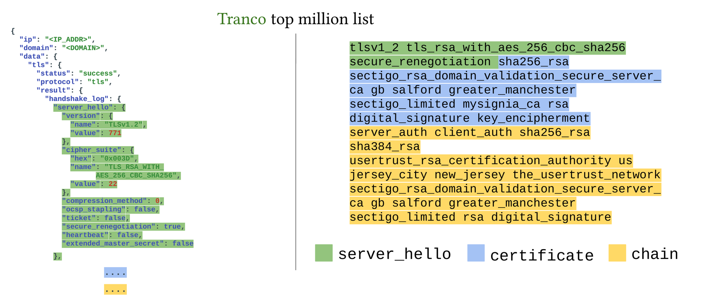{width="78%"}

- The scanner emits nested JSON; BERT wants a sentence, so each handshake becomes one flat string of field values
- Colors mark where the tokens came from: protocol version and cipher suite, then the leaf certificate, then the chain
- WordPiece then splits these into ~32,000 subword tokens, so rare CA names and cipher-suite fragments still get embeddings

::: {.notes}
This is the data-representation step the earlier bullets only name. Ask
students what is lost in the flattening (nesting, field names) and what is
kept (order and co-occurrence, which is what attention exploits). The
original slide animated a WordPiece example over the JSON; that overlay was
dropped so the two representations are side by side.
:::

## The Scaling Problem: O(n²) Attention

**Attention compares every token with every other: cost O(n²) in the sequence length n.**

::: {.columns}
::: {.column width="52%"}
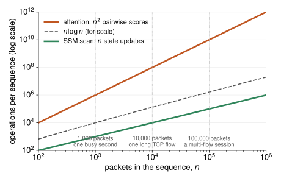
:::
::: {.column width="48%"}
**Why this hurts networking:**

- A few seconds of traffic is thousands of packets; a session is millions
- 1,000 packets → 10⁶ scores; 100,000 packets → 10¹⁰

**Also: no explicit state**

- TCP is a state machine (SYN_SENT → ESTABLISHED → FIN_WAIT); a transformer learns it only *implicitly* from position patterns
- Million-token context windows exist, but the quadratic bill is paid every time
:::
:::

::: {.notes}
This is the key motivation for state space models (the subject of Deck 18).
Even with flash attention and other algorithmic improvements, the O(n²)
wall is real for networking-scale sequences. Compare: GPT-3 handled ~4K
tokens; current frontier models handle ~1M tokens, but that is still only
a few thousand packets for a busy flow. See Chapter 7, "The Scaling
Problem with Transformers."
:::

# State Space Models {.center}

> Maintain a **compact state** — no pairwise attention needed.

::: {.notes}
This section bridges to Deck 18 (NetSSM). SSMs are the motivation for
that full lecture; here we give just enough context to complete the
architecture survey. See Chapter 7, "State Space Models."
:::

## State Space Models and Mamba

**Core idea:** no pairwise attention; a fixed-size **hidden state** $h_t$
summarizes everything seen so far. Each packet updates the state; the output
is read off the state. *(Equation in the appendix.)*

::: {.columns}
::: {.column width="50%"}
**Mamba** (Gu & Dao, 2023):

- $\mathbf{A}, \mathbf{B}, \mathbf{C}$ are **input-dependent**: the model
  chooses what to keep and what to forget
- Hardware-aware parallel scan on GPU
- **O(n)**: cost grows linearly with length

**Why this fits networking:**

- TCP, UDP, QUIC are state machines; the hidden state can hold protocol state
- Flows of thousands of packets are tractable
:::
::: {.column width="50%"}
```{dot}
//| fig-width: 6
//| fig-height: 4.2
digraph ssm {
  rankdir=TB; nodesep=0.5; ranksep=0.45; bgcolor="transparent";
  node [shape=box, style="filled,rounded", fontname="Helvetica", fontsize=18,
        color="#555555", penwidth=1.4, margin="0.16,0.08"];
  edge [color="#555555", penwidth=1.6, fontname="Helvetica", fontsize=16];
  hp [label="h₍t−1₎\nstate so far", fillcolor="#f2d9a8"];
  x  [label="x_t\npacket t", fillcolor="#cfe3f5"];
  h  [label="h_t\nupdated state\n(fixed size)", fillcolor="#f2d9a8"];
  y  [label="y_t\noutput /\nnext packet", fillcolor="#d9efd3"];
  hp -> h [label="A: carry forward"];
  x  -> h [label="B: write in"];
  h  -> y [label="C: read out"];
  h  -> hp [style=dashed, constraint=false];
}
```

::: {.caption}
One fixed-size update per packet; in Mamba, A, B, C depend on x_t.
:::
:::
:::

::: {.notes}
The SSM equations look like a discrete linear dynamical system. Mamba's
key innovation: A, B, C are functions of the current input x_t, not fixed
matrices. This lets the model selectively discard irrelevant packets
(e.g., background traffic from another flow) and retain relevant ones
(e.g., the SYN that initiated this connection). See Chapter 7, "State
Space Models" and "How State Space Models Work."
:::

## NetSSM: State-Aware Traffic Generation

**NetSSM** (Chu et al., *Proc. ACM on Networking*, CoNEXT 2025) applies
Mamba to raw packet-level trace generation.

::: {.columns}
::: {.column width="55%"}
**Key advances over NetDiffusion:**

- **Multi-flow sessions**: interleaved flows and their dependencies
- **8× and 78× longer traces** than prior transformer generators
- No image detour: packets are tokens in a sequence
- Protocol state lives in the hidden state

**Results:** higher fidelity and protocol compliance than prior
generators, without post-processing
:::
::: {.column width="45%"}
**Architecture comparison:**

| Model | Data format | Length | State |
|---|---|---|---|
| NetShare | Flow stats | Unlimited | None |
| NetDiffusion | Image | ~1024 pkts | External |
| NetSSM | Raw packets | 8–78× longer | Implicit SSM |
:::
:::

::: {.notes}
NetSSM is the subject of Deck 18 — this slide is deliberately brief to
avoid duplication. The key point here is that SSMs complete the
architectural evolution story: GANs → Diffusion → Transformers → SSMs,
each addressing the previous generation's most acute limitation. See
Chapter 7, "NetSSM: State Space Models for Network Traffic."
:::

# Broader Applications {.center}

> Beyond traffic generation: LLMs and foundation models
> are reshaping how we *manage* networks.

::: {.notes}
The chapter ends with applications that go beyond synthetic data
generation. These are relevant to current industry deployment and frame
where the field is heading. See Chapter 7, "Applications and Future
Directions."
:::

## NetLLM: Adapting LLMs to Networking Tasks

**NetLLM** (Wu et al., 2024) — rather than train from scratch, fine-tune
existing LLMs for three networking tasks:

::: {.columns}
::: {.column width="55%"}
**Tasks:** viewport prediction for 360° video, adaptive bitrate
selection, and cluster job scheduling

**Approach:** a multimodal encoder turns network time series into
LLM-readable tokens; the LLM is fine-tuned to emit the decision

**Results:** beats the task-specific algorithms and generalizes to
unseen network environments
:::
::: {.column width="45%"}
**Key insight:**

LLMs trained on text have learned **general reasoning patterns** that
transfer to sequential decision-making in networking.

The engineering challenge is the **multimodal gap**: network data is
time-series, not text — the encoder bridge makes it work.
:::
:::

::: {.notes}
NetLLM is an important existence proof that you don't have to train a
foundation model from scratch to get benefit from LLMs in networking.
The generalization result is surprising: fine-tuning on one network
environment and testing on a different one still outperforms algorithms
hand-crafted for that environment. This suggests the LLM's general
reasoning is doing real work, not just memorizing the training environment.
See Chapter 7, "Adapting LLMs for Networking Tasks."
:::

## Privacy in Synthetic Data: The Privacy-Utility Trade-off

**Synthetic data is not automatically private.**

::: {.columns}
::: {.column width="55%"}
**Membership inference:** from synthetic traffic alone, an adversary may
tell whether a given user's flows were in the training set

**Differential privacy:** calibrated noise during training so no single
example moves the output much (Dwork et al., 2014)

**The tension:** more privacy → more noise → lower fidelity
:::
::: {.column width="45%"}
**Three requirements at once:**

1. **Similar enough** to be useful for downstream ML
2. **Different enough** to protect individuals
3. **Diverse enough** to add information

Holding all three for stateful, protocol-constrained
traffic is an **open problem**.
:::
:::

::: {.notes}
This is a critical caveat to the entire chapter. Students sometimes
assume that synthetic data automatically solves the privacy problem —
that assumption is wrong. Membership inference attacks (Shokri et al.,
2017) apply directly to generative models. Differential privacy is the
principled solution, but the noise required to achieve strong guarantees
(epsilon < 1) degrades data quality substantially. For network data,
the temporal dependencies make DP even harder to apply correctly. See
Chapter 7, "Privacy-Preserving Models."
:::

## Where the Field Stood in 2025: NetSSM at CoNEXT

::: {.vignette}
**Dated note (2025).** Chu et al., "NetSSM: Multi-Flow and State-Aware
Network Trace Generation using State-Space Models," arXiv March 2025,
published in *Proceedings of the ACM on Networking* (ACM CoNEXT 2025).
Mamba-based, raw packet-level, **8× to 78× longer traces** than prior
transformer generators, with higher statistical fidelity and protocol
compliance than GAN and diffusion baselines, and the first generator to model
**multi-flow sessions**. It closes the two gaps NetDiffusion's own evaluation
named: sequence length and protocol state.
:::

**Thought question:** NetSSM handles longer traces without quadratic cost.
Which limitation from the diffusion list does it *still* share?

::: {.notes}
Cold-call: the fidelity-diversity trade-off and the privacy-utility
trade-off are not solved by the SSM architecture — they are data-level
challenges independent of the generator's architecture. Also: SSMs may
be less effective at capturing fine-grained local spatial patterns that
diffusion models handle well via the image representation. The best
architecture depends on whether long-range temporal coherence or
fine-grained structural fidelity matters more for a given application.
Update this vignette if a NetSSM follow-on or a competing approach
publishes stronger results.
:::

## Architecture Summary and Tradeoffs

| Architecture | Exemplar | Output | Length | Protocol state | Weak spot |
|---|---|---|---|---|---|
| **GAN** | NetShare | Flow stats | Unlimited | None | Low fidelity, mode collapse |
| **Diffusion** | NetDiffusion | Image → pcap | ~1024 pkts | Repaired afterwards | Short flows, no state |
| **Transformer** | ET-BERT | Tokens | O(n²) cost | Implicit | Quadratic scaling |
| **SSM** | NetSSM | Raw packets | O(n), very long | In the hidden state | Less spatial fidelity |

::: {.notes}
This table is the take-home summary for the chapter. Emphasize that there
is no universally best architecture: the right choice depends on whether
the application needs packet-level detail (use diffusion or SSM), long
trace lengths (use SSM), contextual protocol analysis (use transformer),
or just flow statistics (GAN is sufficient). The field is moving toward
hybrid approaches. See Chapter 7, "Summary."
:::

## Open Challenges and Future Directions

::: {.columns}
::: {.column width="50%"}
**Technical open problems**

- **Context transfer:** can a model trained on VPN-encrypted Netflix traffic
  generalize to VPN-encrypted YouTube without retraining?
- **Foundation model for networking:** a "Stable Diffusion for packets" —
  pre-trained on diverse traffic, fine-tuned for any task (NetFound, Guthula et al., 2023)
- **Longer sequences:** even SSMs struggle beyond ~10,000 packets for complex sessions
- **Protocol compliance without post-processing:** integrate rules into the generator
:::
::: {.column width="50%"}
**Deployment challenges**

- **Evaluation gap:** statistical similarity metrics don't always predict
  downstream ML performance
- **Privacy-utility trade-off** remains unsolved at scale
- **Adversarial robustness:** can synthetic-data-trained classifiers be fooled
  by adversarially crafted real traffic?
- **Generalization:** models trained on one network may not generalize to
  another with different traffic mixes
:::
:::

::: {.notes}
Close the lecture by returning to the open problems in Chapter 7. The
context transfer question is the most interesting for networking: it is
analogous to zero-shot or few-shot learning in NLP — can we generate
traffic for a scenario we've never seen, by combining components we have
seen? The foundation model question (NetFound) mirrors the development of
GPT and BERT: a single large model for all networking tasks. Whether
network data has the right properties for this is still an open question.
See Chapter 7, "Applications and Future Directions."
:::

# Summary {.center}

> Generative models close the labeled-data gap —
> but the right architecture depends on the task.

::: {.notes}
Closing frame: bring it back to the opening question (why do we need to
generate data?) and map each architecture to the use cases it serves best.
Leave students with the three-way trade-off: fidelity, diversity, privacy.
All three chapters of this arc (GANs, Diffusion, Transformers/SSMs) will
appear on the final exam.
:::

# Appendix: The Math {.center}

## GAN Objective

The generator $G$ and discriminator $D$ play a two-player minimax game
(see "Generative Adversarial Networks"):

$$\min_G \max_D \; \mathbb{E}[\log D(x)] + \mathbb{E}[\log(1 - D(G(z)))]$$

- $x$: a real sample; $z$: random noise; $G(z)$: a generated sample
- $D(\cdot)$: the discriminator's estimated probability that its input is real

::: {.notes}
Explain the minimax objective: the discriminator maximizes the probability it
assigns to real data while minimizing the probability it assigns to fakes;
the generator minimizes the probability the discriminator is right. Training
ends when neither can improve — a Nash equilibrium. See Chapter 7, "Early
Approaches: Generative Adversarial Networks."
:::

## Scaled Dot-Product Attention

The attention layer from "The Transformer Architecture":

$$\text{Attention}(Q, K, V) = \text{softmax}\!\left(\frac{QK^\top}{\sqrt{d_k}}\right)V$$

- $Q$, $K$, $V$: query, key, and value matrices (one row per token)
- $QK^\top$: pairwise query–key similarity scores; $\sqrt{d_k}$ keeps them well-scaled
- softmax turns scores into weights; the result is a weighted sum of the values
- Multi-head attention runs several of these in parallel with different projections

::: {.notes}
Vaswani et al. (2017), "Attention Is All You Need." For networking: in a TLS
handshake, the query for the ciphersuite token attends to the protocol version
and certificate chain tokens — exactly the relationships we want to detect
misconfiguration. See Chapter 7, "The Transformer Architecture."
:::

## State-Space Recurrence

The hidden-state update behind "State Space Models and Mamba":

$$h_t = \mathbf{A} h_{t-1} + \mathbf{B} x_t \qquad y_t = \mathbf{C} h_t$$

- $h_t$: hidden state; $x_t$: current input; $y_t$: output
- $\mathbf{A}$ carries the previous state forward, $\mathbf{B}$ writes the input in, $\mathbf{C}$ reads the output out
- In Mamba, $\mathbf{A}, \mathbf{B}, \mathbf{C}$ are functions of $x_t$ (selective), not fixed matrices

::: {.notes}
The SSM equations look like a discrete linear dynamical system. Mamba's key
innovation: A, B, C are functions of the current input x_t, not fixed
matrices. This lets the model selectively discard irrelevant packets (e.g.,
background traffic from another flow) and retain relevant ones (e.g., the
SYN that initiated this connection). See Chapter 7, "State Space Models" and
"How State Space Models Work."
:::
