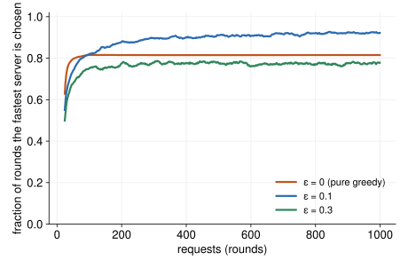
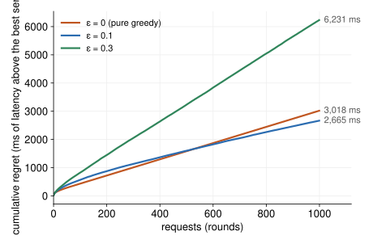
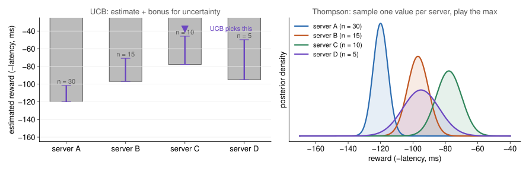
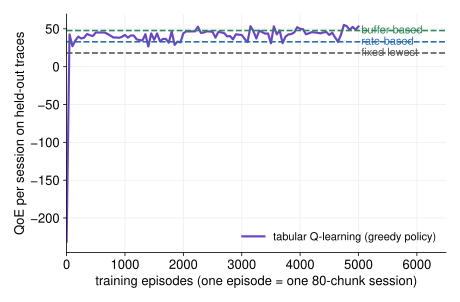
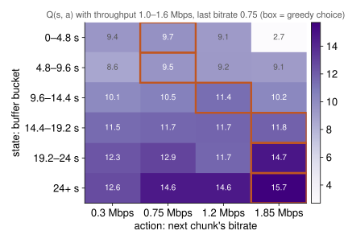
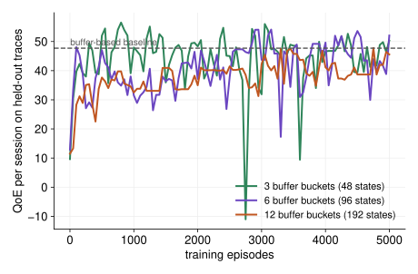
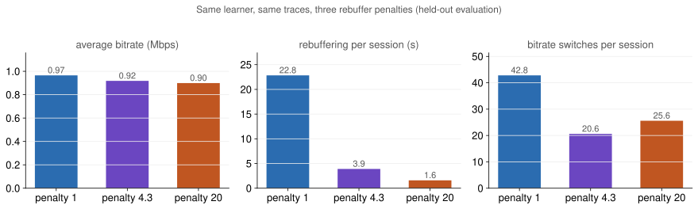

# Why Reinforcement Learning for Systems? {.center}

> Most of this course predicted a label. Many systems problems are a sequence of decisions.

```{=html}
<style>
.reveal .cell-output-display svg, .reveal .cell-output-display img { width: 100%; height: auto; }
.reveal .caption { font-size: 0.55em; color: #666666; margin-top: 0.2em; }
</style>
```

::: {.notes}
Frame the hour. Every earlier lecture produced a prediction: a class, a number, a cluster.
This one produces a policy, a rule for acting, learned from the consequences of acting.
Ask the room for a systems decision whose consequence shows up later than the decision:
a bitrate choice that drains the buffer two chunks from now is the running example.
See the reinforcement learning chapter of the book, introduction.
:::

## Decisions, Not Predictions

::: {.columns}
::: {.column width="48%"}
- **Supervised learning** maps an input to a label; the label is given, the model is scored once
- **Reinforcement learning** maps a **state** to an **action**; the only feedback is a **reward**, often delayed
- The agent's actions **change the environment** it will see next: pick a high bitrate and the buffer drains
- Systems problems with this shape: **bitrate selection, congestion control, scheduling, routing, configuration tuning**
:::
::: {.column width="52%"}
```{dot}
//| fig-width: 6.2
//| fig-height: 4.6
digraph loop {
  rankdir=TB; nodesep=0.6; ranksep=1.0; bgcolor="transparent";
  node [shape=box, style="filled,rounded", fontname="Helvetica", fontsize=20, color="#555555", penwidth=1.4, margin="0.3,0.16"];
  edge [color="#555555", penwidth=1.6, fontname="Helvetica", fontsize=17];
  agent [label="agent\n(the policy π)", fillcolor="#f2d9a8"];
  env [label="environment\n(network, cluster, player)", fillcolor="#cfe3f5"];
  agent -> env [label="  action aₜ\n  bitrate, rate, job"];
  env -> agent [label="state sₜ₊₁  \nreward rₜ  "];
}
```

::: {.caption}
The agent-environment loop (Sutton and Barto, *Reinforcement Learning*, 2nd ed., 2018). The goal is the sum of rewards over the whole episode, not the next one.
:::
:::
:::

::: {.notes}
The diagram is the whole subject. Say the three words that will recur: state (what the agent
sees), action (what it controls), reward (the one scalar it is told). Contrast with the
course so far: a QoE classifier was trained on labelled sessions and never changed the
sessions; an ABR agent changes the session by acting in it. The sum-of-rewards point is the
one students miss: a greedy choice that maximises the next reward is usually not the policy
that maximises the episode.
:::

## Where RL Has Been Tried in Networking {.smaller}

| System | Problem | State | Action | Reward |
|---|---|---|---|---|
| **Pensieve** (Mao, Netravali, Alizadeh, SIGCOMM 2017) | adaptive bitrate | past throughputs, buffer, chunk sizes, last bitrate | next chunk's bitrate | bitrate − rebuffer − switches |
| **Aurora** (Jay et al., ICML 2019) | congestion control | latency gradient and ratio, sending ratio | change to sending rate (continuous) | +throughput, −latency, −loss |
| **Decima** (Mao et al., SIGCOMM 2019) | cluster scheduling | job DAGs, embedded by a GNN | next stage, executor count | −(jobs in system) |
| **Learning to Route** (Valadarsky et al., HotNets 2017) | traffic engineering | recent demand matrices | per-link weights | −(max link utilisation) |
| **Park** (Mao et al., NeurIPS 2019) | benchmark suite | twelve environments, one interface: ABR, congestion control, load balancing, caching, … | | |

Every row is the same three design decisions: **what the agent sees, what it may do, what it is told it did well.**

::: {.notes}
Do not read the table; pick two rows. Pensieve is the one the hands-on reproduces in
miniature. Decima is the one whose state is a graph, which is why it needs a GNN. Park is
there because reproducibility is a real problem in this literature: twelve environments
behind one Gym-style interface so algorithms can be compared. The sentence under the table
is the lesson of the whole MDP section: the modelling choices, not the algorithm, usually
decide whether the project works. See the chapter, "Mapping MDPs to Networking Problems".
:::

## What Makes Systems Hard for RL

```{dot}
//| fig-width: 12.4
//| fig-height: 2.5
digraph hard {
  rankdir=LR; nodesep=0.3; ranksep=0.5; bgcolor="transparent";
  node [shape=box, style="filled,rounded", fontname="Helvetica", fontsize=17, color="#555555", penwidth=1.4, margin="0.16,0.09"];
  edge [color="#555555", penwidth=1.5, fontname="Helvetica", fontsize=14];
  obs [label="partial observation\nthe agent sees a few\nmeasurements, not the network", fillcolor="#cfe3f5"];
  act [label="explore in production?\na bad action costs\nreal users", fillcolor="#f8d7c4"];
  env [label="non-stationary environment\ntraffic mix, paths and\ncompetitors change", fillcolor="#cfe3f5"];
  rew [label="reward design\nthe scalar is a proxy\nfor what we want", fillcolor="#f2d9a8"];
  sim [label="sim-to-real gap\ntrained on traces, deployed\non a network that differs", fillcolor="#f8d7c4"];
  obs -> act -> env -> rew -> sim;
}
```

- **Non-stationary**: cross traffic, paths, and the other agents all move after training
- **Sim-to-real gap**: training happens in a simulator or on traces, and the simulator leaves things out
- **Exploration is unsafe in production**: a random bitrate or sending rate is an experiment on a paying user
- **Reward design**: QoE and "good scheduling" are not scalars; whatever scalar we write down is what gets optimised
- **Partial observability**: a client sees its own buffer and throughput, not the bottleneck queue

::: {.notes}
Each box returns later in the deck: partial observability in the MDP section (the Markov
property and why history goes into the state), exploration in the bandit and safety slides,
non-stationarity and sim-to-real in the deployment section, reward design in the penalty
experiment that the hands-on also runs. The honest summary of the field, from the chapter's
closing section, is that the systems that worked combined a learned component with a
classical algorithm and a safety net; keep that in view while the algorithms get elegant.
:::

# Markov Decision Processes {.center}

> The formal object every RL algorithm in this lecture is solving.

::: {.notes}
Four slides: the MDP tuple on a toy, the two value functions and the Bellman equation, the
hands-on's ABR problem written as an MDP, and the exploration problem that every solver has
to handle. See the chapter, "Markov Decision Processes".
:::

## The MDP

::: {.columns}
::: {.column width="46%"}
An MDP is a tuple $(\mathcal{S}, \mathcal{A}, T, R, \gamma)$:

- $\mathcal{S}$: **states** the agent can be in
- $\mathcal{A}$: **actions** it can take
- $T(s, a, s')$: **transition probability** of landing in $s'$ after $a$ in $s$
- $R(s, a, s')$: the **reward** for that transition
- $\gamma \in [0, 1)$: the **discount**; how much the future counts

**Markov property**: the next state depends only on the current state and action. If it does not, put recent history into the state.
:::
::: {.column width="54%"}
```{dot}
//| fig-width: 6.6
//| fig-height: 5.2
digraph mdp {
  rankdir=TB; nodesep=0.9; ranksep=0.7; bgcolor="transparent";
  node [shape=circle, style="filled", fontname="Helvetica", fontsize=17, color="#555555", penwidth=1.4, fixedsize=true, width=1.25];
  edge [color="#555555", penwidth=1.6, fontname="Helvetica", fontsize=15];
  low [label="buffer\nlow", fillcolor="#f8d7c4"];
  mid [label="buffer\nmid", fillcolor="#f2d9a8"];
  high [label="buffer\nhigh", fillcolor="#d9efd3"];
  low -> mid [label="small: 0.9, +0.3", color="#2f855a"];
  low:w -> low:w [label="small: 0.1, −4", color="#2f855a"];
  low:e -> low:e [label="big: 0.7, −8", color="#c05621"];
  low -> mid [label="big: 0.3, +1.9", color="#c05621"];
  mid -> high [label="small: 1.0, +0.3", color="#2f855a"];
  mid -> mid [label="big: 0.6, +1.9", color="#c05621"];
  mid -> low [label="big: 0.4, +1.9", color="#c05621", constraint=false];
  high -> high [label="big: 0.8, +1.9", color="#c05621"];
  high -> mid [label="big: 0.2, +1.9", color="#c05621", constraint=false];
}
```

::: {.caption}
A three-state MDP for a video player (illustrative numbers). Each arrow is *action: probability, reward*. Green: fetch a small chunk. Orange: fetch a big chunk; −8 and −4 are stalls.
:::
:::
:::

::: {.notes}
Walk the toy. In "buffer low", the big chunk pays 1.9 when it arrives in time but stalls
with probability 0.7, and a stall is −8; the small chunk is safe. In "buffer high" the big
chunk is almost free. The point of the picture: the best action depends on the state, and
the value of an action includes where it leaves you. The chapter's networking versions of
the tuple: states are measurements (RTT, queue lengths, utilisations), actions are knobs
(window, weights, channel), T is stochastic because the network has other users. Define
POMDP in one sentence and say what every practical system does about it: the last k
measurements go into the state, as Pensieve does with eight throughput samples.
:::

## Policies and Value Functions

::: {.columns}
::: {.column width="56%"}
- A **policy** $\pi(a \mid s)$: what to do in each state (deterministic or a distribution)
- **State value** $V^\pi(s) = \mathbb{E}\big[\sum_t \gamma^t r_t \mid s_0 = s, \pi\big]$: how good is it to be here?
- **Action value** $Q^\pi(s, a)$: the same, having committed to $a$ first; lets the agent **compare actions directly**
- The **optimal** $Q^*$ satisfies the **Bellman equation**:

$$Q^*(s,a) = \sum_{s'} T(s,a,s')\Big[R(s,a,s') + \gamma \max_{a'} Q^*(s',a')\Big]$$

- Then $\pi^*(s) = \arg\max_a Q^*(s, a)$: **solve for $Q^*$ and the policy is free**
:::
::: {.column width="44%"}
```{dot}
//| fig-width: 5.4
//| fig-height: 4.4
digraph backup {
  rankdir=TB; nodesep=0.35; ranksep=0.45; bgcolor="transparent";
  node [shape=box, style="filled,rounded", fontname="Helvetica", fontsize=16, color="#555555", penwidth=1.4, margin="0.14,0.08"];
  edge [color="#555555", penwidth=1.5, fontname="Helvetica", fontsize=13];
  sa [label="Q*(s, a)\nvalue of acting now", fillcolor="#f2d9a8"];
  s1 [label="s′₁\nreward R, then\nmax over a′", fillcolor="#cfe3f5"];
  s2 [label="s′₂\nreward R, then\nmax over a′", fillcolor="#cfe3f5"];
  s3 [label="s′₃\nreward R, then\nmax over a′", fillcolor="#cfe3f5"];
  sa -> s1 [label="T(s,a,s′₁)"]; sa -> s2 [label="T(s,a,s′₂)"]; sa -> s3 [label="T(s,a,s′₃)"];
  q1 [label="γ · best Q*(s′₁, ·)", fillcolor="#d9efd3"]; q2 [label="γ · best Q*(s′₂, ·)", fillcolor="#d9efd3"]; q3 [label="γ · best Q*(s′₃, ·)", fillcolor="#d9efd3"];
  s1 -> q1; s2 -> q2; s3 -> q3;
}
```

::: {.caption}
The Bellman backup: the value of (s, a) is the expected immediate reward plus the discounted value of the best next action (Bellman, 1957).
:::
:::
:::

::: {.notes}
Read the equation in words: the value of taking a in s is what you get now plus gamma times
the best you can do from wherever you land, averaged over where you might land. The
recursion is why the problem is solvable at all: one equation per state-action pair, and
the unknowns are the same Q on both sides. The three algorithm families in this deck differ
in how they attack it: value-based methods estimate Q from experience (Q-learning, DQN),
policy methods search over pi directly (REINFORCE), and actor-critic does both. The full
expectation forms are in the appendix.
:::

## ABR as an MDP

::: {.columns}
::: {.column width="46%"}
The Hands-On 19 environment:

- **State**: (**buffer** bucket, **throughput** bucket, **last bitrate**)
- **Action**: the bitrate of the next **4-second chunk**, one of four
- **Transition**: download time = chunk size / throughput; the buffer drains while downloading, gains 4 s when the chunk lands; the trace is **synthetic and stochastic**
- **Reward** (Pensieve's linear QoE): $\;r = \text{bitrate} - 4.3 \times \text{rebuffer s} - 1 \times |\Delta \text{bitrate}|$
- **Baselines**: fixed lowest, rate-based, buffer-based
:::
::: {.column width="54%"}
```{dot}
//| fig-width: 6.6
//| fig-height: 4.8
digraph abr {
  rankdir=TB; nodesep=0.4; ranksep=0.45; bgcolor="transparent";
  node [shape=box, style="filled,rounded", fontname="Helvetica", fontsize=16, color="#555555", penwidth=1.4, margin="0.16,0.09"];
  edge [color="#555555", penwidth=1.5, fontname="Helvetica", fontsize=13];
  st [label="state sₜ\nbuffer bucket · throughput bucket · last bitrate", fillcolor="#f2d9a8"];
  pol [label="policy: pick bitrate aₜ ∈ {0.3, 0.75, 1.2, 1.85} Mbps", fillcolor="#cfe3f5"];
  dl [label="download time = aₜ × 4 s / throughputₜ\n(throughput from the trace)", fillcolor="#eeeeee"];
  buf [label="buffer: drains during download,\nstalls if it hits 0, then +4 s", fillcolor="#eeeeee"];
  rew [label="reward rₜ = aₜ − 4.3 × stall − |aₜ − aₜ₋₁|", fillcolor="#d9efd3"];
  st -> pol -> dl -> buf -> rew;
  rew -> st [label="next state sₜ₊₁", constraint=false, style=dashed];
}
```

::: {.caption}
One chunk of the ABR loop. The buffer couples decisions across time: the penalty for a greedy high bitrate arrives a few chunks later as a stall.
:::
:::
:::

::: {.notes}
This slide is a contract with the hands-on: the same state, action and reward appear in the
notebook. Things to point at. The state is discretised so a table can hold it; the
discretisation is a design decision the Pitfalls slide and the hands-on both poke at. The
reward's three terms and their weights come from Pensieve's QoE_lin, and the weights are
arbitrary: 4.3 per second of stall says one second of rebuffering costs about as much as
the quality difference between the lowest and highest bitrate over two chunks. The hands-on
changes that number and watches the policy change. Baselines first, learner second: the
learner has to beat buffer-based, which is a strong heuristic.
:::

## Exploration vs. Exploitation

::: {.columns}
::: {.column width="50%"}
- The agent only learns the value of actions it **tries**
- **Exploit**: take the action that looks best now. **Explore**: try one that might be better
- **Pure greedy gets stuck**: one unlucky early sample makes a good action look bad, and a greedy agent **never tries it again**
- **ε-greedy**: with probability ε act at random, otherwise act greedily; **decay ε** as estimates firm up
- In production, exploration has a **cost measured in user experience**, so systems constrain it
:::
::: {.column width="50%"}


::: {.caption}
Four servers, unknown latencies, 200 runs averaged (`figures.py`). Pure greedy locks onto whatever looked best after the first few requests and plateaus; ε = 0.1 keeps checking and finds the fastest server about nine times in ten.
:::
:::
:::

::: {.notes}
The figure is from the hands-on's own Part 1 setup. Pure greedy plateaus near 0.8 here
because in about a fifth of the runs an early noisy sample made the fastest server look
slow, and greedy never revisited it. Epsilon 0.1 climbs to about 0.92 and would go higher
with a decaying epsilon; epsilon 0.3 wastes 30 percent of its requests on random servers
forever, so it sits lower. The tradeoff is the next section's subject in its purest form.
Chapter: "Exploration Strategies".
:::

# Multi-Armed Bandits {.center}

> Reinforcement learning with one state: pick an arm, see a reward, repeat.

::: {.notes}
Bandits are RL without the transition function: actions do not change what comes next. They
are worth a section because many systems problems are bandits (server selection, A/B tests,
configuration tuning), and because they isolate exploration. Chapter: "Multi-Armed Bandits".
:::

## Bandits: The One-State MDP

::: {.columns}
::: {.column width="50%"}
- **K arms**, each with an unknown reward distribution; one choice per round, one reward back
- No state transitions: this round's choice does not change the next round's options
- **Regret** after $n$ rounds: $\;\sum_{t=1}^{n} \big(\mu^* - \mu_{a_t}\big)$, the reward given up by not always playing the best arm
- A good algorithm has regret that grows **sublinearly**: it keeps learning, so its mistakes thin out
- Hands-On Part 1: four servers, unknown mean latency, reward = −latency
:::
::: {.column width="50%"}
```{dot}
//| fig-width: 6.2
//| fig-height: 4.0
digraph bandit {
  rankdir=LR; nodesep=0.3; ranksep=1.0; bgcolor="transparent";
  node [shape=box, style="filled,rounded", fontname="Helvetica", fontsize=16, color="#555555", penwidth=1.4, margin="0.16,0.09"];
  edge [color="#555555", penwidth=1.5, fontname="Helvetica", fontsize=13];
  client [label="client\nestimate μ̂ per server\npick one per request", fillcolor="#f2d9a8"];
  a [label="server A\nμ = 120 ms ± 25", fillcolor="#cfe3f5"];
  b [label="server B\nμ = 95 ms ± 25", fillcolor="#cfe3f5"];
  c [label="server C\nμ = 80 ms ± 25", fillcolor="#d9efd3"];
  d [label="server D\nμ = 105 ms ± 25", fillcolor="#cfe3f5"];
  client -> a; client -> b; client -> c [label="best, but unknown"]; client -> d;
  c -> client [label="one latency sample", style=dashed, constraint=false];
}
```

::: {.caption}
The hands-on's bandit: the client knows nothing about the servers except the latencies it has observed. Every request is both a decision and a measurement.
:::
:::
:::

::: {.notes}
Define regret carefully, since the hands-on plots it: the gap between the best arm's mean
and the chosen arm's mean, summed. It is a quantity the experimenter can compute because
the simulator knows the true means; the agent cannot. Linear regret means the agent keeps
making the same mistake at a constant rate (pure greedy stuck on the wrong server, or a
fixed epsilon exploring forever); sublinear regret means mistakes become rarer. Chapter
examples: a wireless access point choosing a channel, AuTO scheduling short flows by
priority level.
:::

## Epsilon-Greedy and Regret

::: {.columns}
::: {.column width="46%"}
- ε = 0: regret grows **linearly in the runs where greedy locked onto the wrong server**; the average hides a bimodal outcome
- ε = 0.1: a small, steady exploration tax, and the curve **bends toward flat** once the estimates are right
- ε = 0.3: the agent finds the best server quickly, then pays for a **random request three times in ten, forever**
- Fix: **decay ε** (or use the bonus-based rules on the next slide) so exploration fades as uncertainty does
:::
::: {.column width="54%"}


::: {.caption}
Cumulative regret, 1,000 requests, averaged over 200 runs (`figures.py`). Final regret: 3,018 ms (ε = 0), 2,665 ms (ε = 0.1), 6,231 ms (ε = 0.3).
:::
:::
:::

::: {.notes}
This is the Part 1 figure the hands-on reproduces. Ask why epsilon 0.3 is worse than greedy
even though it finds the best server: a fixed exploration rate is a fixed per-round tax, and
over a long horizon the tax dominates. Ask why greedy is not even worse: in most runs greedy
happens to lock onto the best or second-best server, and the average is pulled down by the
runs where it did not. The hands-on asks students to look at individual runs for exactly
this reason. Decaying epsilon is the pragmatic fix; the next slide is the principled one.
:::

## UCB and Thompson Sampling



- **Upper Confidence Bound** (Auer, Cesa-Bianchi, Fischer, 2002): play $\arg\max_a \big[\hat{\mu}_a + c\sqrt{\ln t / N_a}\big]$. The bonus shrinks with the number of pulls, so **uncertain arms get tried, confident ones do not**
- **Thompson sampling** (Thompson, 1933): keep a **posterior** per arm, sample one value from each, play the largest. Wide posteriors win sometimes; narrow ones only when their mean is best
- Both explore **where it matters** instead of uniformly at random, and both have provably sublinear regret

::: {.notes}
Intuition only; the hands-on uses epsilon-greedy. Left panel: the grey bars are the estimates
and the purple whiskers are the bonus; server D has been tried five times, so its bonus is
large enough to beat server C's higher estimate, and UCB picks it; after that pull its bonus
shrinks. Right panel: four posteriors; Thompson draws one sample from each and plays the
max, so the wide server D curve gets picked occasionally even though its mean is lowest.
Both are "optimism in the face of uncertainty". In systems, the chapter notes, exploration
degrades service, so conservative or constrained variants are preferred.
:::

## Bandits in Systems

::: {.columns}
::: {.column width="50%"}
- **A/B testing** is a two-armed bandit run badly: fixed split, no adaptation. Bandit allocation sends more traffic to the arm that is winning
- **Server or CDN selection**: arms are replicas or edge sites, reward is latency or throughput
- **Configuration tuning**: arms are settings. **Configanator** (Naseer et al., NSDI 2022) is a **contextual bandit**: the client's network characteristics are the context, the actions are TLS, HTTP and congestion-control settings on the CDN server
- **Protocol selection**: Mutant (Pappone et al., 2025) picks among Cubic, BBR and Vegas with LinUCB from measured conditions
:::
::: {.column width="50%"}
```{dot}
//| fig-width: 6.2
//| fig-height: 4.2
digraph ctx {
  rankdir=TB; nodesep=0.35; ranksep=0.45; bgcolor="transparent";
  node [shape=box, style="filled,rounded", fontname="Helvetica", fontsize=16, color="#555555", penwidth=1.4, margin="0.16,0.09"];
  edge [color="#555555", penwidth=1.5, fontname="Helvetica", fontsize=13];
  ctx [label="context xₜ\nclient's RTT, loss, device, ISP", fillcolor="#cfe3f5"];
  pol [label="bandit: pick a configuration\nreward model per arm, given x", fillcolor="#f2d9a8"];
  a1 [label="HTTP/2 + Cubic\n+ TLS 1.3", fillcolor="#eeeeee"];
  a2 [label="HTTP/3 + BBR", fillcolor="#eeeeee"];
  a3 [label="HTTP/1.1 + Cubic\n+ larger IW", fillcolor="#eeeeee"];
  r [label="reward: page load time\nfor this client", fillcolor="#d9efd3"];
  ctx -> pol; pol -> a1; pol -> a2; pol -> a3; a1 -> r; a2 -> r; a3 -> r;
  r -> pol [label="update the reward model", style=dashed, constraint=false];
}
```

::: {.caption}
A contextual bandit for CDN configuration, in the shape of Configanator: context in, one configuration out, one reward back. The context changes the best arm but the arm does not change the next context.
:::
:::
:::

::: {.notes}
Contextual bandits sit between bandits and MDPs: the context matters, but the action does not
affect the next context, so there is still no planning. That is exactly the configuration
tuning setting, which is why Configanator could use it. The constrained-bandit point from
the chapter belongs here too: switching a configuration or a routing rule has a cost of its
own, and constrained formulations limit how often the agent may switch or bound the chance
of degraded service. Chapter: "Contextual and Constrained Bandits", "Additional Networking
Examples".
:::

# Value-Based Methods {.center}

> Learn Q(s, a) from experience; act by taking the max.

::: {.notes}
Back to the full MDP: actions change the state. Value-based methods estimate the Q-function
and read the policy off it. Four slides: the update rule, the hands-on's learner, the deep
version, and what goes wrong. Chapter: "Value-Based Methods".
:::

## Q-Learning

::: {.columns}
::: {.column width="52%"}
Keep a **table** of $Q(s, a)$, all zeros to start. After taking $a$ in $s$, seeing reward $r$ and landing in $s'$:

$$Q(s,a) \leftarrow (1-\alpha)\,Q(s,a) + \alpha\Big[r + \gamma \max_{a'} Q(s',a')\Big]$$

- $\alpha$: **learning rate**; how far to move toward the new estimate
- $r + \gamma \max_{a'} Q(s', a')$: the **target**, one sample of the Bellman right-hand side
- **Off-policy**: the target uses the best next action whatever the agent does next, so ε-greedy exploration does not bias it
- Converges to $Q^*$ if every pair is visited forever and $\alpha$ decays (Watkins and Dayan, 1992)
:::
::: {.column width="48%"}
```{dot}
//| fig-width: 5.8
//| fig-height: 4.8
digraph qupdate {
  rankdir=TB; nodesep=0.3; ranksep=0.4; bgcolor="transparent";
  node [shape=box, style="filled,rounded", fontname="Helvetica", fontsize=17, color="#555555", penwidth=1.4, margin="0.14,0.08"];
  edge [color="#555555", penwidth=1.5, fontname="Helvetica", fontsize=13];
  tab [shape=plaintext, style="", label=<
    <table border="0" cellborder="1" cellspacing="0" cellpadding="7">
      <tr><td bgcolor="#eeeeee">Q</td><td bgcolor="#eeeeee">0.3</td><td bgcolor="#eeeeee">0.75</td><td bgcolor="#eeeeee">1.2</td><td bgcolor="#eeeeee">1.85</td></tr>
      <tr><td bgcolor="#eeeeee">s (buffer low)</td><td>2.1</td><td bgcolor="#f2d9a8"><b>3.4 → 3.7</b></td><td>1.0</td><td>−2.2</td></tr>
      <tr><td bgcolor="#eeeeee">s′ (buffer mid)</td><td>4.0</td><td bgcolor="#d9efd3"><b>6.2 = max</b></td><td>5.1</td><td>2.7</td></tr>
    </table>>];
  step [label="in s, took a = 0.75\ngot r = 0.75, landed in s′", fillcolor="#cfe3f5"];
  calc [label="target = 0.75 + 0.9 × 6.2 = 6.33\nQ(s, a) ← 0.9 × 3.4 + 0.1 × 6.33 = 3.69", fillcolor="#f2d9a8"];
  step -> calc -> tab;
}
```

::: {.caption}
One update touches one cell. The target borrows the best value in the next row, so values propagate backward from where rewards and stalls happen.
:::
:::
:::

::: {.notes}
Work the numbers in the diagram aloud: the agent was in a low-buffer state, fetched the 0.75
chunk, got 0.75 of reward with no stall, and landed in a mid-buffer state whose best cell is
6.2. The target is 0.75 plus 0.9 times 6.2. The old cell moves a tenth of the way toward it.
Two things to stress. First, "model-free": the agent never learns T or R, only Q. Second,
the off-policy property: the max in the target means exploration (the random actions) does
not corrupt the estimate, which is why epsilon-greedy and Q-learning go together.
Chapter: "Tabular Q-Learning".
:::

## Q-Learning on ABR

::: {.columns}
::: {.column width="50%"}


::: {.caption}
Greedy policy evaluated on five held-out sessionss every 50 episodes (`figures.py`, α = 0.05, γ = 0.9, ε decays 1 → 0.05). Final QoE 53 against 48 (buffer-based), 33 (rate-based), 18 (fixed lowest).
:::
:::
::: {.column width="50%"}


::: {.caption}
One slice of the 96 × 4 table: with mid throughput and the last chunk at 0.75 Mbps, the greedy choice (orange box) steps up as the buffer grows.
:::
:::
:::

- The table has **6 × 4 × 4 = 96 states × 4 actions**; the learner sees a few thousand sessions and outperforms the heuristics it was never told about
- The learned slice **reads like a buffer-based rule**, with the throughput bucket and the switch penalty folded in

::: {.notes}
This is Part 3 of the hands-on, run ahead of time. Left: the curve is noisy early because
epsilon is high and the table is empty; the greedy policy crosses the buffer-based line after
roughly a thousand episodes and settles above it. Right: read the slice as a policy. With an
empty buffer the best action is the lowest bitrate; as the buffer grows the greedy choice
climbs. That is the buffer-based heuristic, rediscovered, with one difference: the learner
also knows the switch penalty, so it hesitates to jump two levels at once. Students'
numbers will differ (their traces are theirs), but the shape should match. If it does not,
the first suspects are epsilon decaying too fast and too few episodes.
:::

## From Tables to Networks: DQN

```{dot}
//| fig-width: 12.4
//| fig-height: 2.3
digraph dqn {
  rankdir=LR; nodesep=0.3; ranksep=0.5; bgcolor="transparent";
  node [shape=box, style="filled,rounded", fontname="Helvetica", fontsize=17, color="#555555", penwidth=1.4, margin="0.16,0.09"];
  edge [color="#555555", penwidth=1.5, fontname="Helvetica", fontsize=14];
  env [label="environment", fillcolor="#cfe3f5"];
  qnet [label="Q-network Q_θ(s, ·)\none value per action", fillcolor="#f2d9a8"];
  buf [label="replay buffer\n(s, a, r, s′)", fillcolor="#eeeeee"];
  batch [label="random\nmini-batch", fillcolor="#eeeeee"];
  tgt [label="target network Q_θ⁻\nfrozen copy of θ", fillcolor="#f8d7c4"];
  loss [label="loss = (Q_θ(s,a) − [r + γ max Q_θ⁻(s′,·)])²\ngradient step on θ", fillcolor="#d9efd3"];
  env -> qnet [label="s"]; qnet -> env [label="ε-greedy a"]; env -> buf [label="store"];
  buf -> batch -> loss; batch -> tgt [label="s′"]; tgt -> loss [label="targets"]; loss -> qnet [label="update θ", style=dashed];
  loss -> tgt [label="copy θ → θ⁻ every N steps", style=dotted, constraint=false];
}
```

- **Function approximation**: a network replaces the table, so continuous and large state spaces work (Mnih et al., *Nature* 2015)
- **Experience replay** breaks the correlation between consecutive transitions; the **target network** stops the target moving with every update
- Uses: **Orca** picks congestion-control strategies (Abbasloo et al., SIGCOMM 2020); **NeuroCuts** learns packet-classification trees (Liang et al., SIGCOMM 2019)
- The hands-on **stays tabular** on purpose: 96 states fit in a table, and the policy can be read off it

::: {.notes}
Same update rule, three engineering changes. Say why each exists, from the chapter: a
network generalises, so an update for one state moves estimates for many; consecutive
transitions are correlated, so train on random samples of the past (replay); the target
depends on the network being trained, so compute it with a frozen copy (target network).
Double DQN (van Hasselt et al., AAAI 2016) decouples choosing the best next action from
evaluating it, which addresses the overestimation on the next slide. And the honest reason
the hands-on is tabular: with 96 states a table is the better tool, and students can read
the policy.
:::

## Pitfalls

::: {.columns}
::: {.column width="48%"}
- **Discretisation**: too coarse and two different situations share a cell; too fine and the table is sparse and learns slowly. Buckets are a model choice, not a detail
- **Overestimation**: the max in the target picks the luckiest estimate, so Q drifts upward. Double DQN separates selection from evaluation
- **Sample efficiency**: every cell needs many visits; here 5,000 sessions for 384 cells. Real networks do not hand out 5,000 sessions to an experiment
- **Non-stationarity**: a table learned on one trace distribution is wrong on another; the held-out evaluation is the honest check
:::
::: {.column width="52%"}


::: {.caption}
Same learner and traces, three buffer discretisations (`figures.py`). Three buckets lose detail; twelve buckets (192 states) learn more slowly and end lower; six is the sweet spot for this budget.
:::
:::
:::

::: {.notes}
The figure is the hands-on's Part 4 discretisation question, answered empirically. Ask the
room before revealing which curve ends highest: most guess that finer is better. Twelve
buckets ends lower because each cell is visited a quarter as often, so the estimates are
still noisy when epsilon has decayed; with four times the episodes it would catch up. Three
buckets ends lower for a different reason: it cannot express "buffer is 8 seconds" versus
"buffer is 2 seconds". The general statement is bias versus variance, the same tradeoff as
everywhere in this course. Chapter: the DQN section on overestimation and the summary's
remarks on sample efficiency.
:::

# Policy Gradient and Actor-Critic {.center}

> Skip the value table: learn the policy itself.

::: {.notes}
Value methods need a max over actions, which fails for continuous or huge action spaces,
and they produce deterministic policies. Policy methods parameterise pi directly and
follow the gradient of expected reward. Four slides: the idea, the actor-critic
architecture, Pensieve as the worked system, and the continuous-control variant.
Chapter: "Policy Gradient Methods", "Actor-Critic Methods", "DDPG".
:::

## Learning the Policy Directly

::: {.columns}
::: {.column width="54%"}
- Parameterise the policy: $\pi_\theta(a \mid s)$ outputs a **distribution over actions**, discrete or **continuous** (a mean and a variance); exploration is built in, no ε needed
- Objective: expected return $J(\theta) = \mathbb{E}_{\tau \sim \pi_\theta}\big[\sum_t \gamma^t r_t\big]$ over whole **trajectories**
- **REINFORCE** (Williams, 1992): run the policy, then make the actions that preceded high returns more likely:

$$\nabla_\theta J(\theta) = \mathbb{E}\Big[\sum_t \nabla_\theta \log \pi_\theta(a_t \mid s_t)\,\big(G_t - b(s_t)\big)\Big]$$

- $G_t$: the return from step $t$; the **baseline** $b(s_t)$ cuts variance without bias
:::
::: {.column width="46%"}
```{dot}
//| fig-width: 5.6
//| fig-height: 4.6
digraph pg {
  rankdir=TB; nodesep=0.3; ranksep=0.4; bgcolor="transparent";
  node [shape=box, style="filled,rounded", fontname="Helvetica", fontsize=15, color="#555555", penwidth=1.4, margin="0.14,0.08"];
  edge [color="#555555", penwidth=1.5, fontname="Helvetica", fontsize=13];
  run [label="run π_θ for one session\n(s₀,a₀,r₀), (s₁,a₁,r₁), …", fillcolor="#cfe3f5"];
  ret [label="compute returns G_t\n= discounted sum of rewards from t on", fillcolor="#eeeeee"];
  good [label="a_t followed by G_t above baseline\n→ raise log π_θ(a_t | s_t)", fillcolor="#d9efd3"];
  bad [label="a_t followed by G_t below baseline\n→ lower log π_θ(a_t | s_t)", fillcolor="#f8d7c4"];
  upd [label="gradient step on θ, repeat", fillcolor="#f2d9a8"];
  run -> ret; ret -> good; ret -> bad; good -> upd; bad -> upd; upd -> run [style=dashed, constraint=false];
}
```

::: {.caption}
REINFORCE in one loop. The environment never has to be differentiable: the gradient is taken through the policy's own log-probabilities, weighted by what happened afterwards.
:::
:::
:::

::: {.notes}
The equation is the policy gradient theorem (Sutton, McAllester, Singh, Mansour, NIPS 1999)
in its practical form; the statement is in the appendix. Say the intuition before the
symbols: you cannot backpropagate through the network you are controlling, but you can
nudge the probability of each action you took in proportion to how well things went after
it. Two consequences for systems. Continuous actions (a sending rate) come for free by
outputting a Gaussian. Variance is the problem: a whole session's return depends on many
later random events, so a single lucky session misleads. The baseline is the fix, and when
the baseline is a learned value function you have the next slide.
Chapter: "The REINFORCE Algorithm", "Variance Reduction with Baselines".
:::

## Actor-Critic

::: {.columns}
::: {.column width="46%"}
- **Actor**: the policy $\pi_\theta(a \mid s)$, updated by the policy gradient
- **Critic**: a value estimate $V_\phi(s)$, trained by temporal difference, like Q-learning
- The critic is the baseline, and more: the **TD advantage** $A_t = r_t + \gamma V_\phi(s_{t+1}) - V_\phi(s_t)$ judges an action **after one step**, not after the whole session
- **A3C** (Mnih et al., ICML 2016): many agents in parallel environments push gradients asynchronously; Pensieve trains with it
- **PPO** (Schulman et al., 2017) clips each update so one bad batch cannot wreck the policy; Aurora uses it
:::
::: {.column width="54%"}
```{dot}
//| fig-width: 6.6
//| fig-height: 5.0
digraph ac {
  rankdir=TB; nodesep=0.7; ranksep=0.7; bgcolor="transparent";
  node [shape=box, style="filled,rounded", fontname="Helvetica", fontsize=17, color="#555555", penwidth=1.4, margin="0.2,0.12"];
  edge [color="#555555", penwidth=1.6, fontname="Helvetica", fontsize=14];
  env [label="environment\n(simulator on traces)", fillcolor="#cfe3f5"];
  actor [label="actor π_θ(a | s)\nsamples the action", fillcolor="#f2d9a8"];
  critic [label="critic V_φ(s)\nbetter than expected?", fillcolor="#d9efd3"];
  env -> actor [label="state s"]; actor -> env [label="action a"];
  env -> critic [label="s, r, s′"];
  critic -> actor [label="advantage\nA = r + γV(s′) − V(s)\nweights the gradient", constraint=false];
  critic -> critic [label="TD error\nupdates φ"];
}
```

::: {.caption}
Two networks, one loop. The actor acts; the critic scores each action against what it expected from that state; the score becomes the weight in the actor's gradient.
:::
:::
:::

::: {.notes}
Actor-critic is the synthesis slide: the value idea (critic) and the policy idea (actor)
in one system. The critic solves REINFORCE's two problems at once: it is the baseline, and
it lets the agent evaluate an action after one transition instead of waiting for the
session to end. A3C's contribution is parallelism: sixteen agents on sixteen different
throughput traces, gradients merged asynchronously, which is both faster and a form of
domain randomisation. PPO's clipped objective is in the chapter; the one-sentence version
is "never move the policy far in one update", which matters for a congestion controller
that must not flip from timid to aggressive in one step. Chapter: "Actor-Critic Methods".
:::

## Pensieve: ABR with Actor-Critic

```{dot}
//| fig-width: 12.4
//| fig-height: 3.0
digraph pensieve {
  rankdir=LR; nodesep=0.3; ranksep=0.5; bgcolor="transparent";
  node [shape=box, style="filled,rounded", fontname="Helvetica", fontsize=15, color="#555555", penwidth=1.4, margin="0.14,0.08"];
  edge [color="#555555", penwidth=1.5, fontname="Helvetica", fontsize=13];
  in [label="inputs (state)\nlast 8 throughputs · last 8 download times\nsizes of the next chunk at each bitrate\nbuffer level · chunks left · last bitrate", fillcolor="#cfe3f5"];
  conv [label="1-D conv over the\nhistories, dense\nfor the scalars", fillcolor="#eeeeee"];
  actor [label="actor: softmax over\n6 bitrates\n(300 kbps … 4.3 Mbps)", fillcolor="#f2d9a8"];
  critic [label="critic: V(s)\ntraining only", fillcolor="#d9efd3"];
  sim [label="chunk-level simulator\nreal throughput traces\n(broadband and cellular)\n16 parallel agents (A3C)", fillcolor="#f8d7c4"];
  out [label="deployed: the actor alone\nruns in the player, picks\nthe next chunk's bitrate", fillcolor="#d9efd3"];
  in -> conv -> actor; conv -> critic; actor -> sim [label="QoE reward"]; sim -> actor [label="gradients", style=dashed]; sim -> critic [style=dashed]; actor -> out;
}
```

- **Mao, Netravali, Alizadeh, SIGCOMM 2017**: no network model, no fixed heuristic; the policy is learned from the reward alone
- **Trained entirely in simulation** on throughput traces, then evaluated in emulation and on real networks; reported **12 to 25% higher average QoE than the best prior scheme** (robustMPC)
- The hands-on is Pensieve with a **table in place of the network**: same state ingredients, same reward, four bitrates instead of six

::: {.notes}
The system of the lecture. Walk the pipeline: the state is a short history plus scalars, a
small network produces a distribution over bitrates, and the critic exists only during
training. Three points. First, Pensieve learns from the reward, so changing the QoE
definition retrains a different controller; the hands-on's penalty experiment is this in
miniature. Second, training is in a chunk-level simulator on recorded throughput traces
(public broadband and cellular datasets plus synthetic ones), which is the pattern the
deployment section examines. Third, the headline numbers are from the paper's own
evaluation; the Puffer deployment later found the sim-to-real gap for ABR is real, which is
the next section. Code: github.com/hongzimao/pensieve.
:::

## DDPG and Continuous Control

::: {.columns}
::: {.column width="50%"}
- Many knobs are **continuous**: a sending rate, a routing weight in [0, 1], a power level. No max over actions is available
- **Stochastic policy gradient** handles it with a Gaussian output; **Aurora** (Jay et al., ICML 2019) does this with PPO: the action is a change to the sending rate
- **DDPG** (Lillicrap et al., ICLR 2016): a **deterministic actor** $\mu_\theta(s)$ and a critic $Q_\phi(s, a)$; the actor follows the critic's gradient $\nabla_a Q$. Replay buffer, soft target updates, exploration by **added noise**
- Uses: **AuTO** sets long-flow rates (Chen et al., SIGCOMM 2018); **DRL-TE** sets routing weights (Xu et al., 2018)
:::
::: {.column width="50%"}
```{dot}
//| fig-width: 6.2
//| fig-height: 4.6
digraph ddpg {
  rankdir=TB; nodesep=0.35; ranksep=0.45; bgcolor="transparent";
  node [shape=box, style="filled,rounded", fontname="Helvetica", fontsize=15, color="#555555", penwidth=1.4, margin="0.14,0.08"];
  edge [color="#555555", penwidth=1.5, fontname="Helvetica", fontsize=13];
  s [label="state s\nRTT trend, throughput, loss", fillcolor="#cfe3f5"];
  actor [label="actor μ_θ(s) → one number\nsending rate, 37.4 Mbps", fillcolor="#f2d9a8"];
  noise [label="+ exploration noise\n(training only)", fillcolor="#eeeeee"];
  critic [label="critic Q_φ(s, a)\nhow good is this rate here?", fillcolor="#d9efd3"];
  env [label="network", fillcolor="#cfe3f5"];
  s -> actor -> noise -> env [label="rate"]; env -> critic [label="r, s′"]; actor -> critic [label="a"];
  critic -> actor [label="∇ₐQ: nudge the rate\nthe way Q increases", style=dashed, constraint=false];
}
```

::: {.caption}
Continuous control: the actor emits a number, the critic says which direction would have been better, and the actor moves that way.
:::
:::
:::

::: {.notes}
One slide, two routes to a continuous action. Aurora's route is the stochastic policy from
the previous slides: PPO with a Gaussian over rate changes, trained in a simple simulator,
and the paper's point is that it generalises to conditions beyond its training range.
DDPG's route is deterministic: the actor outputs the rate, the critic is a Q-network over
(state, rate), and the actor's gradient is the chain rule through the critic. The three
stability tricks are DQN's (replay, target networks) plus soft target blending, and because
the actor is deterministic, exploration has to be injected as noise. Chapter: "Deep
Deterministic Policy Gradient (DDPG)".
:::

# Simulation, Training, and Deployment {.center}

> Where networking RL projects succeed or fail.

::: {.notes}
The algorithms are the smaller half of the problem. Four slides on the pipeline: why
training happens in simulation, what the simulator leaves out, how the reward shapes the
policy, and how a deployed agent is kept from hurting anyone.
Chapter: "Simulation, Training, and Deployment", "Safe and Constrained RL".
:::

## Train in Simulation, Deploy for Real

```{dot}
//| fig-width: 12.4
//| fig-height: 2.1
digraph pipe {
  rankdir=LR; nodesep=0.3; ranksep=0.5; bgcolor="transparent";
  node [shape=box, style="filled,rounded", fontname="Helvetica", fontsize=16, color="#555555", penwidth=1.4, margin="0.14,0.08"];
  edge [color="#555555", penwidth=1.5, fontname="Helvetica", fontsize=14];
  traces [label="measurements\ntraces, topologies,\nworkloads", fillcolor="#cfe3f5"];
  sim [label="simulator or emulator\ntrace replay (Pensieve) · ns-3 (ns3-gym)\nMininet (Iroko) · Park", fillcolor="#eeeeee"];
  train [label="training\nmillions of episodes,\nexploration is free", fillcolor="#f2d9a8"];
  eval [label="evaluation\nheld-out sessionss,\nemulated paths (Pantheon)", fillcolor="#eeeeee"];
  deploy [label="deployment\nfast inference, little\nexploration, monitoring", fillcolor="#d9efd3"];
  traces -> sim -> train -> eval -> deploy;
  deploy -> traces [label="new measurements", style=dashed, constraint=false];
}
```

- **Why simulate**: RL needs millions of interactions, and exploration on a live network degrades service for real users
- **Three kinds of environment**: purpose-built suites (**Park**, Mao et al., NeurIPS 2019; Iroko), **simulator bridges** (ns3-gym), **trace replay** (Pensieve)
- **Evaluate on held-out data**, as the hands-on does: a policy tuned on its training traces has memorised them, not learned ABR
- **Reproducibility**: seeds and hyperparameters move results a lot; a shared benchmark (Park, Pantheon) is the fix

::: {.notes}
The pipeline every system in the table on slide 4 followed. Say the cost argument plainly:
Pensieve trained on the equivalent of years of viewing in a few hours because the simulator
replaces a real download with a division. Then the three environment kinds, and what each
trades: a purpose-built suite is clean and comparable but abstract; a bridged simulator
keeps the protocol models but is slow; trace replay is grounded in real conditions but a
trace recorded under one policy may not predict outcomes under another (CausalSim, Alomar
et al., NSDI 2023, corrects for that bias). The held-out point is the one students need for
the hands-on. Chapter: "Simulation Environments".
:::

## The Sim-to-Real Gap

::: {.columns}
::: {.column width="52%"}
- The simulator **omits** what it does not model: competing flows, the CDN, the player's quirks, users, the agent's own effect on the network
- A trace records a network **under some other policy**; replaying it assumes the new policy would have seen the same throughput
- **Puffer** (Yan et al., NSDI 2020): a year-long randomised experiment with real users found that ABR policies that won in simulation **struggled to beat a simple buffer-based rule** live
- Mitigations: **domain randomisation** (train across many link rates and delays; Tobin et al., 2017), **online fine-tuning** with reduced exploration, training **in situ**
:::
::: {.column width="48%"}
```{dot}
//| fig-width: 5.8
//| fig-height: 4.8
digraph gap {
  rankdir=TB; nodesep=0.3; ranksep=0.4; bgcolor="transparent";
  node [shape=box, style="filled,rounded", fontname="Helvetica", fontsize=15, color="#555555", penwidth=1.4, margin="0.14,0.08"];
  edge [color="#555555", penwidth=1.5, fontname="Helvetica", fontsize=13];
  sim [label="simulator\nthroughput from a trace\nbuffer = arithmetic\none flow, one player", fillcolor="#eeeeee"];
  real [label="real network\nthroughput reacts to the agent\nCDN caches, TCP, Wi-Fi\nother flows, users who pause", fillcolor="#cfe3f5"];
  pol [label="policy trained in the simulator", fillcolor="#f2d9a8"];
  ok [label="good QoE\nin simulation", fillcolor="#d9efd3"];
  bad [label="no better than\nbuffer-based, live\n(Puffer)", fillcolor="#f8d7c4"];
  fix [label="randomise the simulator ·\nfine-tune online · train in situ", fillcolor="#f2d9a8"];
  sim -> pol -> ok; pol -> real -> bad; bad -> fix; fix -> sim [style=dashed, constraint=false];
}
```

::: {.caption}
The gap is everything in the right-hand box that the left-hand box lacks. Puffer's finding is the cautionary data point for ABR.
:::
:::
:::

::: {.notes}
Puffer is the most important empirical result in this section, so give it a minute: a
public video-streaming site run as a randomised controlled trial, tens of thousands of
users over more than a year, algorithms assigned at random per session. Schemes that had
beaten BBA in simulation did not do so in deployment; a model trained in situ on the
site's own data did. The lesson for the hands-on's Part 4 questions: the simulator is a
hypothesis about the world, and the throughput trace was recorded under some other ABR
policy, so it cannot show how the network would have responded to this one. Domain
randomisation is the engineering answer; in situ training is the scientific one.
Chapter: "Simulation Environments" (the mitigation list) and the Puffer paragraph.
:::

## Reward Design



- **The reward is the specification.** Three learners, identical in every way except the rebuffer penalty, produce three different controllers
- Penalty 1: the agent **accepts stalls** for bitrate (about 23 s of rebuffering per session). Penalty 4.3: the Pensieve weight, under 4 s. Penalty 20: it **protects the buffer** and gives up a little bitrate
- **Reward hacking** (Amodei et al., 2016): the agent optimises the scalar you wrote, not the thing you meant; rewarding throughput alone yields a sender that fills every queue
- Hands-On Part 3 ends with exactly this experiment: change the penalty, retrain, watch the policy move

::: {.notes}
The figure is the hands-on's penalty experiment run in advance. Three bars per panel, one
per penalty weight, on held-out sessionss. Read left to right: average bitrate barely
moves; rebuffering falls from about 23 seconds to under 2; switches move too because the
switch penalty is now relatively more or less important. The lesson is from the chapter's
reward-design paragraphs: a reward is a proxy for an operator's goal, and the agent will find
the cheapest way to score it. Ask what a penalty of zero would produce (always the highest
bitrate, constant stalling) and what a penalty of a thousand would (the lowest bitrate,
forever). Multi-objective rewards such as Aurora's are the norm because networking goals
are never one number.
:::

## Safety and Guardrails

```{dot}
//| fig-width: 12.4
//| fig-height: 2.2
digraph safe {
  rankdir=LR; nodesep=0.3; ranksep=0.5; bgcolor="transparent";
  node [shape=box, style="filled,rounded", fontname="Helvetica", fontsize=16, color="#555555", penwidth=1.4, margin="0.14,0.08"];
  edge [color="#555555", penwidth=1.5, fontname="Helvetica", fontsize=14];
  agent [label="RL agent\nproposes an action", fillcolor="#f2d9a8"];
  bound [label="action bounds\nclip to a safe range", fillcolor="#eeeeee"];
  check [label="safety check\nconstraint violated?\nconfidence low?", fillcolor="#eeeeee"];
  classic [label="fallback policy\nCUBIC, buffer-based ABR", fillcolor="#cfe3f5"];
  net [label="network", fillcolor="#cfe3f5"];
  mon [label="monitoring\nreward, violations, drift", fillcolor="#d9efd3"];
  agent -> bound -> check; check -> net [label="pass"]; check -> classic [label="fail"]; classic -> net;
  net -> mon; mon -> agent [label="retrain or reduce exploration", style=dashed, constraint=false];
  mon -> check [label="fall back when drifting", style=dashed, constraint=false];
}
```

- **Hybrid designs** bound the worst case: **Orca** runs CUBIC and lets the agent pick strategies on top (Abbasloo et al., SIGCOMM 2020); Sage (Yen et al., SIGCOMM 2023) adds failure detection
- **Constrained MDPs** add hard requirements via Lagrangian penalties; **control-barrier layers** filter actions so a constraint is never violated (Dinh et al., 2024)
- **Conservative exploration**: start from a known-good policy and widen slowly; **Genet** (Xia et al., SIGCOMM 2022) uses classical algorithms as a training curriculum
- **Monitor** reward and state drift in production; the environment the agent learned is not permanent

::: {.notes}
Close the loop on "exploration is unsafe". The diagram is a composite of the chapter's three
approaches: bounded actions, a fallback classical algorithm, and monitoring. The chapter's
verdict is worth quoting: hybrid approaches are the most practical for now, but each needs its
fallback engineered by hand, and formal safety with RL's performance is open. Students
sometimes read a fallback as an admission of failure; reframe it as the reason an operator
would ever turn the agent on. Chapter: "Safe and Constrained Reinforcement Learning".
:::

# Hands-On 19 Preview {.center}

> Bandits, an ABR environment, tabular Q-learning, and the questions that matter.

::: {.notes}
About forty minutes. The notebook is self-contained; the deck's figures were made with the
same design, so students can check their shapes against the slides.
:::

## Hands-On 19: Four Parts

```{dot}
//| fig-width: 12.4
//| fig-height: 2.4
digraph ho {
  rankdir=LR; nodesep=0.3; ranksep=0.45; bgcolor="transparent";
  node [shape=box, style="filled,rounded", fontname="Helvetica", fontsize=16, color="#555555", penwidth=1.4, margin="0.16,0.09"];
  edge [color="#555555", penwidth=1.5];
  p1 [label="Part 1 · bandit\nfour servers, unknown latency\nε-greedy, ε ∈ {0, 0.1, 0.3}\ncumulative regret", fillcolor="#cfe3f5"];
  p2 [label="Part 2 · ABR environment\n4 bitrates, 4 s chunks, synthetic trace\nQoE = bitrate − 4.3·stall − 1·switch\nthree baselines", fillcolor="#f2d9a8"];
  p3 [label="Part 3 · Q-learning\ndecaying ε, held-out sessions\nthen change the rebuffer penalty", fillcolor="#d9efd3"];
  p4 [label="Part 4 · questions\ndiscretisation · sim-to-real\nreward design · other formulations", fillcolor="#f8d7c4"];
  p1 -> p2 -> p3 -> p4;
}
```

::: {.columns}
::: {.column width="50%"}
**What to look for**

- Part 1: is regret linear or bending? Look at **single runs**, not only the average
- Part 2: which baseline wins on your trace, and **why** (buffer-based should)
:::
::: {.column width="50%"}
&nbsp;

- Part 3: does the greedy policy **cross the buffer-based line**, and does the Q-table slice read like a rule?
- Part 4: there is no right answer to the discretisation question; there is a **measured** one
:::
:::

::: {.notes}
Point back to the slides each part reproduces: slide 13 for Part 1, slide 9 for Part 2,
slides 18 and 29 for Part 3, slides 20 and 28 for Part 4. Expect epsilon decay and episode
count to be the two knobs students touch when their learner does not beat the baseline.
The last question (other networking formulations) is a good pre-breakout prompt: ask each
group to write state, action, reward for one problem that is not ABR.
:::

## Key Takeaways

1. **RL is for decisions with consequences.** State, action, reward; the goal is the sum of rewards over the episode, and actions change what the agent sees next
2. **The MDP formulation is the design.** What the agent sees, what it may do, and what it is told decide the outcome more than the algorithm
3. **Exploration is unavoidable and, in production, expensive.** ε-greedy, UCB, and Thompson sampling are three prices for the same information; regret measures the bill
4. **Value methods learn Q and take the max; policy methods learn π directly; actor-critic does both.** Tabular Q-learning solved the hands-on; Pensieve needed A3C
5. **The reward is the specification**, and the agent will find the cheapest way to score it
6. **Simulation makes training possible and deployment risky.** Hold out data, randomise, fine-tune, and keep a classical fallback

::: {.notes}
Tie back to the course arc: supervised models in earlier lectures predicted QoE from
traffic; this lecture learned a controller that changes it. The hybrid lesson from the
chapter's summary is the one to end on: the networking RL systems that reached deployment
paired a learned component with a classical algorithm and domain knowledge.
:::

## Discussion Questions

1. **Formulation**: pick a systems problem that is not ABR (DNS resolver selection, Wi-Fi channel assignment, a cache eviction policy). Write its state, action and reward. Is it a bandit, a contextual bandit, or a full MDP?

2. **Sim-to-real**: Puffer found that simulation winners did not win live. What would you add to the ABR simulator from the hands-on first, and how would you know it helped?

3. **Reward**: the QoE weights are arbitrary. Who should set them, the operator or the user, and what happens when their objectives differ?

4. **Safety**: an RL congestion controller behaves well for a month and then meets a network condition it never trained on. What should the system around it do, and what should it have been measuring?

::: {.notes}
Breakout material if time remains after the hands-on: five minutes in groups, five minutes
debrief. Question 1 surfaces who has internalised the bandit versus MDP distinction. Question
4 connects to the guardrails slide and is a good cold call.
:::

# Appendix: The Math {.center}

> The three equations the body slides paraphrased.

::: {.notes}
Not taught in the main pass; for a student who wants the statements the body slides
summarised. Notation follows the chapter.
:::

## Bellman Optimality, Q-Learning, and the Policy Gradient {.smaller}

**Value functions and Bellman optimality** (Bellman, 1957):

$$V^\pi(s) = \mathbb{E}\Big[\sum_{t=0}^{\infty} \gamma^t R(s_t,a_t,s_{t+1}) \,\Big|\, s_0 = s, \pi\Big], \qquad
Q^*(s,a) = \sum_{s'} T(s,a,s')\Big[R(s,a,s') + \gamma \max_{a'} Q^*(s',a')\Big], \qquad \pi^*(s) = \arg\max_a Q^*(s,a)$$

**Q-learning update** (Watkins and Dayan, 1992), learning rate $\alpha$, discount $\gamma$; converges to $Q^*$ when every pair is visited infinitely often and $\alpha$ decays appropriately:

$$Q(s,a) \leftarrow (1-\alpha)\,Q(s,a) + \alpha\Big[r + \gamma \max_{a'} Q(s',a')\Big]$$

**Policy gradient theorem** (Sutton, McAllester, Singh, Mansour, 1999), for $J(\theta) = \mathbb{E}_{\tau \sim \pi_\theta}\big[\sum_t \gamma^t r_t\big]$ and return $G_t = \sum_{k \ge t} \gamma^{k-t} r_k$:

$$\nabla_\theta J(\theta) = \mathbb{E}_{\tau \sim \pi_\theta}\Big[\sum_{t} \nabla_\theta \log \pi_\theta(a_t \mid s_t)\,\big(G_t - b(s_t)\big)\Big], \qquad
A(s_t,a_t) \approx r_t + \gamma V_\phi(s_{t+1}) - V_\phi(s_t)$$

The baseline $b$ may be any function of the state without biasing the gradient; choosing $b = V_\phi$ gives the advantage, and the one-step temporal-difference form on the right is what an actor-critic uses.

::: {.notes}
Three statements, no derivations. The chapter gives the expectation forms of V and Q, the
Bellman equation, the tabular update, REINFORCE with a baseline, and the TD advantage, in
that order; the DDPG actor gradient and PPO's clipped surrogate are in the chapter and not
restated here.
:::
